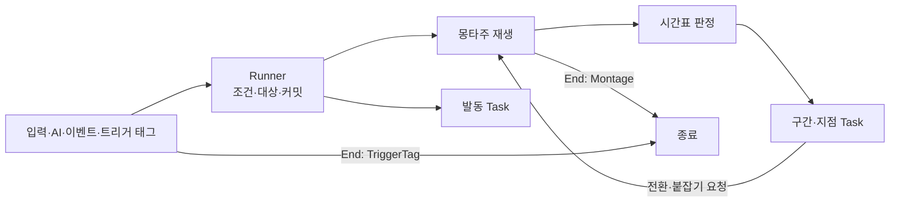

# 행동 ID 분기 제거 설계안

2026-10-17 설계 검토 중입니다. 두 번째 검토에서 정한 방향(단일 Ability는 엔진 어빌리티 기능과 단순한 Runner만 맡고, 기능은 자기 스키마를 가진 독립 Task로 나눔)으로 다시 썼고, 세 번째 검토에서 Task를 범용 기능 12개로 줄였습니다. 승인되면 [어빌리티와 AbilityTask](<어빌리티와 AbilityTask.md>)와 [몽타주 시간표](<몽타주 시간표.md>)의 규칙을 이 문서의 규칙으로 바꾸고, 구현이 끝나면 결정을 주제 문서로 옮긴 뒤 이 문서를 지웁니다.

## 결정과 목표

**`UAgGameplayAbility`는 엔진 어빌리티 기능과 단순한 Timeline Runner만 맡고, Task는 여러 행동이 함께 쓰는 범용 기능 12개만 둡니다. 행동 고유의 규칙은 효과 데이터(`Effects.json`)와 주인 객체로 옮기고, `UAgMontageTimelineComponent`는 Runner에 흡수해 지웁니다.** 지금은 어빌리티 세 파일(`AgGameplayAbility.cpp`, `AgGameplayAbilityEvents.cpp`, `AgGameplayAbilityTasks.cpp`)에 행동 ID 비교가 55곳(9·43·3), 몽타주 ID 비교가 9곳, 데이터 검증(`AgAbilityData.cpp`)에 16곳 있고, 시간표의 사건 다섯 종(처형 타격, 궁극기 마무리, 점프 공격 내리꽂기, 쓰러짐, 돌진 자세 유지)도 그 행동의 분기가 받아 처리합니다.

| 옮길 곳 | 담는 것 |
| - | - |
| Runner(`UAgGameplayAbility`) | 엔진 어빌리티 기능(태그 조건, 트리거, 비용·쿨다운, 재발동, 취소), 대상 선정, 몽타주 재생과 재생 옵션, 시간표 판정, Task 시작·종료, 정한 방식의 종료 |
| Task | 범용 기능 하나와 그 Params의 스키마·검증 |
| 행동 정의(`Abilities.json`) | 발동 조건과 트리거, 대상 선정, 재생할 몽타주와 재생 옵션, 종료 방식, 발동 동안 실행하는 Task |
| 몽타주 시간표(`MontageTimelines.json`) | 섹션 안의 시각에 실행하는 Task(구간·지점) |
| 효과 데이터(`Effects.json`) | 계속 흐르는 시간(패리 구간, 회피 반격 기회, 그로기 시간), 보상(패리, 극한 회피), 지속 소모(달리기)의 값. 모션을 따르는 시간은 시간표에 둡니다(아래 '시간 기준'). |
| 주인 객체 | 행동이 아닌 규칙: 입력(행동 태그 검색, 트리거 태그, 점프, 락온 카메라), 공중 상태·이동 사건·점프 모션·사망(캐릭터), 그로기가 끝날 때의 PP 회복(보스 캐릭터), 패리·극한 회피의 결과와 보상(피격 처리), 평타 반응과 2페이즈 진입(보스 AI) |

- 있는 Task를 조합한 새 행동·패턴은 JSON과 몽타주만으로 더합니다. 새로운 종류의 기능만 Task 파일 하나(Task와 그 Params)로 더하고 Runner는 고치지 않습니다.
- Task는 자기 일만 하고 다른 Task를 모릅니다. Runner는 Task 종류, 행동 ID, 몽타주 ID를 모릅니다. 행동 전체를 맡는 흐름 Task와 자식 Ability는 만들지 않습니다.
- 한 행동만 쓰는 규칙은 Task로 만들지 않습니다. 값은 효과 데이터에, 규칙은 그 규칙의 주인 객체에 둡니다.
- 입력 계층과 HUD는 행동 ID 대신 행동 태그로 스펙을 찾습니다. 같은 키를 쓰는 새 캐릭터의 행동도 데이터만으로 붙습니다.
- 행동이 끝나는 방식은 행동 정의에 적고 추측하지 않습니다. 대부분은 몽타주가 끝날 때, 토글형(가드, 달리기, 락온, 점프)은 트리거 태그가 사라질 때 끝납니다.
- 여러 모션을 쓰는 행동(평타, 회피, 넉업, 점프)은 한 몽타주의 섹션으로 합칩니다.
- 대상이 필요한 행동은 발동할 때 TargetingPreset(GameplayTargetingSystem)으로 대상을 정합니다.
- 게임 동작은 바꾸지 않습니다. 달라지는 곳은 '동작이 달라지는 곳'에 모았습니다.



## 바뀌는 규칙

| 지금 규칙 | 바뀌는 내용 |
| - | - |
| [어빌리티와 AbilityTask](<어빌리티와 AbilityTask.md>) '결정과 목표', '설계에서 줄이는 것', '설정 여부·참조·검증': 기능별 고정 Params(`FAgAbilityTasks`), TaskClass 팩토리·다형 Params·`FInstancedStruct` 금지 | 범용 Task마다 Params 구조체를 두고 `FInstancedStruct`로 담습니다(아래 '스키마와 등록'). 흐름 Task와 Task 사이의 부모·자식·대기 관계를 두지 않는 규칙은 그대로입니다. |
| 같은 문서 '클래스와 책임', 'ASC와 몽타주 시간표의 책임 경계', [몽타주 시간표](<몽타주 시간표.md>) '클래스 구조' | 시간표 판정과 워핑 등록은 Runner가 합니다. 시간표 컴포넌트와 그 알림·구독은 없어집니다. |
| 같은 문서 '설정과 실행 시점의 구분', '시간표 항목 연결', '현재 기획에 필요한 연결', '행동별 호출·종료 연결', '별도 JSON 설정이 없는 내부 Task', '행동별 조합' | 실행 시점은 Task를 둔 곳(발동 Task 목록, 시간표 구간·지점)으로 정합니다. 착지·입력·컷신 종료 같은 사건은 Transition과 PlayCutscene이, 행동 고유 규칙은 효과 데이터와 주인 객체가 맡습니다(아래 '행동별 이관표'). |
| 같은 문서 'Ability 종료와 Task 종료' | 행동 정의의 `End`로 정합니다(아래 '종료'). |
| 같은 문서 '상태 소유권과 실제 충돌', '처형 상태 통합과 행동 제한': Busy는 공통 처리가 관리하고 행동별 설정으로 고르지 않음, State.Acting 없이 행동 모션 실행 기록으로 이동 입력 제한 | Busy는 시간표의 HoldTag 구간(후딜이 없으면 OwnedTags)으로, 이동 입력 제한은 OwnedTags의 `State.Acting`으로 데이터에 적습니다. |
| 같은 문서 '캐릭터와 실행 기능의 책임 경계': 회전 제어는 시간표에 공격·발사·워핑이 있는지로 정하고, 대상은 모션 시작과 워핑 구간 진입에서 정함 | 회전 고정·최소 간격·물리 이동은 Montage의 재생 옵션으로 적고, Runner가 지금처럼 재생에 묶어 캐릭터에 전달합니다. 대상은 아래 '대상'을 따릅니다. |
| 같은 문서 '기능별 설정과 실행', '행동별 조합'의 가드·회피: 기능별 Tasks 설정(PlayMontageAndWait, DrainResource, TimedTag, GrantResources, SlowMotion, LaunchVertical, LaunchToTarget, TargetQuery, Tasks.Attack, TimeStop, LockOn, PlayCutscene), 패리·극한 회피 보상은 가드·회피 어빌리티가 줌, 공통 재생 호출부의 PatternPlayRate | 아래 'Task 목록', '몽타주와 섹션', '효과 데이터'로 바꿉니다. 패리·극한 회피의 보상은 피격 처리가 줍니다. PatternPlayRate는 지우고, 0.8은 보스 공격 패턴 몽타주 일곱 개의 Rate Scale로 옮깁니다. |
| 같은 문서 '재발동': 콤보 진행과 가드 입력은 같은 발동 안의 입력·재생 사건 | 콤보는 평타 몽타주의 Transition 구간이, 가드는 트리거 태그가 맡습니다. 재발동은 회피와 피격 반응만 씁니다. |
| 같은 문서 '스펙별 부여와 초기화': `DynamicAbilityTriggers`는 이벤트 발동에 사용 | `OwnedTagPresent` 트리거도 씁니다(아래 'AbilityTriggers'). |
| 같은 문서 '태그 검색과 취소': 개별 행동 조회는 ID→스펙 핸들 경로 | 플레이어의 입력 계층, 락온 대상 조회, 처형 안내도 HUD처럼 스펙 태그(정확히 일치)로 찾습니다(아래 '입력 계층의 행동 찾기'). 보스 AI는 지금처럼 데이터에 적힌 ID를 씁니다. |
| 같은 문서 '비용·발동 조건의 보존': 점프·공중·가드 입력·처형/락온 대상은 구체 처리의 읽기 전용 검사, DrainResource의 남은 자원 검사, 극한 회피 보상에 쓰려고 회피의 SP 소모량을 기록 | 태그 조건, 트리거 태그 주인의 규칙, Targeting으로 바꿉니다. 달리기의 SP 조건은 입력 계층이, 극한 회피의 SP 환급은 피격 처리가 극한 회피 구간 효과를 건 행동의 Cost로 합니다. |
| [몽타주 시간표](<몽타주 시간표.md>) '형식': 몽타주 → 기능 이름 → 항목, 시각은 몽타주 타임라인 | 몽타주 → 섹션 → 항목 배열이고, 시각은 섹션 시작 기준입니다. 섹션을 넘는 구간은 End에 섹션을 적습니다. 항목은 `Task` 필드로 종류를 정합니다. GameplayEvent 항목과 그 사건 여섯 종(후딜 시작 포함)은 없어집니다. |
| 같은 문서 '판정 규칙'의 '순서', '항목별 실행' | 같은 시각의 기능 순서 대신 배열 순서를 씁니다. 판정은 지금 규칙 그대로이고, 구간 끝 붙잡기 하나를 더합니다(아래 '시간표 판정'). |
| 같은 문서 첫 문단·'원본': 시간표에는 게임 규칙이 쓰는 시각만 둠 | 기획서가 정한 연출인 카메라 셰이크(LeapSlam 착지)도 시간표 지점에 둡니다. `Camera.json`의 `LeapLandingShake`·`LeapLandingShakeRange`를 지웁니다. |
| [대미지와 피격 처리](<대미지와 피격 처리.md>) '클래스 구조'의 `UAgHitResultGameplayEffectComponent`: 극한 회피·패리 이벤트만 보내고 보상은 어빌리티가 줌 | 피격 처리가 패리·극한 회피의 결과(구간 닫기, 보상, 환급, 회피 반격 기회, 슬로우모션)를 효과 데이터의 값으로 적용합니다. 극한 회피 이벤트(`Event.PerfectDodge`)는 없어집니다. |
| [입력 처리](<입력 처리.md>) '기술 결정': 가드 재개 이벤트, 행동 모션 실행 기록으로 이동 제한, 실행 중 어빌리티에 보내는 입력 이벤트 | 입력 계층은 트리거 태그(`Input.Guard`, `Input.Sprint`, `Input.LockOn`)와 이동 입력 태그(`Input.Move`)를 붙이고 뗍니다. 실행 중 행동에 보내는 이벤트는 평타의 `Input.Attack`만 남습니다. |
| [사망 처리](<사망 처리.md>) '사망 처리 순서', '클래스 구조': Death 어빌리티 | 캐릭터가 `Event.Death`를 받아 사망을 처리합니다. '처형 사망'의 판단 기준(공격 쪽 태그)은 그대로입니다. |
| [애니메이션과 이동](<애니메이션과 이동.md>) '점프', '점프 공격', '넉업': 점프 어빌리티가 Jump를 부르고 모션을 재생하며 State.Jumping을 가짐, 넉업은 세 몽타주와 속도 감시 | 엔진 점프, 점프 모션, State.Jumping은 캐릭터가 맡습니다. 넉업은 합친 몽타주의 섹션과, 캐릭터가 보내는 정점·착지 이벤트로 넘어갑니다. |

## Runner

### 맡는 일

| 일 | 내용 |
| - | - |
| 정의 연결 | 지금처럼 ID별 스펙을 만들고 `OnGiveAbility`에서 태그 조건을 초기화합니다. `Activation.Triggers`는 스펙의 `DynamicAbilityTriggers`에 넣습니다. |
| 발동 검사 | 엔진 태그 검사, 비용, 재발동 허용, Targeting의 필수 대상. CanActivateAbility와 커밋 직전에 같은 검사를 합니다. |
| 대상 | 아래 '대상' |
| 몽타주 | 시작 섹션 선택, 재생과 재생 옵션, Task가 요청한 전환과 구간 끝 붙잡기 |
| 시간표 판정 | 지금 시간표 컴포넌트의 판정과 워핑 등록(아래 '시간표 판정') |
| Task 실행 | 발동 Task와 구간·지점 Task의 시작·종료 |
| 종료 | `End`가 정한 때 끝내고, 남은 Task·재생·워핑·재생 옵션을 정리합니다. |

### 발동 순서

1. 검사를 통과하면 대상을 정하고 커밋합니다. 필수 대상이 없거나 커밋에 실패하면 Task를 실행하지 않고 끝냅니다.
2. `Montage`가 있으면 시작 섹션을 골라 재생하고(StartFacing이면 그 전에 돕니다), 시작 위치의 구간·지점을 판정합니다. `bStartOnGround`이고 공중이면 착지할 때 재생합니다.
3. 발동 Task를 배열 순서대로 시작합니다.
4. 중간에 행동이 끝나면 남은 단계를 실행하지 않습니다. 재생에 실패하면 취소로 끝나므로, Launch처럼 되돌릴 수 없는 발동 Task는 실행되지 않습니다.

### Runner와 Task 사이

Runner가 Task에 여는 것은 아래뿐입니다. 다른 Task, 행동 ID, 몽타주 ID는 열지 않습니다.

| 이름 | 뜻 |
| - | - |
| 행동 대상 | 아래 '대상'의 결과. 없을 수 있습니다. |
| 전환 | `{"Section": 섹션, "BlendTime": 초(선택)}`. BlendTime이 없으면 같은 재생 안에서 그 섹션으로 옮기고(블렌드 없음), 있으면 그 섹션부터 다시 재생합니다(새 재생, 그 시간의 블렌드 인). 전환할 섹션의 길이도 읽을 수 있습니다. |
| 구간 끝 붙잡기 | 구간 Task가 구간 끝에서 아직 할 일이 남았으면 재생을 그 구간 끝에 멈춥니다. Task가 끝나면 재생을 이어 갑니다. |

### 종료

| End | 끝나는 때 | 필요한 것 |
| - | - | - |
| Montage | 행동의 재생이 끝날 때. 완료면 정상 종료, 다른 몽타주에 끊기면 취소입니다. Task가 요청한 다시 재생은 끝이 아닙니다. | `Montage` |
| TriggerTag | 트리거 태그가 사라질 때(엔진이 취소) | `OwnedTagPresent` 트리거 하나 |

- 그 밖에 끝나는 길은 엔진의 취소(CancelTags, 사망, 스펙 제거)와 발동 중 실패뿐입니다. Task가 끝났거나 실행 중인 Task가 없다는 이유로 행동이 끝나지 않습니다.
- 모션이 없는 행동은 모두 TriggerTag입니다. 시작하자마자 끝나는 행동은 없습니다.

### 대상

| 출처 | 쓰는 행동 |
| - | - |
| `Targeting`이 있으면 그 결과 중 첫 후보 | 평타, 점프 공격, 회피 반격, 스킬, 처형, 락온, 보스 공격 패턴 |
| 없고 이벤트로 발동했으면 그 이벤트의 Instigator | 피격 반응, 패리, 처형 피격 |
| 그 밖 | 없음 |

| Targeting 필드 | 뜻 |
| - | - |
| Preset | TargetingPreset 에셋. 후보를 모으고 정렬하는 절차입니다. |
| Range | 수평 거리(cm) 상한. 생략하면 제한 없음 |
| TargetRequiredTags, TargetBlockedTags | 대상이 가져야 할 태그와 가지면 안 되는 태그(Activation의 태그 조건은 주인의 태그) |
| bRequired | 대상이 없으면 발동하지 않습니다. |

- 범위와 태그 조건은 행동 JSON의 값을 요청에 실어 보내고, 프리셋 안의 프로젝트 필터 Task가 거릅니다. 지금 `TP_Enemy`(후보 수집)와 코드(범위·생존·적대 거르기)가 나눠 맡는 일을 프리셋 안으로 옮긴 것이며, 수평 거리 정렬도 프로젝트 정렬 Task로 둡니다.
- 프리셋은 `TP_Enemy`(살아 있는 적), `TP_LockOn`(TP_Enemy에 화면 안 조건), `TP_AITarget`(보스 AI의 대상)입니다.
- CanActivateAbility에서 읽기 전용으로, 커밋 직전에 한 번 더 평가합니다. Task가 다시 재생을 요청하면 다시 평가합니다(평타의 타마다 대상). 이벤트 Instigator는 바뀌지 않습니다.
- 워핑 구간마다 대상을 다시 고르던 것은 없어지고 그 재생의 대상을 씁니다. 보스의 대상은 늘 플레이어이고 플레이어 공격은 재생마다 워핑 구간이 하나라 결과가 같습니다.
- 처형 안내 HUD는 처형 스펙의 Targeting을 읽기 전용으로 평가하고, 락온 대상은 실행 중인 락온 행동의 대상입니다. `FindEnemies`, `FindEnemy`, `FindAttackTarget`, `FindExecutionTarget`, `UAgAbilityTask_LockOn::FindTarget`은 지웁니다.

### 몽타주와 섹션

| Montage 필드 | 뜻 |
| - | - |
| MontageId | 캐릭터 데이터 `Montages`의 ID |
| StartSections | `[{"Section": 섹션, "RequiredTags": [...]}]`. 위에서부터 주인이 RequiredTags를 모두 가진 첫 섹션에서 시작하고, 마지막 항목은 조건 없이 둡니다. 생략하면 몽타주 처음부터 재생합니다. |
| StartFacing | `"Target"`이면 행동 대상 쪽으로, `"MoveInput"`이면 이동 입력 방향으로 재생 전에 바로 돕니다(입력이 없으면 돌지 않음). |
| bHoldFacing | 재생 동안 캐릭터의 자동 회전을 멈춥니다. 모션의 방향은 워핑이 정합니다. |
| bKeepDistance | 재생 동안 루트 모션 이동이 행동 대상에게 캐릭터의 `StopDistance`보다 가까이 가지 않게 합니다. |
| bPhysicsTranslation | 재생 동안 루트 모션의 회전은 쓰고, 이동은 공중에서 물리 속도를 따르며 땅에서는 멈춥니다. bKeepDistance보다 먼저입니다(지금과 같음). |
| RootMotionDistance | 지금과 같습니다(보스 Backstep). |
| bStartOnGround | 공중에서 발동하면 착지한 뒤 재생합니다(그로기). |

- 재생 옵션(bHoldFacing, bKeepDistance, bPhysicsTranslation)은 지금 Ability가 캐릭터에 넘기는 이동 제약(`FAgCharacterMotionConstraints`)과 같습니다. 재생하는 Ability는 하나뿐이라 캐릭터의 소유자 하나 API를 그대로 씁니다.
- 재생 배율은 몽타주의 Rate Scale 그대로입니다. 보스 공격 패턴의 0.8은 패턴 몽타주의 Rate Scale에 둡니다.
- 바로 이어지는 동작은 섹션 링크로 잇습니다. 다른 동작으로 넘어갈 때는 전환에 BlendTime을 적어 그 섹션부터 다시 재생합니다. 같은 재생 안의 섹션 이동에는 블렌드가 없어 자세가 튀기 때문입니다. BlendTime은 합치기 전 각 몽타주의 Blend In 시간을 옮깁니다.
- 이벤트를 기다리는 구간(Transition, PlayCutscene)이 있는 동안 몽타주가 끝나지 않도록, 그 구간은 반복 섹션을 끝까지 덮습니다(검증). 평타의 다음 타 입력처럼 이벤트가 오지 않으면 그대로 끝나는 것이 규칙인 전환은 `bOptional`로 표시해 이 검사에서 뺍니다.

### 시간표 판정

지금 컴포넌트의 판정 규칙([몽타주 시간표](<몽타주 시간표.md>) '판정 규칙')을 Runner가 그대로 맡고, 아래만 바꿉니다.

| 규칙 | 내용 |
| - | - |
| 판정 주인 | 행동의 재생을 그 Runner 인스턴스가 판정합니다. Runner의 틱 함수(`FTickFunction`)를 TG_PrePhysics에 두고 캐릭터 무브먼트와 메시의 틱을 선행 조건으로 겁니다(지금 컴포넌트와 같음). 재생이 있는 동안만 켭니다. 워핑은 지금처럼 워핑 컴포넌트의 `OnPreUpdate`에서 등록합니다. |
| 시각 | 항목의 시각은 섹션 시작 기준으로 적고, 재생을 시작할 때 몽타주 시각으로 바꿔 지금처럼 몽타주 재생 위치로 판정합니다. End를 생략하면 그 섹션 끝까지입니다. 섹션을 넘는 구간은 End에 섹션을 적습니다(`"End": {"Section": "Land", "Time": 0.2}`). 구간은 몽타주 타임라인에서 Start부터 End까지라, 그 사이의 반복이나 섹션 이동도 구간 안이면 한 실행으로 이어집니다. |
| 순서 | 같은 시각이면 구간 끝, 지점, 구간 시작 순서이고, 그래도 같으면 배열 순서입니다. |
| 전환 | 지금 규칙대로, 판정 중에 위치를 바꾸면 그 판정의 남은 항목은 실행하지 않습니다. 같은 시각에 함께 실행할 항목은 배열에서 전환 항목보다 앞에 둡니다. 판정 밖(착지, 컷신 종료, 입력 이벤트, 시간)에서 요청한 전환은 바로 적용합니다. 적용한 뒤에는 지금처럼 새 위치로 판정을 맞춥니다. |
| 구간 끝 붙잡기 | 재생 위치를 그 구간 끝으로 되돌려 멈추고 판정을 그 위치에 맞춥니다. 그보다 늦게 끝나는 구간은 켜진 채로 남습니다. |
| 재생 바뀜 | 다시 재생하면 이전 재생의 구간을 끝냅니다. 지점 Task는 재생이 바뀌어도 남습니다. |
| 사본 | 재생을 시작할 때 시간표를 복사해 UPROPERTY로 보관합니다. 컷신 Sequence 같은 에셋 참조를 GC가 봅니다. |

## Task

### 스키마와 등록

- Task의 Params는 공통 부모 `FAgTaskParams`(USTRUCT)를 상속하고 그 Task의 헤더에 둡니다. Task 이름 `X`의 Params는 `FAgXParams`이며, 읽을 때 JSON의 `Task` 값으로 이 구조체를 찾아 `FInstancedStruct`에 담습니다. 구조체 메타데이터는 에디터 전용이라 이름 규칙으로 찾습니다.
- Params의 가상 함수가 자기 필드 읽기(모르는 필드·형식 오류·필수 누락은 오류), 값·참조 검증, 둘 수 있는 곳(발동·구간·지점)과 행동 대상이 필요한지 알리기, 자기 Task 만들기를 맡습니다.
- `AgAbilityTaskParams.h`에 모아 둔 Params와 설정 여부 플래그(`bHas...`), `FAgAbilityTasks`는 없어집니다.
- MotionWarping은 Task가 아니라 Runner가 엔진 워핑에 등록하는 항목입니다. 그 Params(`FAgMotionWarpingParams`)도 같은 방식으로 읽고 검증합니다.
- 새 Task는 둘 이상의 행동이 쓰거나 쓸 수 있는 기능일 때만 더합니다. 한 행동의 규칙은 효과 데이터와 주인 객체로 풉니다.

### 둘 수 있는 곳

| 둔 곳 | 시작 | 끝 |
| - | - | - |
| 발동 Task(행동 정의 `Tasks`) | 발동 순서 3 | 행동 종료, 또는 스스로 끝날 때 |
| 구간(시간표 Start·End) | 재생 위치가 Start에 이를 때 | End, 재생 바뀜, 행동 종료, 또는 스스로 끝날 때. 붙잡기는 위 표 |
| 지점(시간표 Time) | 재생 위치가 Time에 이를 때 | 행동 종료, 또는 스스로 끝날 때 |

### 시간 기준

Task가 시작하고 끝나는 때는 둔 곳이 정하고, 도는 동안의 시간은 Task가 쓰는 엔진 기능이 정합니다. 히트스톱은 두 캐릭터의 시간 배율(`CustomTimeDilation`)만 낮추고, 슬로우모션과 시간 정지는 게임 전체 배율을 바꿉니다.

| 시간 | 따르는 것 | 히트스톱 중 | 쓰는 곳(전투 시스템 '히트스톱 중의 시간') |
| - | - | - | - |
| 모션 시간 | 시간표 구간·지점(몽타주 재생 위치), 캐릭터 무브먼트의 이동(Dash, Launch, 워핑) | 멈춤 | 선딜, 판정 구간, 후딜(Busy), 무적 구간, 극한 회피 구간, 보스 패턴 안의 모든 시간 |
| 월드 시간 | 효과의 지속 시간(발동·지점의 ApplyEffect), 월드 타이머 | 계속 흐름 | 쿨다운, 패리 구간, 회피 반격 기회, 그로기 지속 시간, 리젠과 소모 |
| 주인의 시간 | PlayCutscene(매 프레임 주인의 시간 배율을 재생 속도로) | 멈춤 | 궁극기 컷신 |

- 기획서가 모션을 따른다고 정한 시간은 시간표 구간에, 계속 흐른다고 정한 시간은 효과의 지속 시간에 둡니다. 극한 회피 구간처럼 모션 시간이면서 피격 처리가 지워야 하는 것은 ApplyEffect 구간(길이는 시간표, 태그는 효과)으로 둡니다.
- 슬로우모션과 시간 정지에는 둘 다 함께 느려집니다. 시간 정지에서 빠진 주인은 시간 배율 보정을 받으므로 주인의 모션 시간은 그대로 흐르고, 효과의 지속 시간은 멈춘 것처럼 흐릅니다(지금과 같음).

### Task 목록

`Next`는 위 '전환' 값입니다.

| Task | 둘 수 있는 곳 | Params | 하는 일 |
| - | - | - | - |
| Attack | 구간, 지점 | DamageMultiplier, PoiseMultiplier, HitReaction, bGuardable, MPCharge, UPCharge. 지점만: bFinisher, Targeting(선택), HitLocation(선택: Owner) | 구간이면 무기 스윕 판정입니다. 지점이면 그 시각에 한 번 칩니다. Targeting이 있으면 그 결과 모두를, 없으면 행동 대상을 칩니다. bFinisher면 마지막 일격(`Effect.Damage.Finisher`)이고, HitLocation이 Owner면 피격 위치를 주인 위치로 둡니다. |
| HoldTag | 발동, 구간, 지점 | Tag | 태그를 유지합니다. 지점이면 그 시각부터 행동이 끝날 때까지입니다. |
| ApplyEffect | 발동, 구간, 지점 | Effect. 발동·지점만: bRemoveOnEnd | `Effects.json`의 효과를 주인에게 겁니다. 구간이면 구간 시작에 걸고 구간 끝에 지웁니다(모션 시간). 발동·지점이면 효과의 지속 시간(월드 시간)을 따르고, bRemoveOnEnd면 행동이 끝날 때 지웁니다. |
| SetCollisionResponseToChannel | 발동, 구간 | Channel, Response | 캡슐의 채널 응답을 바꾸고 끝날 때 되돌립니다. |
| Dash | 구간 | Speed, HomingTurnRate, Overshoot, MaxDistance | 행동 대상 쪽으로 돌진합니다. 공격이 막히면(`Event.AttackBlocked`) 그 자리에서 멈춥니다. 구간 끝에 아직 돌진 중이면 구간 끝을 붙잡고, 돌진이 끝나면 놓습니다. |
| Launch | 발동, 지점 | 다음 중 하나: VelocityZ, ToTarget(AirTime, TargetOffset, MaxDistance), Rise(Height, AirTime) | 한 번 띄우거나 던집니다. VelocityZ는 공중일 때 수직 속도만 바꾸고(점프 공격 내리꽂기), ToTarget은 행동 대상 쪽 포물선으로 발사하고(지금 LaunchToTarget 계산), Rise는 그 높이·체공 시간의 수직 루트 모션 점프를 겁니다(넉업). |
| SpawnProjectile | 지점 | ProjectileId, Origin, SocketName, Attack | 투사체 한 발 |
| SendGameplayEvent | 발동, 지점 | Event, Recipient(Owner, Target) | Instigator가 주인, Target이 행동 대상인 게임플레이 이벤트를 받는 쪽에 보냅니다. |
| Transition | 구간, 지점 | Next. 구간만: Event 또는 BeforeTagEnds, bOptional(선택) | 지점이면 그 시각에 전환합니다. 구간이면 그동안 주인이 그 이벤트를 받을 때, 또는 그 태그를 주는 효과가 끝나기 Next 섹션 길이만큼 전에 전환합니다(이미 지났으면 바로). bOptional은 이벤트가 오지 않아도 되는 전환입니다. |
| PlayCutscene | 구간 | Sequence, Next | 구간이 시작되면 컷신을 재생하고 끝나면 전환합니다. 재생 속도는 매 프레임 주인의 시간 배율(`CustomTimeDilation`)을 따르므로 시간 정지와의 시작 순서에 기대지 않습니다. |
| TimeStop | 구간 | 없음 | 구간 동안 주인 말고 시간을 멈춥니다. |
| CameraShake | 지점 | Shake, Range | 로컬 플레이어와의 수평 거리가 Range 이내면 셰이크를 재생합니다. |
| MotionWarping(항목) | 구간 | 지금 필드, StopDistance(선택) | Runner가 엔진 워핑에 등록합니다. 대상은 행동 대상이고, StopDistance는 대상과 맞출 간격입니다. 생략하면 캐릭터의 `StopDistance`입니다. 대상이 TargetingRange 밖이면 지금처럼 회전만 합니다. |

지금 기능 중 Task로 남지 않는 것과 옮기는 곳입니다.

| 지금 | 옮기는 곳 |
| - | - |
| PlayMontageAndWait, RootMotionDistance | 행동 정의의 Montage |
| TargetQuery | Targeting, Attack 지점의 Targeting |
| DrainResource, TimedTag, GrantResources | ApplyEffect와 효과 데이터(SprintDrain, ParryWindow, PerfectDodgeWindow 등) |
| SlowMotion, 극한 회피·패리 보상 | 피격 처리(값은 효과 데이터와 플레이어 데이터) |
| LaunchVertical, LaunchToTarget, 넉업 루트 모션 점프 | Launch |
| LockOn | 대상은 Targeting, 카메라 추적은 플레이어 캐릭터, 해제는 입력 계층 |
| 착지·하강·입력·그로기 시간 대기 | Transition과 캐릭터의 이동 사건(`Event.Landed`, `Event.Apex`), 그로기 시간 효과(GroggyTime) |
| 회전·이동 제약 | Montage의 StartFacing, bHoldFacing, bKeepDistance, bPhysicsTranslation |
| 그로기·처형 피격·페이즈 전환의 PP 회복 | 보스 캐릭터(그로기가 끝날 때), 보스 AI(페이즈 전환이 끝날 때) |

## AbilityTriggers

엔진 트리거(`FAbilityTriggerData`)를 `Activation.Triggers`에 둡니다. 항목은 `{"Tag": 태그, "Source": "GameplayEvent" | "OwnedTagPresent"}`입니다.

| Source | 엔진 동작 | 쓰는 행동 |
| - | - | - |
| GameplayEvent | 그 이벤트를 받으면 발동하고, 이벤트가 실행 정보로 옵니다. | 피격 반응, 패리, 처형 피격, 그로기, 페이즈 전환 |
| OwnedTagPresent | 태그가 0에서 1이 될 때 발동하고, 0이 되면 엔진이 취소합니다. | 가드, 달리기, 락온, 점프 |

OwnedTagPresent는 태그가 붙는 순간에만 발동을 시도하고, 막혀서 실패하면 태그가 붙어 있는 동안 다시 시도하지 않습니다. 그래서 입력 계층은 자기가 붙이는 요청 태그(`Input.Guard`, `Input.Sprint`, `Input.LockOn`)에 다음을 지킵니다. 세 규칙은 요청 태그를 관리하는 함수 하나로 구현하고 가드·달리기·락온이 함께 씁니다.

1. 행동을 시작할 수 있을 때만(그 스펙의 CanActivateAbility) 태그를 붙입니다. 막혀 있으면 붙이지 않고 기다립니다.
2. 붙였는데 행동이 실행되지 않았으면 바로 뗍니다.
3. 태그가 남아 있는데 행동이 다른 이유(CancelTags 등)로 끝나면 태그를 뗍니다. 다시 시작할 때 다시 붙입니다.

| 행동 | 트리거 태그 | 주인과 규칙 |
| - | - | - |
| 가드 | `Input.Guard` | 입력 계층. 가드 키를 누르고 있고 가드를 시작할 수 있을 때 붙이고, 키를 떼면 뗍니다. 막혀 있으면 지금처럼 선입력, 후딜 시작, 행동 종료에서 다시 붙입니다. |
| 달리기 | `Input.Sprint` | 입력 계층. 회피 후딜에 Shift와 이동 입력이 있고 가드 키를 누르지 않았고 SP가 0보다 크면 붙이고, Shift를 떼거나 이동 입력이 없거나 SP가 0이면 뗍니다. |
| 락온 | `Input.LockOn` | 입력 계층. 락온 키로 붙이고 뗍니다(토글). 대상이 죽거나 락온 해제 거리(`LockOnReleaseRange`) 밖으로 나가면 뗍니다. 락온 대상이 없으면 시작할 수 없어 붙이지 않습니다(규칙 1). |
| 점프 | `State.Jumping` | 캐릭터. 점프가 실제로 시작될 때(`OnJumped`) 붙이고 착지할 때(`Landed`) 뗍니다. 요청이 아니라 공중 상태라 위 규칙 대신, 입력 계층이 점프 행동을 시작할 수 있을 때만 엔진 `Jump`를 불러 막힌 발동을 피하고, 키를 떼면 `StopJumping`을 부릅니다. 행동이 다른 이유로 끝나도 떼지 않습니다(점프 공격의 시작 조건). |

락온의 대상 상실은 태그 주인이 판단해야 행동이 끝나므로, 해제 조건(대상 사망, 해제 거리)을 입력 계층으로 옮깁니다. 락온 행동은 대상만 갖고, 카메라 추적(지금 LockOn Task의 카메라 부분)은 플레이어 캐릭터가 락온 대상을 읽어 합니다.

### 그로기는 트리거 태그로 끝내지 않음

그로기는 몽타주 종료형으로 둡니다. 그로기 시간은 효과(GroggyTime, 월드 시간 5초)로 두고, 그로기 몽타주의 반복 섹션에 둔 Transition이 이 효과가 끝나기 복귀 섹션 길이만큼 전에 복귀를 시작합니다. 전투 시스템 '그로기'는 '히트스톱은 복귀 시작 예정 시점을 늦추지 않고, 복귀 모션 중 히트스톱만큼 그로기 종료가 늦어진다'고 정하는데, 다른 두 방법은 이를 지키지 못합니다.

| 방법 | 문제 |
| - | - |
| 그로기 몽타주를 5초로 늘림 | 히트스톱(타격마다 0.12초)이 몽타주를 멈춰 복귀 시작이 맞은 횟수만큼 늦어집니다. |
| 5초 태그 효과의 OwnedTagPresent | 효과는 월드 시간으로 5초에 끝나 히트스톱으로 늦어진 복귀 모션을 자릅니다. 처형 피격이 그로기를 늘리면 효과도 늘려야 합니다. |

## 주인 객체로 옮기는 규칙

| 주인 | 맡는 것 | 대신 지우는 것 |
| - | - | - |
| 플레이어 캐릭터(입력 계층) | 키에 맞는 행동을 행동 태그로 찾습니다(아래 '입력 계층의 행동 찾기'). 위 트리거 태그, 이동 입력이 있는 동안의 `Input.Move`. 평타 키는 평타가 실행 중이면 `Input.Attack` 이벤트를 보내고, 아니면 발동합니다(평타 키의 점프 공격·회피 반격 우선순위는 그대로). 가드 키를 누른 채 후딜이 시작될 때 가드가 실행 중이면 후딜에 든 패리 모션(`Ability.Action.Parry`)을 취소합니다. 락온 중 카메라 추적. 이동 입력 제한은 `State.Acting`과 지금 태그로 봅니다. | 실행 중 어빌리티에 보내던 `Input.Guard`·`Input.LockOn` 이벤트, `Input.GuardReleased`, `Event.Guard.Resume`, 이동 제한 기록 조회(`BlocksMovementInput`), LockOn Task |
| 캐릭터 | `State.Airborne`(이동 모드가 떨어지는 중인 동안). 이동 사건: 착지하면 `Event.Landed`, 공중에서 수직 속도가 오름에서 내림으로 바뀌면 `Event.Apex`를 자기에게 보냅니다. 점프의 `State.Jumping`과 점프 모션: 플레이어는 [애니메이션과 이동](<애니메이션과 이동.md>) '점프'의 규칙대로 `Jump` 몽타주의 Start·Land 섹션을 재생합니다. 사망은 `Event.Death`를 받아 처리합니다(아래 사망 모션). | Death 스펙과 `Ability.Reaction.Death`, 어빌리티의 점프·착지 대기·넉업 속도 감시·사망 분기 |
| 보스 캐릭터 | 그로기가 끝나면(State.Groggy가 사라졌고 살아 있으면) PP를 MaxPP로 채웁니다(`PPRefill`). 처형 피격이 State.Groggy를 이어 받으므로, 처형 피격이 끝날 때 한 번 채웁니다. | 보스 그로기 타이머(그로기 시간은 GroggyTime 효과로), 어빌리티의 그로기 시간 호출과 PP 회복 |
| 피격 처리(`UAgHitResultGameplayEffectComponent`) | 패리: 공격자의 PP 감소(`ParryPPLoss`), 방어자의 패리 구간(ParryWindow) 제거, 보상(`ParryReward`), 그다음 `Event.Parry`(패리 모션). 극한 회피: 극한 회피 구간(PerfectDodgeWindow) 제거로 회피마다 한 번만, 그 효과를 건 행동의 Cost만큼 환급, 보상(`PerfectDodgeReward`), 회피 반격 기회(`DodgeCounterChance`), 슬로우모션(플레이어 데이터의 값). 순서는 전투 시스템 '피격 처리 순서'를 따릅니다. | 가드·회피 어빌리티의 보상, PP 감소, 패리 구간 닫기, `Event.PerfectDodge` |
| 보스 AI | 평타 시작 알림(`Event.BasicAttackStarted`)은 그대로 받습니다. 보내는 쪽만 평타·점프 공격 시간표의 SendGameplayEvent 지점으로 바뀝니다. 페이즈 전환이 정상 종료로 끝나면(`OnAbilityEnded`) PP를 채우고 2페이즈로 넘어갑니다. | 어빌리티의 평타 시작 알림 함수, PP 회복, 2페이즈 진입 |
| HUD | 그로기 중 PP 바는 GroggyTime 효과의 지난 시간 ÷ 지속 시간이고, 효과가 끝난 뒤에도 그로기면 가득 찬 바입니다(전투 HUD). | 보스 그로기 타이머 조회 |

- 사망 모션: 캐릭터 데이터에 `DeathMotions`(`[{"Montage": "Executed", "KilledBy": "Ability.Action.Execution", "Death": "ExecutedDeath"}]`)를 둡니다. 사망할 때 Montage를 재생 중이고 사망 이벤트의 공격 쪽 태그에 KilledBy가 있으면, 다른 어빌리티를 취소하기 전에 재생 위치를 보관하고 Death 모션을 그 위치에서 이어 재생한 뒤 끝나면 래그돌로 바꿉니다. 처형 피격 중 다른 공격으로 죽으면 일반 사망인 지금 규칙과 같습니다.
- 캐릭터가 직접 재생하는 몽타주(점프, 사망)의 종료 콜백은 EndPlay에서 메시를 해제하기 전에 끊습니다. 지금 EndPlay가 어빌리티를 먼저 취소해 막는 문제와 같은 이유입니다.
- 캐릭터가 직접 재생하는 몽타주에는 판정할 Runner가 없으므로 시간표를 두지 않습니다(검증).

### 입력 계층의 행동 찾기

입력 계층은 행동 ID 대신 행동 태그로 스펙을 찾습니다. 키와 행동 태그의 대응은 입력 규칙이라 입력 계층(C++)에 두고, 그 태그를 가진 정의가 무엇인지는 캐릭터의 행동 목록이 정합니다. 그래서 같은 키를 쓰는 새 캐릭터의 행동은 다른 ID로 정의하고 Tags만 맞추면 데이터만으로 붙습니다(마일스톤2의 플레이어 추가). HUD는 이미 스킬·궁극기 슬롯을 태그로 찾습니다.

| 키·처리 | 찾는 행동 태그 |
| - | - |
| 평타 키 | 공중이면 `Ability.Action.JumpAttack`, 회피 반격 기회가 있으면 `Ability.Action.DodgeCounter`, 그 밖에는 `Ability.Action.BasicAttack`(실행 중이면 `Input.Attack` 이벤트). 순서는 지금과 같습니다. |
| 가드 키 | `Ability.Action.Guard`(트리거 태그를 붙여도 되는지 확인) |
| 회피·달리기 키 | `Ability.Action.Dodge`, 회피 후딜의 달리기는 `Ability.Sprint` |
| 점프 키 | `Ability.Action.Jump`(엔진 Jump를 불러도 되는지 확인) |
| 스킬, 궁극기, 처형 키 | `Ability.Action.Skill`, `Ability.Action.Ultimate`, `Ability.Action.Execution` |
| 락온 키, 락온 대상 조회 | `Ability.LockOn` |
| 패리 후딜 복귀(취소) | `Ability.Action.Parry` |
| 처형 안내 HUD(Targeting 평가) | `Ability.Action.Execution` |

- 스펙 태그(`GetDynamicSpecSourceTags`)가 그 태그와 정확히 같은 스펙을 찾습니다. 엔진 `TryActivateAbilitiesByTag`는 클래스 태그를 보므로 쓰지 않습니다. HUD의 검색을 `UAgAbilitySystemComponent`의 함수 하나로 옮겨 입력 계층과 함께 씁니다.
- 한 캐릭터에서 위 태그를 정확히 가진 행동은 태그마다 하나 이하입니다(검증). 없으면 그 키는 아무것도 하지 않습니다.
- 새 키를 더할 때(입력 태그, Enhanced Input 에셋)만 이 표와 C++가 바뀝니다.
- 보스 AI는 지금처럼 캐릭터의 행동 목록과 StateTree 에셋에 적힌 ID를 씁니다. ID가 데이터에서 오므로 코드에는 행동 ID가 없습니다.

## 행동별 이관표

| 행동 | 지금의 분기 | 새 구성 |
| - | - | - |
| 평타 | 입력 이벤트 대기, BasicAttackMontageIds의 타 선택, 다음 타, 평타 시작 알림 | Targeting(TP_Enemy), `BasicAttack` 몽타주(섹션 Attack1~5, bHoldFacing·bKeepDistance). 섹션마다 Busy 구간, 시작의 SendGameplayEvent(평타 시작 알림), 후딜부터 섹션 끝까지 Transition(`Input.Attack`, 다음 섹션을 BlendTime으로 다시 재생, Attack5 다음은 Attack1, bOptional). 입력 없이 섹션이 끝나면 몽타주가 끝나 콤보가 초기화됩니다. |
| 점프 | CanJump 검사, Busy·착지 대기·Jump·점프 모션, 모션 완료 무시, 착지 모션과 종료, StopJumping | 트리거 `State.Jumping`, End TriggerTag, OwnedTags State.Busy. 점프와 모션은 캐릭터 |
| 점프 공격 | IsFalling 검사, 물리 속도 이동·착지 대기, 평타 시작 알림, 착지 때 Land 섹션, 내리꽂기 사건 | RequiredTags State.Jumping, Targeting(TP_Enemy), 몽타주 bHoldFacing·bPhysicsTranslation. 시간표: Start·Fall의 Transition(`Event.Landed` → Land), Launch 지점(VelocityZ), SendGameplayEvent 지점, Start에서 Land로 넘어가는 Attack·Busy 구간 |
| 회피 | 극한 회피 대기, 입력 방향 회전과 Roll·Backstep 선택, 극한 회피 보상 | `Dodge` 몽타주(섹션 Roll, Backstep, StartSections는 `Input.Move`가 있으면 Roll, StartFacing MoveInput), 시간표의 ApplyEffect 구간(PerfectDodgeWindow). 보상과 한 번만 주는 규칙은 피격 처리 |
| 회피 반격, 스킬 | 없음 | Targeting(TP_Enemy), 몽타주 bHoldFacing·bKeepDistance, 시간표 Busy 구간 |
| 가드 | 키 유지 검사, 입력·패리 대기, 가드 태그·패리 구간, 패리 모션과 그 후딜·완료 처리, 종료 때 패리 구간 닫기 | 트리거 `Input.Guard`, End TriggerTag, OwnedTags State.Guarding, ApplyEffect(ParryWindow, bRemoveOnEnd). 패리 모션은 Parry 스펙, 패리 후딜 복귀는 입력 계층, 패리 결과와 보상은 피격 처리 |
| 패리(새 스펙) | 가드 안의 `Event.Parry` 처리 | 트리거 `Event.Parry`, Parry 몽타주(StartFacing Target), Busy 구간. CancelTags에 가드가 없어 가드를 끝내지 않습니다. |
| 궁극기 | Busy와 시간 정지 시작, 컷신 시작과 완료 처리, 베기 선 Cue 켜고 끄기, 마무리 사건 | 시간표: 첫 섹션의 PlayCutscene(Judgment로 전환), 첫 섹션에서 Judgment로 넘어가는 TimeStop·Busy 구간, Judgment의 마무리 Attack 지점(Targeting 범위 10m, bFinisher). 베기 선은 Judgment 섹션의 엔진 상태 노티파이(`UAnimNotify_GameplayCueState`)가 켜고 끕니다. |
| 처형 | 대상 검사·보관, 처형 간격, 처형 피격 알림, 워핑 대상과 최소 간격 예외, 처형 타격 사건 둘 | Targeting(범위 3m, 대상 State.Groggy, State.Execution·State.Airborne 제외, 필수), 몽타주 bHoldFacing, SendGameplayEvent(`Event.Executed`, Target), 워핑 항목의 StopDistance(지금 ExecutionDistance), Attack 지점 둘(두 번째 bFinisher). bKeepDistance는 두지 않습니다. |
| 달리기 | 없음(입력 계층이 취소) | 트리거 `Input.Sprint`, End TriggerTag, ApplyEffect(SprintDrain, bRemoveOnEnd) |
| 락온 | 대상 검사, 키 재입력 대기, 대상 상실 처리, 락온 대상 조회 | 트리거 `Input.LockOn`, End TriggerTag, Targeting(TP_LockOn, 범위 20m, 필수). 해제 조건과 카메라는 플레이어 캐릭터 |
| 넉백, 가드 브레이크 | 피격 반응 태그로 회전, 쓰러짐 사건 | 몽타주 StartFacing Target. 넉백은 시간표의 HoldTag 지점(무적) |
| 가드 밀림 | 피격 반응 태그로 회전 | 몽타주 StartFacing Target. CancelTags의 `Ability.Action`을 `Ability.Action.Parry`로 바꿔 가드를 끝내지 않습니다. |
| 넉업 | 회전, 루트 모션 점프와 상승·하강 감시, 착지, 기상, 중간 모션 완료 무시, 쓰러짐 사건 | `KnockUp` 몽타주(섹션 Rise, Fall, Land, GetUp, StartFacing Target), Launch(Rise). 시간표는 아래 표 |
| 그로기 | 처형 대기, 착지 대기, 그로기 모션·시간·End 섹션, 처형 피격, 완료 때 PP 회복, 종료 때 그로기 시간 정지 | 몽타주 bStartOnGround. 시간표: 첫 지점의 ApplyEffect(GroggyTime), 반복 섹션의 Transition(BeforeTagEnds `State.GroggyTime` → End). 처형 피격은 Executed 스펙, PP 회복은 보스 캐릭터 |
| 처형 피격(새 스펙) | 그로기 안의 `Event.Executed` 처리, 그로기 정의의 HoldTag·충돌 설정 | 트리거 `Event.Executed`, RequiredTags State.Groggy, OwnedTags State.Groggy·State.Execution, CancelTags 그로기. Executed 몽타주(StartFacing Target), SetCollisionResponseToChannel(Pawn 무시) |
| 페이즈 전환 | 완료 때 PP 회복과 2페이즈 진입 | 몽타주만. PP 회복과 2페이즈는 보스 AI |
| 사망 | 처형 사망 판단과 이어 재생, 래그돌 | 캐릭터의 사망 처리와 DeathMotions |
| DoubleStrike, Sweep, QuintupleStrike, SwordWave, JumpSlam | 재생 배율 | Targeting(TP_AITarget), 몽타주 bHoldFacing·bKeepDistance, 몽타주 Rate Scale 0.8 |
| 도약(LeapSlam) | 보스 대상 검사, 물리 속도 이동·착지 대기, 발사, 착지 때 End 섹션·셰이크·착지 타격 | Targeting(TP_AITarget, 필수), 몽타주 bHoldFacing·bPhysicsTranslation, Launch(ToTarget). 시간표는 아래 표 |
| 돌진 찌르기(DashThrust) | 막힘 대기, 돌진 종료 때 남은 구간 닫기, 자세 유지 사건 | Targeting(TP_AITarget), 몽타주 bHoldFacing·bKeepDistance, Dash(막힘 정지, 구간 끝 붙잡기)와 시간표 배치(아래 예시) |
| Backstep(보스) | 재생 배율 제외 | Montage의 RootMotionDistance. Rate Scale를 바꾸지 않습니다. |
| 데이터 검증 | 행동 ID별 필수 항목, 행동 ID별 모션 목록 | 아래 '검증' |

## 데이터·에셋 변경

### 행동 정의

| 필드 | 형식 |
| - | - |
| Id, Tags, Cooldown, Cost, PatternSelection | 지금과 같습니다. |
| Activation | RequiredTags, BlockedTags, OwnedTags, BlockTags, CancelTags, Triggers, bAllowRetrigger. TriggerEvents는 Triggers로 바뀝니다. |
| Targeting, Montage | 위 '대상', '몽타주와 섹션'. 쓰는 행동만 적습니다. |
| End | `"Montage"` 또는 `"TriggerTag"` |
| Tasks | 발동 Task 배열. 항목은 `{"Task": 이름, Params 필드...}`입니다. |

Id·Tags·Cooldown·Activation·Cost·End·Tasks는 항상 적습니다. 아래 예시는 Activation의 빈 배열을 생략했습니다.

- 모션이 있는 플레이어 행동(평타, 점프 공격, 회피, 회피 반격, 스킬, 궁극기, 처형, 패리)은 OwnedTags에 `State.Acting`을 둡니다.
- Busy는 시간표의 HoldTag 구간(시작부터 지금 후딜 시작까지)으로 둡니다. 후딜이 없는 처형과 점프는 OwnedTags에 `State.Busy`를 둡니다.

가드와 패리:

```json
{
  "Guard": {
    "Tags": ["Ability.Action.Guard"],
    "Cooldown": 0,
    "Activation": {
      "BlockedTags": ["State.Busy", "State.HitReaction", "State.Groggy", "State.Execution", "State.Dead"],
      "OwnedTags": ["State.Guarding"],
      "CancelTags": ["Ability.Action", "Ability.Sprint"],
      "Triggers": [{"Tag": "Input.Guard", "Source": "OwnedTagPresent"}]
    },
    "Cost": null,
    "End": "TriggerTag",
    "Tasks": [
      {"Task": "ApplyEffect", "Effect": "ParryWindow", "bRemoveOnEnd": true}
    ]
  },
  "Parry": {
    "Tags": ["Ability.Action.Parry"],
    "Cooldown": 0,
    "Activation": {
      "BlockedTags": ["State.Dead"],
      "OwnedTags": ["State.Acting"],
      "Triggers": [{"Tag": "Event.Parry", "Source": "GameplayEvent"}]
    },
    "Cost": null,
    "Montage": {"MontageId": "Parry", "StartFacing": "Target"},
    "End": "Montage",
    "Tasks": []
  }
}
```

회피와 처형:

```json
{
  "Dodge": {
    "Tags": ["Ability.Action.Dodge"],
    "Cooldown": 0.4,
    "Activation": {
      "BlockedTags": ["State.Busy", "State.HitReaction", "State.Groggy", "State.Execution", "State.Dead"],
      "OwnedTags": ["State.Acting"],
      "CancelTags": ["Ability.Action", "Ability.Sprint"],
      "bAllowRetrigger": true
    },
    "Cost": {"Resource": "SP", "Amount": 20},
    "Montage": {
      "MontageId": "Dodge",
      "StartSections": [{"Section": "Roll", "RequiredTags": ["Input.Move"]}, {"Section": "Backstep"}],
      "StartFacing": "MoveInput"
    },
    "End": "Montage",
    "Tasks": []
  },
  "Execution": {
    "Tags": ["Ability.Action.Execution"],
    "Cooldown": 0,
    "Activation": {
      "BlockedTags": ["State.Busy", "State.HitReaction", "State.Groggy", "State.Execution", "State.Dead"],
      "OwnedTags": ["State.Execution", "State.Invincible", "State.Busy", "State.Acting"],
      "CancelTags": ["Ability.Action", "Ability.Sprint"]
    },
    "Cost": null,
    "Targeting": {"Preset": "/Game/Data/TP_Enemy.TP_Enemy", "Range": 300, "TargetRequiredTags": ["State.Groggy"], "TargetBlockedTags": ["State.Execution", "State.Airborne"], "bRequired": true},
    "Montage": {"MontageId": "Execution", "bHoldFacing": true},
    "End": "Montage",
    "Tasks": [
      {"Task": "SendGameplayEvent", "Event": "Event.Executed", "Recipient": "Target"}
    ]
  }
}
```

토글형(Activation의 BlockedTags는 지금과 같아 생략):

```json
{
  "Sprint": {
    "Tags": ["Ability.Sprint"],
    "Cooldown": 0,
    "Activation": {
      "OwnedTags": ["State.Sprinting"],
      "CancelTags": ["Ability.Action", "Ability.Sprint"],
      "Triggers": [{"Tag": "Input.Sprint", "Source": "OwnedTagPresent"}]
    },
    "Cost": null,
    "End": "TriggerTag",
    "Tasks": [{"Task": "ApplyEffect", "Effect": "SprintDrain", "bRemoveOnEnd": true}]
  },
  "LockOn": {
    "Tags": ["Ability.LockOn"],
    "Cooldown": 0,
    "Activation": {"Triggers": [{"Tag": "Input.LockOn", "Source": "OwnedTagPresent"}]},
    "Cost": null,
    "Targeting": {"Preset": "/Game/Data/TP_LockOn.TP_LockOn", "Range": 2000, "bRequired": true},
    "End": "TriggerTag",
    "Tasks": []
  },
  "Jump": {
    "Tags": ["Ability.Action.Jump"],
    "Cooldown": 0,
    "Activation": {
      "OwnedTags": ["State.Busy"],
      "CancelTags": ["Ability.Action"],
      "Triggers": [{"Tag": "State.Jumping", "Source": "OwnedTagPresent"}]
    },
    "Cost": null,
    "End": "TriggerTag",
    "Tasks": []
  }
}
```

넉업, 처형 피격, 도약(나머지 필드는 지금과 같음):

```json
{
  "KnockUp": {
    "Montage": {"MontageId": "KnockUp", "StartFacing": "Target"},
    "End": "Montage",
    "Tasks": [{"Task": "Launch", "Rise": {"Height": 120, "AirTime": 0.6}}]
  },
  "Executed": {
    "Montage": {"MontageId": "Executed", "StartFacing": "Target"},
    "End": "Montage",
    "Tasks": [{"Task": "SetCollisionResponseToChannel", "Channel": "Pawn", "Response": "Ignore"}]
  },
  "LeapSlam": {
    "Targeting": {"Preset": "/Game/Data/TP_AITarget.TP_AITarget", "bRequired": true},
    "Montage": {"MontageId": "LeapSlam", "bHoldFacing": true, "bPhysicsTranslation": true},
    "End": "Montage",
    "Tasks": [{"Task": "Launch", "ToTarget": {"AirTime": 1.35, "TargetOffset": 150, "MaxDistance": 1200}}]
  }
}
```

나머지 행동은 '행동별 이관표'대로 바꿉니다. Death 정의는 지웁니다.

### 효과 데이터

`Effects.json`에 더하는 효과입니다. 패리·극한 회피의 보상과 회피 반격 기회는 피격 처리가, 나머지는 ApplyEffect가 겁니다.

| 효과 | 정의 | 값의 지금 위치 |
| - | - | - |
| ParryWindow | 0.3초, `State.ParryWindow` | 가드의 TimedTag |
| PerfectDodgeWindow | 무한, `State.PerfectDodgeWindow`. 길이는 시간표 구간(구르기·물러나기 0~0.15초)이 정합니다. | 구르기·물러나기 시간표의 HoldTag(구간 값은 그대로) |
| DodgeCounterChance | 1초, `State.DodgeCounterChance` | 회피의 TimedTag |
| GroggyTime | 5초, `State.GroggyTime` | `CombatRules.json`의 `GroggyDuration` |
| SprintDrain | 무한, 주기 0.1초, SP 초당 −12 | 달리기의 DrainResource |
| ParryReward | 즉시, MP +15, UP +10 | 가드의 GrantResources |
| PerfectDodgeReward | 즉시, MP +10, UP +10 | 회피의 GrantResources |

- 더 쓰지 않는 `TimedTag`, `ResourceDrain` 효과는 지웁니다. 코드가 거는 효과 목록(`EAgEffect`)에서도 빼고 ParryReward, PerfectDodgeReward, DodgeCounterChance를 더합니다.
- 극한 회피 환급은 `Resource` 효과로 겁니다. 양은 PerfectDodgeWindow 효과를 건 행동(효과 컨텍스트의 어빌리티)의 Cost입니다.
- 극한 회피의 슬로우모션 값(0.3배, 실제 0.3초)은 궁극기 적중 슬로우모션처럼 플레이어 데이터에 둡니다(`PerfectDodgeSlowMotionSpeed`, `PerfectDodgeSlowMotionDuration`).
- 넉업 높이·체공 시간은 `CombatRules.json`에서 넉업 정의의 Launch(Rise)로 옮깁니다. 넉업은 플레이어와 보스가 같은 정의를 씁니다.

### 몽타주 시간표

`{"몽타주 경로": {"섹션": [항목, ...]}}`이고, 항목은 `{"Task": 이름, "Start", "End"(선택)}` 또는 `{"Task": 이름, "Time"}`에 Params 필드를 더합니다. 항목은 한 줄에 하나씩 적습니다. 섹션이 하나인 몽타주는 엔진 기본 섹션 이름(Default)을 씁니다. 지금 값을 옮길 때 시각은 그 섹션의 시작 시각을 뺀 값입니다. 합친 몽타주는 섹션이 원래 몽타주라 값이 그대로입니다.

회피와 평타 1타(BlendTime은 자리 표시이며, 구현 때 원래 몽타주의 Blend In 값을 옮깁니다):

```json
{
  "/Game/Animations/AM_Player_Dodge.AM_Player_Dodge": {
    "Roll": [
      {"Task": "HoldTag", "Start": 0, "End": 0.6, "Tag": "State.Busy"},
      {"Task": "ApplyEffect", "Start": 0, "End": 0.15, "Effect": "PerfectDodgeWindow"},
      {"Task": "HoldTag", "Start": 0, "End": 0.3, "Tag": "State.Invincible"}
    ],
    "Backstep": [
      {"Task": "HoldTag", "Start": 0, "End": 0.4, "Tag": "State.Busy"},
      {"Task": "ApplyEffect", "Start": 0, "End": 0.15, "Effect": "PerfectDodgeWindow"},
      {"Task": "HoldTag", "Start": 0, "End": 0.3, "Tag": "State.Invincible"}
    ]
  },
  "/Game/Animations/AM_Player_BasicAttack.AM_Player_BasicAttack": {
    "Attack1": [
      {"Task": "SendGameplayEvent", "Time": 0, "Event": "Event.BasicAttackStarted", "Recipient": "Owner"},
      {"Task": "MotionWarping", "Start": 0, "End": 0.22, "TargetingRange": 200, "MaxWarpDistance": 110, "RotationMethod": "ConstantRate"},
      {"Task": "HoldTag", "Start": 0, "End": 0.3, "Tag": "State.Busy"},
      {"Task": "Attack", "Start": 0.27, "End": 0.3, "DamageMultiplier": 0.8, "PoiseMultiplier": 0.8, "HitReaction": "Flinch", "bGuardable": true, "MPCharge": 4, "UPCharge": 0},
      {"Task": "Transition", "Start": 0.3, "Event": "Input.Attack", "bOptional": true, "Next": {"Section": "Attack2", "BlendTime": 0.25}}
    ]
  }
}
```

돌진 찌르기, 처형, 넉백:

```json
{
  "/Game/Animations/AM_Boss_DashThrust.AM_Boss_DashThrust": {
    "Default": [
      {"Task": "MotionWarping", "Start": 0, "End": 0.9, "TargetingRange": null, "MaxWarpDistance": 0, "RotationMethod": "ConstantRate"},
      {"Task": "Dash", "Start": 0.9166667, "End": 1.0366666, "Speed": 2000, "HomingTurnRate": 90, "Overshoot": 200, "MaxDistance": 2000},
      {"Task": "Attack", "Start": 0.9166667, "End": 1.0376666, "DamageMultiplier": 2, "PoiseMultiplier": 1, "HitReaction": "KnockUp", "bGuardable": true, "MPCharge": 0, "UPCharge": 0},
      {"Task": "SetCollisionResponseToChannel", "Start": 0.9166667, "End": 1.0376666, "Channel": "Pawn", "Response": "Ignore"}
    ]
  },
  "/Game/Animations/AM_Player_Execute.AM_Player_Execute": {
    "Default": [
      {"Task": "MotionWarping", "Start": 0.0001, "End": 0.3333333, "TargetingRange": null, "MaxWarpDistance": null, "RotationMethod": "Slerp", "StopDistance": 95},
      {"Task": "Attack", "Time": 0.33333334, "DamageMultiplier": 1.5, "PoiseMultiplier": 0, "HitReaction": "None", "bGuardable": true, "MPCharge": 0, "UPCharge": 0, "bFinisher": false},
      {"Task": "Attack", "Time": 0.8, "DamageMultiplier": 4.5, "PoiseMultiplier": 0, "HitReaction": "None", "bGuardable": true, "MPCharge": 0, "UPCharge": 0, "bFinisher": true}
    ]
  },
  "/Game/Animations/AM_Player_KnockBack.AM_Player_KnockBack": {
    "Default": [
      {"Task": "HoldTag", "Time": 0.1, "Tag": "State.Invincible"}
    ]
  }
}
```

돌진 찌르기의 Dash는 자세 유지 시각에 끝나고, 아직 돌진 중이면 그 위치를 붙잡습니다. 판정·충돌 구간은 그보다 0.001초 뒤에 끝나므로 붙잡는 동안 켜져 있고, 돌진이 끝나 재생이 이어지면 다음 판정에서 닫힙니다.

섹션 위치를 몽타주 에셋에서 읽어야 하는 몽타주:

| 몽타주 | 섹션별 항목 |
| - | - |
| AM_KnockUp(합침) | Rise: Transition(`Event.Apex` → Fall, BlendTime 지금 AM_KnockUpFall의 Blend In), Transition(`Event.Landed` → Land, 같은 BlendTime). Fall(반복): Transition(`Event.Landed` → Land, 블렌드 없음). Land: HoldTag 지점(State.Invincible, 지금 쓰러짐 사건 위치), Transition 지점(GetUp, BlendTime 지금 AM_GetUp의 Blend In. 시각은 지금 기상이 시작되는 낙하 몽타주의 블렌드 아웃 시작). GetUp: 없음 |
| AM_Player_JumpAttack | Start: 회전 워핑(지금 값), SendGameplayEvent 지점(0, 평타 시작 알림), Launch 지점(지금 내리꽂기 사건 위치, VelocityZ −1000), Transition(`Event.Landed` → Land). Fall(반복): Transition(`Event.Landed` → Land). Attack(Start 0.23부터 Land의 지금 끝 위치까지)과 Busy(Start 0부터 Land의 지금 후딜 시작까지)는 End에 Land 섹션을 적은 구간 하나씩입니다. |
| AM_Boss_LeapSlam | End 앞의 섹션들: Transition(`Event.Landed` → End). End: CameraShake 지점(0, Medium, 1500), Attack 지점(0, Targeting TP_AITarget 범위 350·State.Airborne 제외, 지금 LeapSlam의 Attack 값, HitLocation Owner, bFinisher false). 회전 워핑은 지금과 같습니다. |
| AM_Player_Ultimate | 첫 섹션(반복): PlayCutscene(지금 Sequence, Judgment). TimeStop(첫 섹션 0부터 Judgment의 마무리 시각까지)과 Busy(첫 섹션 0부터 Judgment의 지금 후딜 시작까지)는 End에 Judgment를 적은 구간입니다. Judgment: Attack 지점(마무리 시각, Targeting TP_Enemy 범위 1000, 지금 궁극기의 Attack 값, bFinisher true). 같은 시각이면 구간 끝이 먼저라 시간 정지가 풀린 뒤 칩니다. |
| AM_Boss_Groggy | 첫 섹션: ApplyEffect 지점(0, GroggyTime, bRemoveOnEnd false). 반복 섹션: Transition(BeforeTagEnds `State.GroggyTime` → End) |
| AM_Player_DodgeCounter, AM_Player_Skill, AM_Player_Parry, 평타 2~5타 | 지금 후딜 시작까지 Busy 구간. 평타는 1타와 같은 배치입니다. |

### 몽타주와 프리셋 에셋

| 에셋 | 변경 |
| - | - |
| AM_Player_BasicAttack(새) | AM_Player_BasicAttack1~5를 섹션 Attack1~5로 합칩니다. 섹션끼리 잇지 않아 각 섹션 끝에서 몽타주가 끝납니다. |
| AM_Player_Dodge(새) | AM_Player_Roll, AM_Player_Backstep을 섹션 Roll, Backstep으로 합칩니다. |
| AM_KnockUp | AM_KnockUpFall(낙하 반복, Land)과 AM_GetUp을 섹션 Fall, Land, GetUp으로 더합니다. Rise는 전환 전에 끝나지 않게 반복 섹션을 둡니다. 플레이어와 보스가 함께 씁니다. |
| AM_Player_Jump | 첫 섹션을 Start로 하고, AM_Player_Land를 섹션 Land로 더해 Start와 잇지 않습니다. |
| 보스 공격 패턴 7개 | Rate Scale 0.8(DoubleStrike, Sweep, DashThrust, LeapSlam, QuintupleStrike, SwordWave, JumpSlam) |
| AM_Player_Ultimate | Judgment 섹션 시작부터 마무리까지 엔진 `UAnimNotify_GameplayCueState`(`GameplayCue.UltimateSlashes`) |
| 기다리는 구간의 몽타주 | 반복 섹션 확인: 궁극기 첫 섹션, 그로기, 점프 공격 Fall, 도약 공중, 넉업 Rise·Fall |
| TargetingPreset | TP_Enemy에 프로젝트 필터·정렬 Task를 넣고, TP_LockOn(화면 안 필터)과 TP_AITarget(AI 대상 선택)을 더합니다. |

합친 뒤 원래 몽타주(AM_Player_BasicAttack1~5, AM_Player_Roll, AM_Player_Backstep, AM_KnockUpFall, AM_GetUp, AM_Player_Land)는 지웁니다.

### 캐릭터·전투 규칙·카메라 데이터

| 대상 | 변경 |
| - | - |
| `Characters.json`의 `Player` | Abilities에 Parry를 더하고 Death를 뺍니다. Montages는 합친 몽타주에 맞춥니다(BasicAttack1~5는 BasicAttack, Roll·Backstep은 Dodge로 바꾸고 KnockUpFall·GetUp·Land는 지움). `BasicAttackMontageIds`, `ExecutionDistance`(처형 워핑의 StopDistance로), `LockOnRange`(락온의 Targeting.Range로), `EnemyTargeting`(행동의 Targeting.Preset으로)을 지우고, `PerfectDodgeSlowMotionSpeed`·`PerfectDodgeSlowMotionDuration`을 더합니다. `LockOnReleaseRange`는 입력 계층이 읽습니다. |
| `Characters.json`의 `Boss` | Abilities에 Executed를 더하고 Death를 뺍니다. Montages의 KnockUpFall·GetUp을 지웁니다. `PatternPlayRate`를 지우고 `DeathMotions`를 더합니다. |
| `CombatRules.json` | `KnockUpAirTime`·`KnockUpHeight`(넉업의 Launch로), `GroggyDuration`(GroggyTime 효과로)을 지웁니다. |
| `Camera.json` | `LeapLandingShake`, `LeapLandingShakeRange`를 지웁니다(LeapSlam 시간표의 CameraShake로). |

### 태그

| 구분 | 태그 |
| - | - |
| 더함 | `State.Airborne`, `State.Acting`, `State.GroggyTime`, `Input.Move`, `Input.Sprint`, `Event.Landed`, `Event.Apex`, `Ability.Action.Parry`, `Ability.Reaction.Executed` |
| 지움 | `Event.Guard.Resume`, `Input.GuardReleased`, `Event.PerfectDodge`, `Event.RecoveryStarted`, `Event.ExecutionBlow`, `Event.UltimateFinish`, `Event.JumpAttackPlunge`, `Event.DownGrounded`, `Event.Boss.DashHold`, `Ability.Reaction.Death` |
| 쓰임이 바뀜 | `Input.Guard`·`Input.LockOn`(입력 계층이 트리거 태그로 붙임), `State.Jumping`(캐릭터가 붙임), `State.ParryWindow`·`State.PerfectDodgeWindow`·`State.DodgeCounterChance`(효과가 줌), `Event.BasicAttackStarted`(시간표 지점이 보냄) |

## 검증

- 지우는 것: 행동 ID별 필수 항목 검사(`ValidateRequiredTasks`), BasicAttackMontageIds 검사, 행동 ID별 모션 목록
- 행동 정의: Task 이름은 등록된 Task이고, 각 Params가 읽기·검증·둘 수 있는 곳을 검사합니다. End가 Montage면 Montage가, TriggerTag면 OwnedTagPresent 트리거가 정확히 하나 있습니다. Triggers의 Source는 GameplayEvent나 OwnedTagPresent입니다. Targeting의 Preset은 있는 에셋이고 Range는 0 이상의 유한한 수입니다. StartSections의 섹션은 그 몽타주 ID를 쓰는 모든 캐릭터의 몽타주에 있고, 마지막 항목은 조건이 없습니다.
- Task 값: ApplyEffect의 Effect는 `Effects.json`에 있고, 구간에 두면 무한 효과입니다. Launch는 VelocityZ·ToTarget·Rise 중 정확히 하나입니다. Transition은 지점이면 트리거가 없고, 구간이면 Event와 BeforeTagEnds 중 정확히 하나입니다. Attack의 bFinisher·Targeting·HitLocation은 지점에만 둡니다.
- 행동 대상: 행동 대상이 필요한 것(StartFacing Target, bKeepDistance, Launch ToTarget, Dash, Targeting이 없는 Attack 지점, Recipient가 Target인 SendGameplayEvent)이 행동 정의나 그 몽타주의 시간표에 있으면, 그 행동은 Targeting이나 GameplayEvent 트리거를 가집니다.
- 시간표 키: 어떤 행동의 Montage가 재생하는 몽타주만 키가 될 수 있습니다. 캐릭터가 직접 재생하는 몽타주(점프, 사망, 움찔)의 시간표는 오류입니다.
- 시간표 항목: 섹션은 그 몽타주에 있고, 0 ≤ Time ≤ 섹션 길이, 0 ≤ Start < 섹션 길이입니다. End는 같은 섹션이면 Start보다 뒤이고 섹션 길이 이하이며, 다른 섹션이면 몽타주 타임라인에서 Start보다 뒤입니다. 전환의 섹션은 그 몽타주에 있고, 전환 지점은 섹션 끝보다 앞입니다. 이벤트를 기다리는 구간(bOptional이 아닌 Transition, PlayCutscene)은 반복 섹션을 끝까지 덮습니다. 반복 섹션 안의 지점과 워핑 구간은 지금처럼 오류입니다.
- 지금 규칙 유지: 경쟁 구간(Dash끼리, 같은 채널의 충돌 응답끼리), 몽타주의 노티파이(프로젝트·워핑 노티파이 금지, 예고 끝과 판정 시작, Dash 시작의 루트 모션 끄기), 투사체 ID
- 캐릭터 데이터: DeathMotions의 몽타주 ID, 점프 몽타주의 Start·Land 섹션. 플레이어는 '입력 계층의 행동 찾기' 표의 태그를 정확히 가진 행동이 태그마다 하나 이하이며, 검증은 입력 계층과 같은 C++ 표를 읽습니다.
- 오류에는 파일, 행동 ID나 몽타주 경로·섹션, 항목 번호, 필드 경로를 붙입니다.

## 엔진 동작 확인

| 가정 | 확인할 곳 | 구현 때 확인 |
| - | - | - |
| 스펙별 `DynamicAbilityTriggers`가 OwnedTagPresent를 등록하고, 태그가 0이 되면 취소하며, 실패한 발동을 다시 시도하지 않음 | `AbilitySystemComponent_Abilities.cpp`의 트리거 등록과 태그 감시 | 가드·달리기·락온·점프의 시작과 끝 |
| PreActivate가 ActivationOwnedTags를 CancelTags 적용보다 먼저 붙임 | `GameplayAbility.cpp`의 PreActivate | 처형 피격이 그로기를 취소해도 State.Groggy가 끊기지 않는지(PP 회복이 한 번인지) |
| 같은 몽타주를 다시 재생하면 새 인스턴스가 블렌드 인하고 이전 인스턴스는 그 시간으로 블렌드 아웃함 | `AnimInstance.cpp`의 Montage_Play | 평타 다음 타, 넉업 낙하·기상의 블렌드가 지금과 같은지 |
| 재발동은 실행 중인 인스턴스를 취소가 아닌 종료로 끝낸 뒤 다시 발동함 | `AbilitySystemComponent_Abilities.cpp` 1836~1844 | 회피·피격 반응 재발동 |
| 파생 USTRUCT의 가상 함수를 `FInstancedStruct`의 포인터로 부를 수 있음 | `InstancedStruct.h`(5.5부터 엔진 기본 모듈) | Params 읽기·검증·Task 생성 |
| 타겟팅 요청 핸들에 프로젝트 데이터를 붙여 프리셋의 Task가 읽을 수 있음 | TargetingSystem의 요청 핸들별 데이터 | 범위·태그 필터 |
| 효과 컨텍스트에서 그 효과를 건 어빌리티 인스턴스를 찾을 수 있음 | `GameplayEffectTypes.h`의 `GetAbilityInstance_NotReplicated` | 극한 회피 환급량 |
| 레벨 시퀀스 재생 속도를 재생 중에 바꿀 수 있고, 시퀀스는 게임 전체 시간 배율을 따름 | `MovieSceneSequencePlayer`의 SetPlayRate | 시간 정지가 시작·끝나는 프레임의 컷신 속도 |
| 몽타주 위치를 옮긴 뒤 멈추면 그 위치의 자세에 루트 이동이 없음 | `Montage_SetPosition`, `Montage_Pause` | 돌진 찌르기 자세 유지와 판정·충돌 구간 유지 |
| 착지할 때 Landed가 이동 모드 변경보다 먼저 불림 | `CharacterMovementComponent.cpp`의 ProcessLanded | 착지 모션을 고를 때 State.Jumping과 점프 행동이 남아 있는지 |
| 루트 모션 점프 중 캐릭터 무브먼트의 수직 속도가 경로를 따름 | `AbilityTask_ApplyRootMotionJumpForce`, 루트 모션 소스 | 넉업의 `Event.Apex` 시점 |
| 엔진 GameplayCue 상태 노티파이가 메시 주인을 대상으로 Cue를 켜고 끔 | `AnimNotify_GameplayCueState.cpp` | 베기 선이 Judgment에서 켜지고 마무리에서 꺼지는지 |
| Rate Scale은 재생 배율처럼 위치·루트 모션·노티파이에 적용됨 | `FAnimMontageInstance`의 Advance | 보스 패턴의 속도와 이동 거리 |
| 그로기를 취소한 뒤 처형 피격 몽타주를 재생해도 블렌드가 같음 | 지금은 같은 Ability 안에서 바로 Montage_Play, 바뀐 뒤에는 그로기를 블렌드 아웃으로 멈춘 뒤 재생 | 처형 정렬(워핑, 간격) |

## 동작이 달라지는 곳

| 상황 | 지금 | 바뀐 뒤 | 추천 |
| - | - | - | - |
| 돌진 찌르기가 자세 유지 시점 전에 막히거나 거리를 다 감 | 판정과 충돌 해제가 바로 끝남 | 자세 유지 시점 직후까지 남음(몽타주 시간 최대 0.12초, 실제 시간 0.15초) | 받아들입니다. 자세 유지 전의 돌진 거리는 약 3m라 출발할 때 플레이어나 벽이 그보다 가까울 때만 생기고, 가드·패리로 막힌 공격은 같은 대상에 다시 맞지 않습니다. 정확히 맞추려면 Dash와 함께 끝나는 구간 표시가 필요합니다. |
| 패리 모션 후딜 전에 가드 키를 떼었다가 다시 눌러 선입력으로 가드가 시작됨 | 패리 구간이 생기지 않음 | 패리 구간이 생김 | 플레이어 사양 '패리 구간' 표 1행을 따르는 수정입니다. |
| 넉업의 낙하 자세 전환 | 정점보다 블렌드 시간의 절반 앞에서 시작해 정점에서 반씩 섞임 | 정점(`Event.Apex`)에서 시작해 블렌드 시간의 절반 뒤에 반씩 섞임 | 받아들입니다. 차이가 보이면 낙하 전환의 BlendTime을 줄입니다. 지금처럼 맞추려면 넉업 전용 전환 조건(Task)이 필요합니다. |
| 점프 입력과 같은 프레임에 점프 행동을 막는 상태가 시작됨(드묾) | 점프하지 않음 | 점프는 하지만 점프 행동이 시작되지 않아 그 점프 동안 Busy가 없음 | 받아들입니다. 입력 계층이 Jump 직전에 발동 가능을 확인하므로, 그 사이 피격 반응 같은 상태가 시작될 때만 생기고 그 상태가 행동을 막습니다. |

## 구현 순서와 완료 조건

바꾸기 전에 '지금과 같다'를 판단할 기준값(넉업 전환 시각, 돌진 자세 유지 위치, 콤보와 넉업의 블렌드, 그로기 복귀 시각)을 재 둡니다. 단계마다 빌드와 시나리오 테스트로 확인한 뒤 다음 단계로 갑니다.

| 단계 | 작업 |
| - | - |
| ① Runner와 Task 스키마 | 시간표 컴포넌트를 Runner로 흡수, Task별 Params와 등록, 새 JSON 형식(발동 Task 배열, 섹션별 시간표)과 범용 검증. 몽타주는 그대로이고 행동 분기는 새 데이터를 읽게만 바꿔 동작이 같습니다. |
| ② 발동·종료·대상과 규칙 이전 | Triggers와 End, Targeting과 프리셋, Montage의 재생 옵션, 범용 Task, 효과 데이터, Parry·Executed 스펙, 주인 객체(입력 계층과 행동 태그 검색, 캐릭터의 이동 사건, 보스의 PP 회복, 피격 처리의 패리·극한 회피 보상, 보스 AI, HUD), Rate Scale. 섹션 합치기가 필요 없는 행동의 분기를 지웁니다. |
| ③ 섹션 합치기 | 평타·회피·넉업·점프 몽타주 합치기, StartSections와 전환, 남은 분기·태그·데이터 필드·함수 삭제, 관련 문서 갱신 |

| 검증 대상 | 완료 기준 |
| - | - |
| 구조 | `Source/Ag/AbilitySystem`과 데이터 검증에 행동 ID·몽타주 ID·섹션 이름 비교가 없고, 플레이어 캐릭터와 HUD는 행동 ID로 스펙을 찾지 않으며, `UAgMontageTimelineComponent`가 없습니다. Task는 위 목록의 12개이고, Runner는 Task 종류를 모르며, Task는 다른 Task를 부르지 않습니다. |
| 동작 | 평타 콤보와 초기화, 점프와 착지 모션, 점프 공격, 회피와 극한 회피(한 번만), 가드·패리·가드 밀림·후딜 복귀, 달리기, 락온과 해제, 처형, 궁극기 순서(컷신, 베기 선, 시간 정지 해제 뒤 마무리), 넉업·넉백, 보스 8개 패턴과 재생 속도, 그로기(공중 시작, 시간, HUD, 처형 피격, PP 회복), 페이즈 전환, 사망과 처형 사망이 지금과 같습니다. 단 '동작이 달라지는 곳'은 표를 따릅니다. |
| 데이터 | 잘못된 Task·필드·참조·효과·몽타주·섹션은 읽을 때 파일과 경로를 붙인 오류가 납니다. |

반영할 문서: [어빌리티와 AbilityTask](<어빌리티와 AbilityTask.md>), [몽타주 시간표](<몽타주 시간표.md>), [캐릭터와 GAS](<캐릭터와 GAS.md>), [입력 처리](<입력 처리.md>), [보스](<보스.md>), [전투 규칙](<전투 규칙.md>), [대미지와 피격 처리](<대미지와 피격 처리.md>), [애니메이션과 이동](<애니메이션과 이동.md>), [사망 처리](<사망 처리.md>), [카메라, HUD, 화면 UI, 게임 플로우](<카메라, HUD, 화면 UI, 게임 플로우.md>), [JSON 데이터](<JSON 데이터.md>), [데이터 위치표](<데이터 위치표.md>), [구현 위치표](<구현 위치표.md>)
