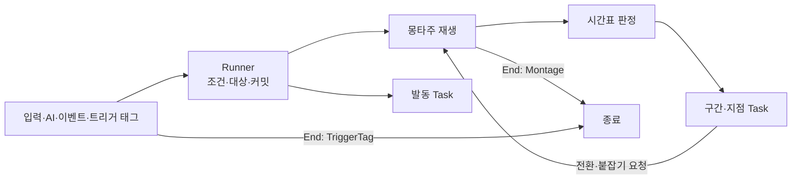

# 행동 ID 분기 제거 설계안

2026-10-17 설계 검토 중입니다. 두 번째 검토에서 정한 방향(단일 Ability는 엔진 어빌리티 기능과 단순한 Runner만 맡고, 기능은 자기 스키마를 가진 독립 Task로 나눔)으로 다시 썼습니다. 승인되면 [어빌리티와 AbilityTask](<어빌리티와 AbilityTask.md>)와 [몽타주 시간표](<몽타주 시간표.md>)의 규칙을 이 문서의 규칙으로 바꾸고, 구현이 끝나면 결정을 주제 문서로 옮긴 뒤 이 문서를 지웁니다.

## 결정과 목표

**`UAgGameplayAbility`는 엔진 어빌리티 기능과 단순한 Timeline Runner만 맡습니다. 행동마다 다른 처리는 Task, 데이터(행동 정의와 몽타주 시간표), 주인 객체로 옮기고, `UAgMontageTimelineComponent`는 Runner에 흡수해 지웁니다.** 지금은 어빌리티 세 파일(`AgGameplayAbility.cpp`, `AgGameplayAbilityEvents.cpp`, `AgGameplayAbilityTasks.cpp`)에 행동 ID 비교가 55곳(9·43·3), 몽타주 ID 비교가 9곳, 데이터 검증(`AgAbilityData.cpp`)에 16곳 있고, 시간표의 사건 다섯 종(처형 타격, 궁극기 마무리, 점프 공격 내리꽂기, 쓰러짐, 돌진 자세 유지)도 그 행동의 분기가 받아 처리합니다.

| 옮길 곳 | 담는 것 |
| - | - |
| Runner(`UAgGameplayAbility`) | 엔진 어빌리티 기능(태그 조건, 트리거, 비용·쿨다운, 재발동, 취소), 대상 선정, 몽타주 재생과 시간표 판정, Task 시작·종료, 정한 방식의 종료 |
| Task | 기능 하나와 그 Params의 스키마·검증 |
| 행동 정의(`Abilities.json`) | 발동 조건과 트리거, 대상 선정, 재생할 몽타주와 시작 섹션, 종료 방식, 발동 동안 실행하는 Task |
| 몽타주 시간표(`MontageTimelines.json`) | 섹션 안의 시각에 실행하는 Task(구간·지점) |
| 주인 객체 | 행동이 아닌 규칙: 입력(트리거 태그, 점프), 공중 상태·점프 모션·사망(캐릭터), 그로기 시간(보스 캐릭터), 패리 결과(피격 처리), 평타 반응과 2페이즈 진입(보스 AI) |

- 새 기능은 Task 파일 하나(Task와 그 Params)로 더하고 Runner는 고치지 않습니다. 있는 Task를 조합한 새 행동·패턴은 JSON과 몽타주만으로 더합니다.
- Task는 자기 일만 하고 다른 Task를 모릅니다. Runner는 Task 종류, 행동 ID, 몽타주 ID를 모릅니다. 행동 전체를 맡는 흐름 Task와 자식 Ability는 만들지 않습니다.
- 행동이 끝나는 방식은 행동 정의에 적고 추측하지 않습니다. 대부분은 몽타주가 끝날 때, 토글형(가드, 달리기, 락온, 점프)은 트리거 태그가 사라질 때 끝납니다.
- 여러 모션을 쓰는 행동(평타, 회피, 넉업, 점프)은 한 몽타주의 섹션으로 합칩니다.
- 대상이 필요한 행동은 발동할 때 TargetingPreset(GameplayTargetingSystem)으로 대상을 정합니다.
- 게임 동작은 바꾸지 않습니다. 달라지는 곳은 '동작이 달라지는 곳'에 모았습니다.



## 바뀌는 규칙

| 지금 규칙 | 바뀌는 내용 |
| - | - |
| [어빌리티와 AbilityTask](<어빌리티와 AbilityTask.md>) '결정과 목표', '설계에서 줄이는 것', '설정 여부·참조·검증': 기능별 고정 Params(`FAgAbilityTasks`), TaskClass 팩토리·다형 Params·`FInstancedStruct` 금지 | Task마다 Params 구조체를 두고 `FInstancedStruct`로 담습니다(아래 '스키마와 등록'). 흐름 Task와 Task 사이의 부모·자식·대기 관계를 두지 않는 규칙은 그대로입니다. |
| 같은 문서 '클래스와 책임', 'ASC와 몽타주 시간표의 책임 경계', [몽타주 시간표](<몽타주 시간표.md>) '클래스 구조' | 시간표 판정과 워핑 등록은 Runner가 합니다. 시간표 컴포넌트와 그 알림·구독은 없어집니다. |
| 같은 문서 '설정과 실행 시점의 구분', '시간표 항목 연결', '현재 기획에 필요한 연결', '행동별 호출·종료 연결', '별도 JSON 설정이 없는 내부 Task', '행동별 조합' | 실행 시점은 Task를 둔 곳(발동 Task 목록, 시간표 구간·지점)으로 정합니다. 사건 연결은 그 사건을 받는 Task(착지, 컷신 종료, 입력 이벤트)와 주인 객체로 옮깁니다(아래 '행동별 이관표'). |
| 같은 문서 'Ability 종료와 Task 종료' | 행동 정의의 `End`로 정합니다(아래 '종료'). |
| 같은 문서 '상태 소유권과 실제 충돌', '처형 상태 통합과 행동 제한': Busy는 공통 처리가 관리하고 행동별 설정으로 고르지 않음, State.Acting 없이 행동 모션 실행 기록으로 이동 입력 제한 | Busy는 시간표의 HoldTag 구간(후딜이 없으면 OwnedTags)으로, 이동 입력 제한은 OwnedTags의 `State.Acting`으로 데이터에 적습니다. |
| 같은 문서 '캐릭터와 실행 기능의 책임 경계': Ability가 이동 제약을 하나로 합쳐 전달, 대상은 모션 시작과 워핑 구간 진입에서 정함 | 회전 고정·최소 간격·물리 이동은 각각 Task이고 캐릭터가 소유자별 요청을 합칩니다. 대상은 아래 '대상'을 따릅니다. |
| 같은 문서 '기능별 설정과 실행': TimedTag에 종료 정책 필드 없음, LaunchToTarget은 함수, TargetQuery, Tasks.Attack 배열, Dash는 몽타주를 제어하지 않음, TimeStop·PlayCutscene·LockOn은 사건 처리가 호출, PlayMontageAndWait, 공통 재생 호출부의 PatternPlayRate | 아래 'Task 목록'으로 바꿉니다. 모션은 행동 정의의 `Montage`가 고릅니다. PatternPlayRate는 지우고, 0.8은 보스 공격 패턴 몽타주 일곱 개의 Rate Scale로 옮깁니다. |
| 같은 문서 '재발동': 콤보 진행과 가드 입력은 같은 발동 안의 입력·재생 사건 | 콤보는 평타 몽타주의 WaitEvent 구간이, 가드는 트리거 태그가 맡습니다. 재발동은 회피와 피격 반응만 씁니다. |
| 같은 문서 '스펙별 부여와 초기화': `DynamicAbilityTriggers`는 이벤트 발동에 사용 | `OwnedTagPresent` 트리거도 씁니다(아래 'AbilityTriggers'). |
| 같은 문서 '비용·발동 조건의 보존': 점프 가능·공중 여부·가드 입력 유지·처형/락온 대상은 구체 처리의 읽기 전용 검사 | 태그 조건, 트리거 태그 주인의 규칙, Targeting으로 바꿉니다. |
| [몽타주 시간표](<몽타주 시간표.md>) '형식': 몽타주 → 기능 이름 → 항목, 시각은 몽타주 타임라인 | 몽타주 → 섹션 → 항목 배열이고, 시각은 섹션 시작 기준입니다. 항목은 `Task` 필드로 종류를 정합니다. GameplayEvent 항목과 그 사건 여섯 종(후딜 시작 포함)은 없어집니다. |
| 같은 문서 '판정 규칙'의 '순서'·'섹션 이동', '항목별 실행' | 같은 시각은 배열 순서, Task가 요청한 전환은 같은 시각의 항목을 마친 뒤 적용, 섹션이 바뀌어도 같은 Task·같은 값의 구간은 이어 갑니다(아래 '시간표 판정'). |
| 같은 문서 첫 문단·'원본': 시간표에는 게임 규칙이 쓰는 시각만 둠 | 기획서가 정한 연출인 카메라 셰이크(LeapSlam 착지)도 시간표 지점에 둡니다. `Camera.json`의 `LeapLandingShake`·`LeapLandingShakeRange`를 지웁니다. |
| [입력 처리](<입력 처리.md>) '기술 결정': 가드 재개 이벤트, 행동 모션 실행 기록으로 이동 제한, 실행 중 어빌리티에 보내는 입력 이벤트 | 입력 계층은 트리거 태그(`Input.Guard`, `Input.Sprint`, `Input.LockOn`)와 이동 입력 태그(`Input.Move`)를 붙이고 뗍니다. 실행 중 행동에 보내는 이벤트는 평타의 `Input.Attack`만 남습니다. |
| [사망 처리](<사망 처리.md>) '사망 처리 순서', '클래스 구조': Death 어빌리티 | 캐릭터가 `Event.Death`를 받아 사망을 처리합니다. '처형 사망'의 판단 기준(공격 쪽 태그)은 그대로입니다. |
| [애니메이션과 이동](<애니메이션과 이동.md>) '점프', '점프 공격', '넉업': 점프 어빌리티가 Jump를 부르고 모션을 재생하며 State.Jumping을 가짐, 넉업은 세 몽타주 | 엔진 점프, 점프 모션, State.Jumping은 캐릭터가, 넉업은 합친 몽타주의 섹션이 맡습니다. |

## Runner

### 맡는 일

| 일 | 내용 |
| - | - |
| 정의 연결 | 지금처럼 ID별 스펙을 만들고 `OnGiveAbility`에서 태그 조건을 초기화합니다. `Activation.Triggers`는 스펙의 `DynamicAbilityTriggers`에 넣습니다. |
| 발동 검사 | 엔진 태그 검사, 비용(자원, DrainResource의 남은 자원), 재발동 허용, Targeting의 필수 대상. CanActivateAbility와 커밋 직전에 같은 검사를 합니다. |
| 대상 | 아래 '대상' |
| 몽타주 | 시작 섹션 선택과 재생, Task가 요청한 전환과 구간 끝 붙잡기 |
| 시간표 판정 | 지금 시간표 컴포넌트의 판정과 워핑 등록(아래 '시간표 판정') |
| Task 실행 | 발동 Task와 구간·지점 Task의 시작·종료, 정상 완료 알림 |
| 종료 | `End`가 정한 때 끝내고, 남은 Task·재생·워핑을 정리합니다. |

### 발동 순서

1. 검사를 통과하면 대상을 정하고 커밋합니다. 필수 대상이 없거나 커밋에 실패하면 Task를 실행하지 않고 끝냅니다.
2. `Montage`가 있으면 시작 섹션을 골라 재생하고 시작 위치의 구간·지점을 판정합니다. `bStartOnGround`이고 공중이면 착지할 때 재생합니다.
3. 발동 Task를 배열 순서대로 시작합니다.
4. 중간에 행동이 끝나면 남은 단계를 실행하지 않습니다. 재생에 실패하면 취소로 끝나므로, LaunchToTarget처럼 되돌릴 수 없는 발동 Task는 실행되지 않습니다.

### Runner와 Task 사이

Runner가 Task에 여는 것은 아래뿐입니다. 다른 Task, 행동 ID, 몽타주 ID는 열지 않습니다.

| 이름 | 뜻 |
| - | - |
| 행동 대상 | 아래 '대상'의 결과. 없을 수 있습니다. |
| 쓴 비용 | 이번 커밋에서 실제로 줄인 자원 양(극한 회피 환급) |
| 전환 | `{"Section": 섹션, "BlendTime": 초(선택)}`. BlendTime이 없으면 같은 재생 안에서 그 섹션으로 옮기고(블렌드 없음), 있으면 그 섹션부터 다시 재생합니다(새 재생, 그 시간의 블렌드 인). |
| 구간 끝 붙잡기 | 구간 Task가 구간 끝에서 아직 할 일이 남았으면 재생을 그 구간 끝에 멈춥니다. Task가 끝나면 재생을 이어 갑니다. |
| 정상 완료 알림 | Runner가 정상 종료로 끝내기 직전에 실행 중인 발동 Task에 알립니다. 취소에서는 알리지 않습니다. |

### 종료

| End | 끝나는 때 | 필요한 것 |
| - | - | - |
| Montage | 행동의 재생이 끝날 때. 완료면 정상 종료, 다른 몽타주에 끊기면 취소입니다. Task가 요청한 다시 재생은 끝이 아닙니다. | `Montage` |
| TriggerTag | 트리거 태그가 사라질 때(엔진이 취소) | `OwnedTagPresent` 트리거 하나 |

- 그 밖에 끝나는 길은 엔진의 취소(CancelTags, 사망, 스펙 제거)와 발동 중 실패뿐입니다. Task가 끝났거나 실행 중인 Task가 없다는 이유로 행동이 끝나지 않습니다.
- 모션이 없는 행동은 모두 TriggerTag입니다. 시작하자마자 끝나는 행동은 없습니다.

### 대상

| 출처 | 쓰는 행동 |
| - | - |
| `Targeting`이 있으면 그 결과 중 첫 후보 | 평타, 점프 공격, 회피 반격, 스킬, 처형, 락온, 보스 공격 패턴 |
| 없고 이벤트로 발동했으면 그 이벤트의 Instigator | 피격 반응, 패리, 처형 피격 |
| 그 밖 | 없음 |

| Targeting 필드 | 뜻 |
| - | - |
| Preset | TargetingPreset 에셋. 후보를 모으고 정렬하는 절차입니다. |
| Range | 수평 거리(cm) 상한. 생략하면 제한 없음 |
| TargetRequiredTags, TargetBlockedTags | 대상이 가져야 할 태그와 가지면 안 되는 태그(Activation의 태그 조건은 주인의 태그) |
| bRequired | 대상이 없으면 발동하지 않습니다. |

- 범위와 태그 조건은 행동 JSON의 값을 요청에 실어 보내고, 프리셋 안의 프로젝트 필터 Task가 거릅니다. 지금 `TP_Enemy`(후보 수집)와 코드(범위·생존·적대 거르기)가 나눠 맡는 일을 프리셋 안으로 옮긴 것이며, 수평 거리 정렬도 프로젝트 정렬 Task로 둡니다.
- 프리셋은 `TP_Enemy`(살아 있는 적), `TP_LockOn`(TP_Enemy에 화면 안 조건), `TP_AITarget`(보스 AI의 대상)입니다.
- CanActivateAbility에서 읽기 전용으로, 커밋 직전에 한 번 더 평가합니다. Task가 다시 재생을 요청하면 다시 평가합니다(평타의 타마다 대상). 이벤트 Instigator는 바뀌지 않습니다.
- 워핑 구간마다 대상을 다시 고르던 것은 없어지고 그 재생의 대상을 씁니다. 보스의 대상은 늘 플레이어이고 플레이어 공격은 재생마다 워핑 구간이 하나라 결과가 같습니다.
- 처형 안내 HUD는 처형 스펙의 Targeting을 읽기 전용으로 평가하고, 락온 대상은 실행 중인 락온 행동의 대상입니다. `FindEnemies`, `FindEnemy`, `FindAttackTarget`, `FindExecutionTarget`, `UAgAbilityTask_LockOn::FindTarget`은 지웁니다.

### 몽타주와 섹션

| Montage 필드 | 뜻 |
| - | - |
| MontageId | 캐릭터 데이터 `Montages`의 ID |
| StartSections | `[{"Section": 섹션, "RequiredTags": [...]}]`. 위에서부터 주인이 RequiredTags를 모두 가진 첫 섹션에서 시작하고, 마지막 항목은 조건 없이 둡니다. 생략하면 몽타주 처음부터 재생합니다. |
| RootMotionDistance | 지금과 같습니다(보스 Backstep). |
| bStartOnGround | 공중에서 발동하면 착지한 뒤 재생합니다(그로기). |

- 재생 배율은 몽타주의 Rate Scale 그대로입니다. 보스 공격 패턴의 0.8은 패턴 몽타주의 Rate Scale에 둡니다.
- 바로 이어지는 동작은 섹션 링크로 잇습니다. 다른 동작으로 넘어갈 때는 전환에 BlendTime을 적어 그 섹션부터 다시 재생합니다. 같은 재생 안의 섹션 이동에는 블렌드가 없어 자세가 튀기 때문입니다. BlendTime은 합치기 전 각 몽타주의 Blend In 시간을 옮깁니다.
- 기다리는 Task(WaitLanding, WaitFalling, GroggyRecovery, PlayCutscene)가 기다리는 동안 몽타주가 끝나지 않도록, 그 구간은 반복 섹션을 끝까지 덮습니다(검증).

### 시간표 판정

지금 컴포넌트의 판정 규칙([몽타주 시간표](<몽타주 시간표.md>) '판정 규칙')을 Runner가 그대로 맡고, 아래만 바꿉니다.

| 규칙 | 내용 |
| - | - |
| 판정 주인 | 행동의 재생을 그 Runner 인스턴스가 판정합니다. Runner의 틱 함수(`FTickFunction`)를 TG_PrePhysics에 두고 캐릭터 무브먼트와 메시의 틱을 선행 조건으로 겁니다(지금 컴포넌트와 같음). 재생이 있는 동안만 켭니다. 워핑은 지금처럼 워핑 컴포넌트의 `OnPreUpdate`에서 등록합니다. |
| 시각 | 항목의 시각은 그 섹션 시작 기준입니다. 구간은 한 섹션 안에 두고, End를 생략하면 섹션 끝까지입니다. |
| 이어 가기 | 섹션이 바뀌는 판정(링크로 넘어감, 섹션 이동, 다시 재생)에서 끝나는 구간과 시작하는 구간이 같은 Task·같은 값이면 실행을 끊지 않고 새 구간으로 넘깁니다. 여러 섹션에 걸치는 구간(점프 공격 판정, 궁극기 시간 정지와 Busy)은 섹션마다 같은 항목을 둡니다. 판정 구간도 한 실행이라 적중 기록이 이어집니다. |
| 순서 | 같은 시각이면 구간 끝, 지점, 구간 시작 순서이고, 그래도 같으면 배열 순서입니다. |
| 전환 요청 | 판정 중에 요청하면 같은 시각의 남은 항목까지 실행한 뒤 적용하고, 그보다 늦은 항목은 실행하지 않습니다. 판정 밖(착지, 컷신 종료, 입력 이벤트, 시간)에서 요청하면 바로 적용합니다. 적용한 뒤 새 위치로 판정을 맞추며, 건너뛴 지점은 실행하지 않고 새 위치의 지점은 실행합니다. |
| 구간 끝 붙잡기 | 재생 위치를 그 구간 끝으로 되돌려 멈추고 판정을 그 위치에 맞춥니다. 그보다 늦게 끝나는 구간은 켜진 채로 남습니다. |
| 재생 바뀜 | 다시 재생하면 이전 재생의 구간을 끝냅니다(이어 가기 제외). 지점 Task는 재생이 바뀌어도 남습니다. |
| 사본 | 재생을 시작할 때 시간표를 복사해 UPROPERTY로 보관합니다. 컷신 Sequence 같은 에셋 참조를 GC가 봅니다. |

## Task

### 스키마와 등록

- Task의 Params는 공통 부모 `FAgTaskParams`(USTRUCT)를 상속하고 그 Task의 헤더에 둡니다. Task 이름 `X`의 Params는 `FAgXParams`이며, 읽을 때 JSON의 `Task` 값으로 이 구조체를 찾아 `FInstancedStruct`에 담습니다. 구조체 메타데이터는 에디터 전용이라 이름 규칙으로 찾습니다.
- Params의 가상 함수가 자기 필드 읽기(모르는 필드·형식 오류·필수 누락은 오류), 값·참조 검증, 둘 수 있는 곳(발동·구간·지점)과 행동 대상이 필요한지 알리기, 자기 Task 만들기를 맡습니다.
- `AgAbilityTaskParams.h`에 모아 둔 Params와 설정 여부 플래그(`bHas...`), `FAgAbilityTasks`는 없어집니다.
- MotionWarping은 Task가 아니라 Runner가 엔진 워핑에 등록하는 항목입니다. 그 Params(`FAgMotionWarpingParams`)도 같은 방식으로 읽고 검증합니다.

### 둘 수 있는 곳

| 둔 곳 | 시작 | 끝 |
| - | - | - |
| 발동 Task(행동 정의 `Tasks`) | 발동 순서 3 | 행동 종료, 또는 스스로 끝날 때 |
| 구간(시간표 Start·End) | 재생 위치가 Start에 이를 때 | End, 재생 바뀜, 행동 종료, 또는 스스로 끝날 때. 이어 가기와 붙잡기는 위 표 |
| 지점(시간표 Time) | 재생 위치가 Time에 이를 때 | 행동 종료, 또는 스스로 끝날 때 |

### Task 목록

굵은 이름은 새 Task입니다. 나머지는 지금 기능의 값과 동작을 옮깁니다. `Next`는 위 '전환' 값입니다.

| Task | 둘 수 있는 곳 | Params | 하는 일 |
| - | - | - | - |
| Attack | 구간 | DamageMultiplier, PoiseMultiplier, HitReaction, bGuardable, MPCharge, UPCharge | 무기 스윕 판정 |
| **SingleHit** | 지점 | Attack의 값 필드, bFinisher, Targeting(선택), HitLocation(선택: Owner) | 그 시각에 한 번 칩니다. Targeting이 있으면 그 결과 모두를, 없으면 행동 대상을 칩니다. bFinisher면 마지막 일격(`Effect.Damage.Finisher`)입니다. HitLocation이 Owner면 피격 위치를 주인 위치로 둡니다. |
| HoldTag | 발동, 구간, 지점 | Tag | 태그를 유지합니다. 지점이면 그 시각부터 행동이 끝날 때까지입니다. |
| TimedTag | 발동 | Tag, Duration, bRemoveOnEnd | 시간 태그 효과(`TimedTag`)를 겁니다. bRemoveOnEnd면 행동이 끝날 때 함께 지웁니다. |
| SetCollisionResponseToChannel | 발동, 구간 | Channel, Response | 캡슐의 채널 응답을 바꾸고 끝날 때 되돌립니다. |
| Dash | 구간 | Speed, HomingTurnRate, Overshoot, MaxDistance | 행동 대상 쪽으로 돌진합니다. 공격이 막히면(`Event.AttackBlocked`) 그 자리에서 멈춥니다. 구간 끝에 아직 돌진 중이면 구간 끝을 붙잡고, 돌진이 끝나면 놓습니다. |
| SpawnProjectile | 지점 | ProjectileId, Origin, SocketName, Attack | 투사체 한 발 |
| DrainResource | 발동 | Resource, AmountPerSecond | 주기 소모 효과 |
| GrantResources | 발동, 지점 | SP, MP, UP | 자원 효과를 한 번 겁니다. |
| **PerfectDodge** | 발동 | MP, UP, CounterChanceDuration, SlowMotionSpeed, SlowMotionRealDuration | 발동마다 `Event.PerfectDodge`를 처음 받을 때만 보상을 줍니다: 쓴 비용 환급, MP·UP, 회피 반격 기회(`State.DodgeCounterChance`), 슬로우모션. 극한 회피 구간은 시간표의 HoldTag(`State.PerfectDodgeWindow`)입니다. |
| **FaceTarget** | 발동 | 없음 | 행동 대상 쪽으로 바로 돕니다. |
| **FaceMoveInput** | 발동 | 없음 | 이동 입력이 있으면 그 방향으로 바로 돕니다. |
| **HoldFacing** | 발동 | 없음 | 캐릭터의 자동 회전을 멈춥니다. 모션의 방향은 워핑이 정합니다. |
| **KeepDistance** | 발동 | 없음 | 루트 모션 이동이 행동 대상에게 캐릭터의 `StopDistance`보다 가까이 가지 않게 합니다. |
| **PhysicsTranslation** | 발동 | 없음 | 루트 모션의 회전은 쓰고, 이동은 공중에서 물리 속도를 따르며 땅에서는 멈춥니다. 함께 있으면 KeepDistance는 쓰지 않습니다(지금과 같음). |
| LaunchVertical | 지점 | VelocityZ | 그 시각에 공중이면 수직 속도만 바꿉니다. |
| LaunchToTarget | 발동 | AirTime, TargetOffset, MaxDistance | 행동 대상 쪽으로 한 번 발사합니다(지금 함수의 계산). |
| **KnockUpLaunch** | 발동 | 없음 | 전투 규칙의 넉업 높이·체공 시간으로 루트 모션 점프를 겁니다. |
| **WaitFalling** | 구간 | Next | 넉업으로 오르는 것을 확인한 뒤, 남은 상승 시간이 Next의 BlendTime 절반이 되면 전환합니다. 감속은 전투 규칙의 넉업 높이·체공 시간으로 정합니다(지금 계산). |
| **WaitLanding** | 구간 | Next | 착지 사건(이동 모드가 걷기로 바뀜)에서 전환합니다. 땅에 있다는 상태만으로는 전환하지 않습니다. |
| **GroggyRecovery** | 구간 | Next | 주인의 그로기 시간이 '전투 규칙의 그로기 지속 시간 − Next 섹션의 길이'에 이르면 전환합니다. 이미 지났으면 바로 전환합니다. |
| **WaitEvent** | 구간 | Event, Next | 주인이 그 게임플레이 이벤트를 받으면 전환합니다. |
| **PlaySection** | 지점 | Next | 그 시각에 전환합니다. |
| PlayCutscene | 구간 | Sequence, Next | 구간이 시작되면 컷신을 재생하고 끝나면 전환합니다. 재생 속도는 매 프레임 주인의 시간 배율(`CustomTimeDilation`)을 따르므로 시간 정지와의 시작 순서에 기대지 않습니다. |
| TimeStop | 구간 | 없음 | 구간 동안 주인 말고 시간을 멈춥니다. |
| LockOn | 발동 | 없음 | 행동 대상을 향해 카메라를 돌립니다(지금 Task의 카메라 부분). |
| **RefillPP** | 발동 | 없음 | 정상 완료 알림에서 PP를 MaxPP로 채웁니다. |
| **SendGameplayEvent** | 발동, 지점 | Event, Recipient(Owner, Target) | Instigator가 주인, Target이 행동 대상인 이벤트를 받는 쪽에 보냅니다. |
| **CameraShake** | 지점 | Shake, Range | 로컬 플레이어와의 수평 거리가 Range 이내면 셰이크를 재생합니다. |
| MotionWarping(항목) | 구간 | 지금 필드, StopDistance(선택) | Runner가 엔진 워핑에 등록합니다. 대상은 행동 대상이고, StopDistance는 대상과 맞출 간격입니다. 생략하면 캐릭터의 `StopDistance`입니다. 대상이 TargetingRange 밖이면 지금처럼 회전만 합니다. |

## AbilityTriggers

엔진 트리거(`FAbilityTriggerData`)를 `Activation.Triggers`에 둡니다. 항목은 `{"Tag": 태그, "Source": "GameplayEvent" | "OwnedTagPresent"}`입니다.

| Source | 엔진 동작 | 쓰는 행동 |
| - | - | - |
| GameplayEvent | 그 이벤트를 받으면 발동하고, 이벤트가 실행 정보로 옵니다. | 피격 반응, 패리, 처형 피격, 그로기, 페이즈 전환 |
| OwnedTagPresent | 태그가 0에서 1이 될 때 발동하고, 0이 되면 엔진이 취소합니다. | 가드, 달리기, 락온, 점프 |

OwnedTagPresent는 태그가 붙는 순간에만 발동을 시도하고, 막혀서 실패하면 태그가 붙어 있는 동안 다시 시도하지 않습니다. 그래서 입력 계층은 자기가 붙이는 요청 태그(`Input.Guard`, `Input.Sprint`, `Input.LockOn`)에 다음을 지킵니다.

1. 행동을 시작할 수 있을 때만(그 스펙의 CanActivateAbility) 태그를 붙입니다. 막혀 있으면 붙이지 않고 기다립니다.
2. 붙였는데 행동이 실행되지 않았으면 바로 뗍니다.
3. 태그가 남아 있는데 행동이 다른 이유(CancelTags 등)로 끝나면 태그를 뗍니다. 다시 시작할 때 다시 붙입니다.

| 행동 | 트리거 태그 | 주인과 규칙 |
| - | - | - |
| 가드 | `Input.Guard` | 입력 계층. 가드 키를 누르고 있고 가드를 시작할 수 있을 때 붙이고, 키를 떼면 뗍니다. 막혀 있으면 지금처럼 선입력, 후딜 시작, 행동 종료에서 다시 붙입니다. |
| 달리기 | `Input.Sprint` | 입력 계층. 회피 후딜에 Shift와 이동 입력이 있고 가드 키를 누르지 않았으면 붙이고, Shift를 떼거나 이동 입력이 없거나 SP가 0이면 뗍니다. |
| 락온 | `Input.LockOn` | 입력 계층. 락온 키로 붙이고 뗍니다(토글). 대상이 죽거나 락온 해제 거리(`LockOnReleaseRange`) 밖으로 나가면 뗍니다. 락온 대상이 없으면 시작할 수 없어 붙이지 않습니다(규칙 1). |
| 점프 | `State.Jumping` | 캐릭터. 점프가 실제로 시작될 때(`OnJumped`) 붙이고 착지할 때(`Landed`) 뗍니다. 요청이 아니라 공중 상태라 위 규칙 대신, 입력 계층이 점프 행동을 시작할 수 있을 때만 엔진 `Jump`를 불러 막힌 발동을 피하고, 키를 떼면 `StopJumping`을 부릅니다. 행동이 다른 이유로 끝나도 떼지 않습니다(점프 공격의 시작 조건). |

락온의 대상 상실은 태그 주인이 판단해야 행동이 끝나므로, 해제 조건(대상 사망, 해제 거리)을 입력 계층으로 옮기고 LockOn Task는 카메라만 맡습니다.

### 그로기는 트리거 태그로 끝내지 않음

그로기는 몽타주 종료형으로 두고, 복귀 시작은 GroggyRecovery가 보스 캐릭터의 그로기 시간(월드 시간)으로 정합니다. 전투 시스템 '그로기'는 '히트스톱은 복귀 시작 예정 시점을 늦추지 않고, 복귀 모션 중 히트스톱만큼 그로기 종료가 늦어진다'고 정하는데, 다른 두 방법은 이를 지키지 못합니다.

| 방법 | 문제 |
| - | - |
| 그로기 몽타주를 5초로 늘림 | 히트스톱(타격마다 0.12초)이 몽타주를 멈춰 복귀 시작이 맞은 횟수만큼 늦어집니다. |
| 5초 태그 효과의 OwnedTagPresent | 효과는 월드 시간으로 5초에 끝나 히트스톱으로 늦어진 복귀 모션을 자릅니다. 복귀 시작 시점은 따로 계산해야 하고, 처형 피격이 그로기를 늘리면 효과도 늘려야 합니다. |

## 주인 객체로 옮기는 규칙

| 주인 | 맡는 것 | 대신 지우는 것 |
| - | - | - |
| 플레이어 캐릭터(입력 계층) | 위 트리거 태그, 이동 입력이 있는 동안의 `Input.Move`. 평타 키는 평타가 실행 중이면 `Input.Attack` 이벤트를 보내고, 아니면 발동합니다(평타 키의 점프 공격·회피 반격 우선순위는 그대로). 가드 키를 누른 채 후딜이 시작될 때 가드가 실행 중이면 후딜에 든 패리 모션(`Ability.Action.Parry`)을 취소합니다. 이동 입력 제한은 `State.Acting`과 지금 태그로 봅니다. | 실행 중 어빌리티에 보내던 `Input.Guard`·`Input.LockOn` 이벤트, `Input.GuardReleased`, `Event.Guard.Resume`, 이동 제한 기록 조회(`BlocksMovementInput`) |
| 캐릭터 | `State.Airborne`(이동 모드가 떨어지는 중인 동안). 점프의 `State.Jumping`과 점프 모션: 플레이어는 [애니메이션과 이동](<애니메이션과 이동.md>) '점프'의 규칙대로 `Jump` 몽타주의 Start·Land 섹션을 재생합니다. 이동 제약은 HoldFacing·KeepDistance·PhysicsTranslation의 요청을 소유자별로 보관해 합칩니다. 사망은 `Event.Death`를 받아 처리합니다(아래 사망 모션). | Death 스펙과 `Ability.Reaction.Death`, 어빌리티의 점프·사망 분기, 소유자가 하나뿐인 이동 제약 |
| 보스 캐릭터 | 그로기 시간: State.Groggy가 있고 땅에 있으면 흐르기 시작해 State.Groggy가 사라지면 멈춥니다. HUD와 GroggyRecovery가 이 값을 읽습니다. | 어빌리티의 그로기 시간 호출 |
| 피격 처리(`UAgHitResultGameplayEffectComponent`) | 패리 성공 시 공격자의 PP 감소 효과와 방어자의 패리 구간 제거(전투 시스템 '피격 처리 순서') | 가드 어빌리티의 PP 감소와 패리 구간 닫기 |
| 보스 AI | 평타 시작 알림(`Event.BasicAttackStarted`)은 그대로 받습니다. 보내는 쪽만 평타·점프 공격 시간표의 SendGameplayEvent 지점으로 바뀝니다. 페이즈 전환이 정상 종료로 끝나면(`OnAbilityEnded`) 2페이즈로 넘어갑니다. | 어빌리티의 평타 시작 알림 함수와 2페이즈 진입 |

- 사망 모션: 캐릭터 데이터에 `DeathMotions`(`[{"Montage": "Executed", "KilledBy": "Ability.Action.Execution", "Death": "ExecutedDeath"}]`)를 둡니다. 사망할 때 Montage를 재생 중이고 사망 이벤트의 공격 쪽 태그에 KilledBy가 있으면, 다른 어빌리티를 취소하기 전에 재생 위치를 보관하고 Death 모션을 그 위치에서 이어 재생한 뒤 끝나면 래그돌로 바꿉니다. 처형 피격 중 다른 공격으로 죽으면 일반 사망인 지금 규칙과 같습니다.
- 캐릭터가 직접 재생하는 몽타주(점프, 사망)의 종료 콜백은 EndPlay에서 메시를 해제하기 전에 끊습니다. 지금 EndPlay가 어빌리티를 먼저 취소해 막는 문제와 같은 이유입니다.
- 캐릭터가 직접 재생하는 몽타주에는 판정할 Runner가 없으므로 시간표를 두지 않습니다(검증).

## 행동별 이관표

| 행동 | 지금의 분기 | 새 구성 |
| - | - | - |
| 평타 | 입력 이벤트 대기, BasicAttackMontageIds의 타 선택, 다음 타, 평타 시작 알림 | Targeting(TP_Enemy), `BasicAttack` 몽타주(섹션 Attack1~5). 섹션마다 Busy 구간, 시작의 SendGameplayEvent(평타 시작 알림), 후딜부터 섹션 끝까지 WaitEvent(`Input.Attack`, 다음 섹션을 BlendTime으로 다시 재생, Attack5 다음은 Attack1). 입력 없이 섹션이 끝나면 몽타주가 끝나 콤보가 초기화됩니다. 발동 Task HoldFacing·KeepDistance |
| 점프 | CanJump 검사, Busy·착지 대기·Jump·점프 모션, 모션 완료 무시, 착지 모션과 종료, StopJumping | 트리거 `State.Jumping`, End TriggerTag, OwnedTags State.Busy. 점프와 모션은 캐릭터 |
| 점프 공격 | IsFalling 검사, 물리 속도 이동·착지 대기, 평타 시작 알림, 착지 때 Land 섹션, 내리꽂기 사건 | RequiredTags State.Jumping, Targeting(TP_Enemy). HoldFacing·PhysicsTranslation. 시간표: Start·Fall의 WaitLanding(Land), LaunchVertical 지점, SendGameplayEvent 지점, 세 섹션에 걸친 Attack·Busy 구간(이어 가기) |
| 회피 | 극한 회피 대기, 입력 방향 회전과 Roll·Backstep 선택, 극한 회피 보상 | `Dodge` 몽타주(섹션 Roll, Backstep), StartSections(`Input.Move`가 있으면 Roll), FaceMoveInput, PerfectDodge |
| 회피 반격, 스킬 | 없음 | Targeting(TP_Enemy), 시간표 Busy 구간, HoldFacing·KeepDistance |
| 가드 | 키 유지 검사, 입력·패리 대기, 가드 태그·패리 구간, 패리 모션과 그 후딜·완료 처리, 종료 때 패리 구간 닫기 | 트리거 `Input.Guard`, End TriggerTag, OwnedTags State.Guarding, TimedTag(State.ParryWindow, bRemoveOnEnd). 패리는 Parry 스펙, 패리 후딜 복귀는 입력 계층, PP 감소는 피격 처리 |
| 패리(새 스펙) | 가드 안의 `Event.Parry` 처리 | 트리거 `Event.Parry`. FaceTarget, GrantResources, Parry 몽타주, Busy 구간. CancelTags에 가드가 없어 가드를 끝내지 않습니다. |
| 궁극기 | Busy와 시간 정지 시작, 컷신 시작과 완료 처리, 베기 선 Cue 켜고 끄기, 마무리 사건 | 시간표: 첫 섹션의 PlayCutscene(Judgment로 전환), 두 섹션에 걸친 TimeStop·Busy(이어 가기), Judgment의 마무리 SingleHit(Targeting 범위 10m, bFinisher). 베기 선은 Judgment 섹션의 엔진 상태 노티파이(`UAnimNotify_GameplayCueState`)가 켜고 끕니다. |
| 처형 | 대상 검사·보관, 처형 간격, 처형 피격 알림, 워핑 대상과 최소 간격 예외, 처형 타격 사건 둘 | Targeting(범위 3m, 대상 State.Groggy, State.Execution·State.Airborne 제외, 필수), HoldFacing, SendGameplayEvent(`Event.Executed`, Target), 워핑 항목의 StopDistance(지금 ExecutionDistance), SingleHit 지점 둘(두 번째 bFinisher). KeepDistance는 두지 않습니다. |
| 달리기 | 없음(입력 계층이 취소) | 트리거 `Input.Sprint`, End TriggerTag, DrainResource |
| 락온 | 대상 검사, 키 재입력 대기, 대상 상실 처리, 락온 대상 조회 | 트리거 `Input.LockOn`, End TriggerTag, Targeting(TP_LockOn, 범위 20m, 필수), LockOn. 해제 조건은 입력 계층 |
| 넉백, 가드 브레이크 | 피격 반응 태그로 회전, 쓰러짐 사건 | FaceTarget. 넉백은 시간표의 HoldTag 지점(무적) |
| 가드 밀림 | 피격 반응 태그로 회전 | FaceTarget. CancelTags의 `Ability.Action`을 `Ability.Action.Parry`로 바꿔 가드를 끝내지 않습니다. |
| 넉업 | 회전, 루트 모션 점프와 상승·하강 감시, 착지, 기상, 중간 모션 완료 무시, 쓰러짐 사건 | `KnockUp` 몽타주(섹션 Rise, Fall, Land, GetUp). FaceTarget, KnockUpLaunch. 시간표는 아래 표 |
| 그로기 | 처형 대기, 착지 대기, 그로기 모션·시간·End 섹션, 처형 피격, 완료 때 PP 회복, 종료 때 그로기 시간 정지 | bStartOnGround, End 앞 섹션들의 GroggyRecovery(End), RefillPP. 처형 피격은 Executed 스펙, 그로기 시간은 보스 캐릭터 |
| 처형 피격(새 스펙) | 그로기 안의 `Event.Executed` 처리, 그로기 정의의 HoldTag·충돌 설정 | 트리거 `Event.Executed`, RequiredTags State.Groggy, OwnedTags State.Groggy·State.Execution, CancelTags 그로기. FaceTarget, SetCollisionResponseToChannel(Pawn 무시), Executed 몽타주, RefillPP |
| 페이즈 전환 | 완료 때 PP 회복과 2페이즈 진입 | RefillPP, 보스 AI |
| 사망 | 처형 사망 판단과 이어 재생, 래그돌 | 캐릭터의 사망 처리와 DeathMotions |
| DoubleStrike, Sweep, QuintupleStrike, SwordWave, JumpSlam | 재생 배율 | Targeting(TP_AITarget), HoldFacing·KeepDistance, 몽타주 Rate Scale 0.8 |
| 도약(LeapSlam) | 보스 대상 검사, 물리 속도 이동·착지 대기, 발사, 착지 때 End 섹션·셰이크·착지 타격 | Targeting(TP_AITarget, 필수), HoldFacing·PhysicsTranslation·LaunchToTarget. 시간표는 아래 표 |
| 돌진 찌르기(DashThrust) | 막힘 대기, 돌진 종료 때 남은 구간 닫기, 자세 유지 사건 | Dash(막힘 정지, 구간 끝 붙잡기)와 시간표 배치(아래 예시) |
| Backstep(보스) | 재생 배율 제외 | Rate Scale를 바꾸지 않습니다. |
| 데이터 검증 | 행동 ID별 필수 항목, 행동 ID별 모션 목록 | 아래 '검증' |

## 데이터·에셋 변경

### 행동 정의

| 필드 | 형식 |
| - | - |
| Id, Tags, Cooldown, Cost, PatternSelection | 지금과 같습니다. |
| Activation | RequiredTags, BlockedTags, OwnedTags, BlockTags, CancelTags, Triggers, bAllowRetrigger. TriggerEvents는 Triggers로 바뀝니다. |
| Targeting, Montage | 위 '대상', '몽타주와 섹션'. 쓰는 행동만 적습니다. |
| End | `"Montage"` 또는 `"TriggerTag"` |
| Tasks | 발동 Task 배열. 항목은 `{"Task": 이름, Params 필드...}`입니다. |

Id·Tags·Cooldown·Activation·Cost·End·Tasks는 항상 적습니다. 아래 예시는 Activation의 빈 배열을 생략했습니다.

- 모션이 있는 플레이어 행동(평타, 점프 공격, 회피, 회피 반격, 스킬, 궁극기, 처형, 패리)은 OwnedTags에 `State.Acting`을 둡니다.
- Busy는 시간표의 HoldTag 구간(시작부터 지금 후딜 시작까지)으로 둡니다. 후딜이 없는 처형과 점프는 OwnedTags에 `State.Busy`를 둡니다.

가드와 패리:

```json
{
  "Guard": {
    "Tags": ["Ability.Action.Guard"],
    "Cooldown": 0,
    "Activation": {
      "BlockedTags": ["State.Busy", "State.HitReaction", "State.Groggy", "State.Execution", "State.Dead"],
      "OwnedTags": ["State.Guarding"],
      "CancelTags": ["Ability.Action", "Ability.Sprint"],
      "Triggers": [{"Tag": "Input.Guard", "Source": "OwnedTagPresent"}]
    },
    "Cost": null,
    "End": "TriggerTag",
    "Tasks": [
      {"Task": "TimedTag", "Tag": "State.ParryWindow", "Duration": 0.3, "bRemoveOnEnd": true}
    ]
  },
  "Parry": {
    "Tags": ["Ability.Action.Parry"],
    "Cooldown": 0,
    "Activation": {
      "BlockedTags": ["State.Dead"],
      "OwnedTags": ["State.Acting"],
      "Triggers": [{"Tag": "Event.Parry", "Source": "GameplayEvent"}]
    },
    "Cost": null,
    "Montage": {"MontageId": "Parry"},
    "End": "Montage",
    "Tasks": [
      {"Task": "FaceTarget"},
      {"Task": "GrantResources", "SP": 0, "MP": 15, "UP": 10}
    ]
  }
}
```

회피와 처형:

```json
{
  "Dodge": {
    "Tags": ["Ability.Action.Dodge"],
    "Cooldown": 0.4,
    "Activation": {
      "BlockedTags": ["State.Busy", "State.HitReaction", "State.Groggy", "State.Execution", "State.Dead"],
      "OwnedTags": ["State.Acting"],
      "CancelTags": ["Ability.Action", "Ability.Sprint"],
      "bAllowRetrigger": true
    },
    "Cost": {"Resource": "SP", "Amount": 20},
    "Montage": {
      "MontageId": "Dodge",
      "StartSections": [{"Section": "Roll", "RequiredTags": ["Input.Move"]}, {"Section": "Backstep"}]
    },
    "End": "Montage",
    "Tasks": [
      {"Task": "FaceMoveInput"},
      {"Task": "PerfectDodge", "MP": 10, "UP": 10, "CounterChanceDuration": 1, "SlowMotionSpeed": 0.3, "SlowMotionRealDuration": 0.3}
    ]
  },
  "Execution": {
    "Tags": ["Ability.Action.Execution"],
    "Cooldown": 0,
    "Activation": {
      "BlockedTags": ["State.Busy", "State.HitReaction", "State.Groggy", "State.Execution", "State.Dead"],
      "OwnedTags": ["State.Execution", "State.Invincible", "State.Busy", "State.Acting"],
      "CancelTags": ["Ability.Action", "Ability.Sprint"]
    },
    "Cost": null,
    "Targeting": {"Preset": "/Game/Data/TP_Enemy.TP_Enemy", "Range": 300, "TargetRequiredTags": ["State.Groggy"], "TargetBlockedTags": ["State.Execution", "State.Airborne"], "bRequired": true},
    "Montage": {"MontageId": "Execution"},
    "End": "Montage",
    "Tasks": [
      {"Task": "HoldFacing"},
      {"Task": "SendGameplayEvent", "Event": "Event.Executed", "Recipient": "Target"}
    ]
  }
}
```

토글형(Activation의 BlockedTags는 지금과 같아 생략):

```json
{
  "Sprint": {
    "Tags": ["Ability.Sprint"],
    "Cooldown": 0,
    "Activation": {
      "OwnedTags": ["State.Sprinting"],
      "CancelTags": ["Ability.Action", "Ability.Sprint"],
      "Triggers": [{"Tag": "Input.Sprint", "Source": "OwnedTagPresent"}]
    },
    "Cost": null,
    "End": "TriggerTag",
    "Tasks": [{"Task": "DrainResource", "Resource": "SP", "AmountPerSecond": 12}]
  },
  "LockOn": {
    "Tags": ["Ability.LockOn"],
    "Cooldown": 0,
    "Activation": {"Triggers": [{"Tag": "Input.LockOn", "Source": "OwnedTagPresent"}]},
    "Cost": null,
    "Targeting": {"Preset": "/Game/Data/TP_LockOn.TP_LockOn", "Range": 2000, "bRequired": true},
    "End": "TriggerTag",
    "Tasks": [{"Task": "LockOn"}]
  },
  "Jump": {
    "Tags": ["Ability.Action.Jump"],
    "Cooldown": 0,
    "Activation": {
      "OwnedTags": ["State.Busy"],
      "CancelTags": ["Ability.Action"],
      "Triggers": [{"Tag": "State.Jumping", "Source": "OwnedTagPresent"}]
    },
    "Cost": null,
    "End": "TriggerTag",
    "Tasks": []
  }
}
```

넉업과 도약(나머지 필드는 지금과 같음):

```json
{
  "KnockUp": {
    "Montage": {"MontageId": "KnockUp"},
    "End": "Montage",
    "Tasks": [{"Task": "FaceTarget"}, {"Task": "KnockUpLaunch"}]
  },
  "LeapSlam": {
    "Targeting": {"Preset": "/Game/Data/TP_AITarget.TP_AITarget", "bRequired": true},
    "Montage": {"MontageId": "LeapSlam"},
    "End": "Montage",
    "Tasks": [
      {"Task": "HoldFacing"},
      {"Task": "PhysicsTranslation"},
      {"Task": "LaunchToTarget", "AirTime": 1.35, "TargetOffset": 150, "MaxDistance": 1200}
    ]
  }
}
```

나머지 행동은 '행동별 이관표'대로 바꿉니다. Death 정의는 지웁니다.

### 몽타주 시간표

`{"몽타주 경로": {"섹션": [항목, ...]}}`이고, 항목은 `{"Task": 이름, "Start", "End"(선택)}` 또는 `{"Task": 이름, "Time"}`에 Params 필드를 더합니다. 항목은 한 줄에 하나씩 적습니다. 섹션이 하나인 몽타주는 엔진 기본 섹션 이름(Default)을 씁니다. 지금 값을 옮길 때 시각은 그 섹션의 시작 시각을 뺀 값입니다. 합친 몽타주는 섹션이 원래 몽타주라 값이 그대로입니다.

회피와 평타 1타(BlendTime은 자리 표시이며, 구현 때 원래 몽타주의 Blend In 값을 옮깁니다):

```json
{
  "/Game/Animations/AM_Player_Dodge.AM_Player_Dodge": {
    "Roll": [
      {"Task": "HoldTag", "Start": 0, "End": 0.6, "Tag": "State.Busy"},
      {"Task": "HoldTag", "Start": 0, "End": 0.15, "Tag": "State.PerfectDodgeWindow"},
      {"Task": "HoldTag", "Start": 0, "End": 0.3, "Tag": "State.Invincible"}
    ],
    "Backstep": [
      {"Task": "HoldTag", "Start": 0, "End": 0.4, "Tag": "State.Busy"},
      {"Task": "HoldTag", "Start": 0, "End": 0.15, "Tag": "State.PerfectDodgeWindow"},
      {"Task": "HoldTag", "Start": 0, "End": 0.3, "Tag": "State.Invincible"}
    ]
  },
  "/Game/Animations/AM_Player_BasicAttack.AM_Player_BasicAttack": {
    "Attack1": [
      {"Task": "SendGameplayEvent", "Time": 0, "Event": "Event.BasicAttackStarted", "Recipient": "Owner"},
      {"Task": "MotionWarping", "Start": 0, "End": 0.22, "TargetingRange": 200, "MaxWarpDistance": 110, "RotationMethod": "ConstantRate"},
      {"Task": "HoldTag", "Start": 0, "End": 0.3, "Tag": "State.Busy"},
      {"Task": "Attack", "Start": 0.27, "End": 0.3, "DamageMultiplier": 0.8, "PoiseMultiplier": 0.8, "HitReaction": "Flinch", "bGuardable": true, "MPCharge": 4, "UPCharge": 0},
      {"Task": "WaitEvent", "Start": 0.3, "Event": "Input.Attack", "Next": {"Section": "Attack2", "BlendTime": 0.25}}
    ]
  }
}
```

돌진 찌르기, 처형, 넉백:

```json
{
  "/Game/Animations/AM_Boss_DashThrust.AM_Boss_DashThrust": {
    "Default": [
      {"Task": "MotionWarping", "Start": 0, "End": 0.9, "TargetingRange": null, "MaxWarpDistance": 0, "RotationMethod": "ConstantRate"},
      {"Task": "Dash", "Start": 0.9166667, "End": 1.0366666, "Speed": 2000, "HomingTurnRate": 90, "Overshoot": 200, "MaxDistance": 2000},
      {"Task": "Attack", "Start": 0.9166667, "End": 1.0376666, "DamageMultiplier": 2, "PoiseMultiplier": 1, "HitReaction": "KnockUp", "bGuardable": true, "MPCharge": 0, "UPCharge": 0},
      {"Task": "SetCollisionResponseToChannel", "Start": 0.9166667, "End": 1.0376666, "Channel": "Pawn", "Response": "Ignore"}
    ]
  },
  "/Game/Animations/AM_Player_Execute.AM_Player_Execute": {
    "Default": [
      {"Task": "MotionWarping", "Start": 0.0001, "End": 0.3333333, "TargetingRange": null, "MaxWarpDistance": null, "RotationMethod": "Slerp", "StopDistance": 95},
      {"Task": "SingleHit", "Time": 0.33333334, "DamageMultiplier": 1.5, "PoiseMultiplier": 0, "HitReaction": "None", "bGuardable": true, "MPCharge": 0, "UPCharge": 0, "bFinisher": false},
      {"Task": "SingleHit", "Time": 0.8, "DamageMultiplier": 4.5, "PoiseMultiplier": 0, "HitReaction": "None", "bGuardable": true, "MPCharge": 0, "UPCharge": 0, "bFinisher": true}
    ]
  },
  "/Game/Animations/AM_Player_KnockBack.AM_Player_KnockBack": {
    "Default": [
      {"Task": "HoldTag", "Time": 0.1, "Tag": "State.Invincible"}
    ]
  }
}
```

돌진 찌르기의 Dash는 자세 유지 시각에 끝나고, 아직 돌진 중이면 그 위치를 붙잡습니다. 판정·충돌 구간은 그보다 0.001초 뒤에 끝나므로 붙잡는 동안 켜져 있고, 돌진이 끝나 재생이 이어지면 다음 판정에서 닫힙니다.

섹션 위치를 몽타주 에셋에서 읽어야 하는 몽타주:

| 몽타주 | 섹션별 항목 |
| - | - |
| AM_KnockUp(합침) | Rise: WaitFalling(Fall, BlendTime 지금 AM_KnockUpFall의 Blend In), WaitLanding(Land, 같은 BlendTime). Fall(반복): WaitLanding(Land, 블렌드 없음). Land: HoldTag 지점(State.Invincible, 지금 쓰러짐 사건 위치), PlaySection 지점(GetUp, BlendTime 지금 AM_GetUp의 Blend In. 시각은 지금 기상이 시작되는 낙하 몽타주의 블렌드 아웃 시작). GetUp: 없음 |
| AM_Player_JumpAttack | Start: 회전 워핑(지금 값), SendGameplayEvent 지점(0, 평타 시작 알림), LaunchVertical 지점(지금 내리꽂기 사건 위치, VelocityZ −1000), WaitLanding(Land). Fall(반복): WaitLanding(Land). 세 섹션에 Attack(지금 값)과 Busy(지금 후딜 시작까지)를 나눠 두어 이어 갑니다. |
| AM_Boss_LeapSlam | End 앞의 섹션들: WaitLanding(End). End: CameraShake 지점(0, Medium, 1500), SingleHit 지점(0, Targeting TP_AITarget 범위 350·State.Airborne 제외, 지금 LeapSlam의 Attack 값, HitLocation Owner, bFinisher false). 회전 워핑은 지금과 같습니다. |
| AM_Player_Ultimate | 첫 섹션(반복): PlayCutscene(지금 Sequence, Judgment), TimeStop·Busy(섹션 끝까지). Judgment: TimeStop(0~마무리 시각), Busy(0~지금 후딜 시작), SingleHit 지점(마무리 시각, Targeting TP_Enemy 범위 1000, 지금 궁극기의 Attack 값, bFinisher true). 같은 시각이면 구간 끝이 먼저라 시간 정지가 풀린 뒤 칩니다. |
| AM_Boss_Groggy | End 앞의 섹션들: GroggyRecovery(End, 이어 가기) |
| AM_Player_DodgeCounter, AM_Player_Skill, AM_Player_Parry, 평타 2~5타 | 지금 후딜 시작까지 Busy 구간. 평타는 1타와 같은 배치입니다. |

### 몽타주와 프리셋 에셋

| 에셋 | 변경 |
| - | - |
| AM_Player_BasicAttack(새) | AM_Player_BasicAttack1~5를 섹션 Attack1~5로 합칩니다. 섹션끼리 잇지 않아 각 섹션 끝에서 몽타주가 끝납니다. |
| AM_Player_Dodge(새) | AM_Player_Roll, AM_Player_Backstep을 섹션 Roll, Backstep으로 합칩니다. |
| AM_KnockUp | AM_KnockUpFall(낙하 반복, Land)과 AM_GetUp을 섹션 Fall, Land, GetUp으로 더합니다. Rise는 전환 전에 끝나지 않게 반복 섹션을 둡니다. 플레이어와 보스가 함께 씁니다. |
| AM_Player_Jump | 첫 섹션을 Start로 하고, AM_Player_Land를 섹션 Land로 더해 Start와 잇지 않습니다. |
| 보스 공격 패턴 7개 | Rate Scale 0.8(DoubleStrike, Sweep, DashThrust, LeapSlam, QuintupleStrike, SwordWave, JumpSlam) |
| AM_Player_Ultimate | Judgment 섹션 시작부터 마무리까지 엔진 `UAnimNotify_GameplayCueState`(`GameplayCue.UltimateSlashes`) |
| 기다리는 구간의 몽타주 | 반복 섹션 확인: 궁극기 첫 섹션, 그로기, 점프 공격 Fall, 도약 공중, 넉업 Rise·Fall |
| TargetingPreset | TP_Enemy에 프로젝트 필터·정렬 Task를 넣고, TP_LockOn(화면 안 필터)과 TP_AITarget(AI 대상 선택)을 더합니다. |

합친 뒤 원래 몽타주(AM_Player_BasicAttack1~5, AM_Player_Roll, AM_Player_Backstep, AM_KnockUpFall, AM_GetUp, AM_Player_Land)는 지웁니다.

### 캐릭터·카메라 데이터

| 대상 | 변경 |
| - | - |
| `Characters.json`의 `Player` | Abilities에 Parry를 더하고 Death를 뺍니다. Montages는 합친 몽타주에 맞춥니다(BasicAttack1~5는 BasicAttack, Roll·Backstep은 Dodge로 바꾸고 KnockUpFall·GetUp·Land는 지움). `BasicAttackMontageIds`, `ExecutionDistance`(처형 워핑의 StopDistance로), `LockOnRange`(락온의 Targeting.Range로), `EnemyTargeting`(행동의 Targeting.Preset으로)을 지웁니다. `LockOnReleaseRange`는 입력 계층이 읽습니다. |
| `Characters.json`의 `Boss` | Abilities에 Executed를 더하고 Death를 뺍니다. Montages의 KnockUpFall·GetUp을 지웁니다. `PatternPlayRate`를 지우고 `DeathMotions`를 더합니다. |
| `Camera.json` | `LeapLandingShake`, `LeapLandingShakeRange`를 지웁니다(LeapSlam 시간표의 CameraShake로). |

### 태그

| 구분 | 태그 |
| - | - |
| 더함 | `State.Airborne`, `State.Acting`, `Input.Move`, `Input.Sprint`, `Ability.Action.Parry`, `Ability.Reaction.Executed` |
| 지움 | `Event.Guard.Resume`, `Input.GuardReleased`, `Event.RecoveryStarted`, `Event.ExecutionBlow`, `Event.UltimateFinish`, `Event.JumpAttackPlunge`, `Event.DownGrounded`, `Event.Boss.DashHold`, `Ability.Reaction.Death` |
| 쓰임이 바뀜 | `Input.Guard`·`Input.LockOn`(입력 계층이 트리거 태그로 붙임), `State.Jumping`(캐릭터가 붙임), `Event.BasicAttackStarted`(시간표 지점이 보냄) |

## 검증

- 지우는 것: 행동 ID별 필수 항목 검사(`ValidateRequiredTasks`), BasicAttackMontageIds 검사, 행동 ID별 모션 목록
- 행동 정의: Task 이름은 등록된 Task이고, 각 Params가 읽기·검증·둘 수 있는 곳을 검사합니다. End가 Montage면 Montage가, TriggerTag면 OwnedTagPresent 트리거가 정확히 하나 있습니다. Triggers의 Source는 GameplayEvent나 OwnedTagPresent입니다. Targeting의 Preset은 있는 에셋이고 Range는 0 이상의 유한한 수입니다. StartSections의 섹션은 그 몽타주 ID를 쓰는 모든 캐릭터의 몽타주에 있고, 마지막 항목은 조건이 없습니다.
- 행동 대상: 행동 대상이 필요한 Task(FaceTarget, KeepDistance, LaunchToTarget, LockOn, Dash, Targeting이 없는 SingleHit, Recipient가 Target인 SendGameplayEvent)가 발동 Task나 그 몽타주의 시간표에 있으면, 그 행동은 Targeting이나 GameplayEvent 트리거를 가집니다.
- 시간표 키: 어떤 행동의 Montage가 재생하는 몽타주만 키가 될 수 있습니다. 캐릭터가 직접 재생하는 몽타주(점프, 사망, 움찔)의 시간표는 오류입니다.
- 시간표 항목: 섹션은 그 몽타주에 있고, 0 ≤ Start < End ≤ 섹션 길이, 0 ≤ Time ≤ 섹션 길이입니다. 전환의 섹션은 그 몽타주에 있고, 전환 지점은 섹션 끝보다 앞입니다. 기다리는 Task의 구간은 반복 섹션을 끝까지 덮습니다. 반복 섹션 안의 지점과 워핑 구간은 지금처럼 오류입니다.
- 지금 규칙 유지: 경쟁 구간(Dash끼리, 같은 채널의 충돌 응답끼리), 몽타주의 노티파이(프로젝트·워핑 노티파이 금지, 예고 끝과 판정 시작, Dash 시작의 루트 모션 끄기), 투사체 ID
- 캐릭터 데이터: DeathMotions의 몽타주 ID, 점프 몽타주의 Start·Land 섹션
- 오류에는 파일, 행동 ID나 몽타주 경로·섹션, 항목 번호, 필드 경로를 붙입니다.

## 엔진 동작 확인

| 가정 | 확인할 곳 | 구현 때 확인 |
| - | - | - |
| 스펙별 `DynamicAbilityTriggers`가 OwnedTagPresent를 등록하고, 태그가 0이 되면 취소하며, 실패한 발동을 다시 시도하지 않음 | `AbilitySystemComponent_Abilities.cpp`의 트리거 등록과 태그 감시 | 가드·달리기·락온·점프의 시작과 끝 |
| PreActivate가 ActivationOwnedTags를 CancelTags 적용보다 먼저 붙임 | `GameplayAbility.cpp`의 PreActivate | 처형 피격이 그로기를 취소해도 State.Groggy가 끊기지 않는지(그로기 시간, HUD) |
| 같은 몽타주를 다시 재생하면 새 인스턴스가 블렌드 인하고 이전 인스턴스는 그 시간으로 블렌드 아웃함 | `AnimInstance.cpp`의 Montage_Play | 평타 다음 타, 넉업 낙하·기상의 블렌드가 지금과 같은지 |
| 재발동은 실행 중인 인스턴스를 취소가 아닌 종료로 끝낸 뒤 다시 발동함 | `AbilitySystemComponent_Abilities.cpp` 1836~1844 | 회피·피격 반응 재발동 |
| 파생 USTRUCT의 가상 함수를 `FInstancedStruct`의 포인터로 부를 수 있음 | `InstancedStruct.h`(5.5부터 엔진 기본 모듈) | Params 읽기·검증·Task 생성 |
| 타겟팅 요청 핸들에 프로젝트 데이터를 붙여 프리셋의 Task가 읽을 수 있음 | TargetingSystem의 요청 핸들별 데이터 | 범위·태그 필터 |
| 레벨 시퀀스 재생 속도를 재생 중에 바꿀 수 있고, 시퀀스는 게임 전체 시간 배율을 따름 | `MovieSceneSequencePlayer`의 SetPlayRate | 시간 정지가 시작·끝나는 프레임의 컷신 속도 |
| 몽타주 위치를 옮긴 뒤 멈추면 그 위치의 자세에 루트 이동이 없음 | `Montage_SetPosition`, `Montage_Pause` | 돌진 찌르기 자세 유지와 판정·충돌 구간 유지 |
| 착지할 때 Landed가 이동 모드 변경보다 먼저 불림 | `CharacterMovementComponent.cpp`의 ProcessLanded | 착지 모션을 고를 때 State.Jumping과 점프 행동이 남아 있는지 |
| 엔진 GameplayCue 상태 노티파이가 메시 주인을 대상으로 Cue를 켜고 끔 | `AnimNotify_GameplayCueState.cpp` | 베기 선이 Judgment에서 켜지고 마무리에서 꺼지는지 |
| Rate Scale은 재생 배율처럼 위치·루트 모션·노티파이에 적용됨 | `FAnimMontageInstance`의 Advance | 보스 패턴의 속도와 이동 거리 |
| 그로기를 취소한 뒤 처형 피격 몽타주를 재생해도 블렌드가 같음 | 지금은 같은 Ability 안에서 바로 Montage_Play, 바뀐 뒤에는 그로기를 블렌드 아웃으로 멈춘 뒤 재생 | 처형 정렬(워핑, 간격) |

## 동작이 달라지는 곳

| 상황 | 지금 | 바뀐 뒤 | 추천 |
| - | - | - | - |
| 돌진 찌르기가 자세 유지 시점 전에 막히거나 거리를 다 감 | 판정과 충돌 해제가 바로 끝남 | 자세 유지 시점 직후까지 남음(몽타주 시간 최대 0.12초, 실제 시간 0.15초) | 받아들입니다. 자세 유지 전의 돌진 거리는 약 3m라 출발할 때 플레이어나 벽이 그보다 가까울 때만 생기고, 가드·패리로 막힌 공격은 같은 대상에 다시 맞지 않습니다. 정확히 맞추려면 Dash와 함께 끝나는 구간 표시가 필요합니다. |
| 패리 모션 후딜 전에 가드 키를 떼었다가 다시 눌러 선입력으로 가드가 시작됨 | 패리 구간이 생기지 않음 | 패리 구간이 생김 | 플레이어 사양 '패리 구간' 표 1행을 따르는 수정입니다. |
| 점프 입력과 같은 프레임에 점프 행동을 막는 상태가 시작됨(드묾) | 점프하지 않음 | 점프는 하지만 점프 행동이 시작되지 않아 그 점프 동안 Busy가 없음 | 받아들입니다. 입력 계층이 Jump 직전에 발동 가능을 확인하므로, 그 사이 피격 반응 같은 상태가 시작될 때만 생기고 그 상태가 행동을 막습니다. |

## 구현 순서와 완료 조건

바꾸기 전에 '지금과 같다'를 판단할 기준값(넉업 전환 시각, 돌진 자세 유지 위치, 콤보와 넉업의 블렌드, 그로기 복귀 시각)을 재 둡니다. 단계마다 빌드와 시나리오 테스트로 확인한 뒤 다음 단계로 갑니다.

| 단계 | 작업 |
| - | - |
| ① Runner와 Task 스키마 | 시간표 컴포넌트를 Runner로 흡수, Task별 Params와 등록, 새 JSON 형식(발동 Task 배열, 섹션별 시간표)과 범용 검증. 몽타주는 그대로이고 행동 분기는 새 데이터를 읽게만 바꿔 동작이 같습니다. |
| ② 발동·종료·대상 | Triggers와 End, Targeting과 프리셋, 새 Task, Parry·Executed 스펙, 주인 객체(입력 계층, 캐릭터, 보스 그로기 시간, 피격 처리, 보스 AI), Rate Scale. 섹션 합치기가 필요 없는 행동의 분기를 지웁니다. |
| ③ 섹션 합치기 | 평타·회피·넉업·점프 몽타주 합치기, StartSections와 전환, 남은 분기·태그·데이터 필드·함수 삭제, 관련 문서 갱신 |

| 검증 대상 | 완료 기준 |
| - | - |
| 구조 | `Source/Ag/AbilitySystem`과 데이터 검증에 행동 ID·몽타주 ID·섹션 이름 비교가 없고, `UAgMontageTimelineComponent`가 없습니다. Runner는 Task 종류를 모르고, Task는 다른 Task를 부르지 않습니다. |
| 동작 | 평타 콤보와 초기화, 점프와 착지 모션, 점프 공격, 회피와 극한 회피(한 번만), 가드·패리·가드 밀림·후딜 복귀, 달리기, 락온과 해제, 처형, 궁극기 순서(컷신, 베기 선, 시간 정지 해제 뒤 마무리), 넉업·넉백, 보스 8개 패턴과 재생 속도, 그로기(공중 시작, 시간, HUD, 처형 피격, PP 회복), 페이즈 전환, 사망과 처형 사망이 지금과 같습니다. 단 '동작이 달라지는 곳'은 표를 따릅니다. |
| 데이터 | 잘못된 Task·필드·참조·몽타주·섹션은 읽을 때 파일과 경로를 붙인 오류가 납니다. |

반영할 문서: [어빌리티와 AbilityTask](<어빌리티와 AbilityTask.md>), [몽타주 시간표](<몽타주 시간표.md>), [캐릭터와 GAS](<캐릭터와 GAS.md>), [입력 처리](<입력 처리.md>), [보스](<보스.md>), [전투 규칙](<전투 규칙.md>), [대미지와 피격 처리](<대미지와 피격 처리.md>), [애니메이션과 이동](<애니메이션과 이동.md>), [사망 처리](<사망 처리.md>), [카메라, HUD, 화면 UI, 게임 플로우](<카메라, HUD, 화면 UI, 게임 플로우.md>), [JSON 데이터](<JSON 데이터.md>), [데이터 위치표](<데이터 위치표.md>), [구현 위치표](<구현 위치표.md>)
