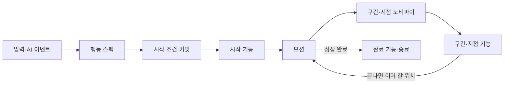

# 행동 ID 분기 제거 설계안

2026-10-17 설계 검토 전입니다. 승인되면 [AbilityTask 기반 어빌리티 설계안](<AbilityTask 기반 어빌리티 설계안.md>)의 일부 규칙을 이 문서의 규칙으로 바꿉니다.

같은 날 몽타주 노티파이와 ParamsId를 [몽타주 시간표](<몽타주 시간표.md>)로 옮겼습니다. 이 문서는 아직 노티파이를 전제로 쓰여 있어, 검토 전에 다음처럼 고칩니다.

- ParamsId와 이름별 맵을 쓰지 않습니다. 시작 기능은 이름 없는 값으로, 몽타주에 묶인 기능은 시간표 항목으로 둡니다. 코드가 이름으로 찾는 나머지 20개(가드의 Guarding·ParryWindow·Parry, 회피의 PerfectDodge 둘·CounterChance, 궁극기의 UltimateCamera·Finish 둘, 처형의 Execution·Stab·Finish, 넉백·넉업의 Downed 둘, 도약의 LandingHit·Landing, 그로기의 Executed·PassThroughPawn)를 없앱니다.
- '몽타주 노티파이' 표와 공용 지점 노티파이는 시간표 항목으로 바꿉니다. 연출(GameplayCue)은 몽타주 노티파이로 남깁니다.
- '한 프레임 앞에 둔다' 같은 배치 요령은 시간표 판정 규칙의 순서로 대신합니다.
- 기능의 실행 시점(구간 기능과 시작 기능의 구분)은 이 문서를 고칠 때 다시 정합니다.
- 같은 날 데이터를 종류별 JSON으로 나눴습니다([JSON 데이터](<JSON 데이터.md>)). 캐릭터 값은 `Characters.json`, 행동 정의는 `Abilities.json`(두 캐릭터가 같은 정의를 함께 씀), GameplayEffect는 `Effects.json`의 효과 정의입니다. 이 문서의 데이터 변경과 예시는 이 구조로 다시 씁니다.

## 결정과 목표

**구체 클래스 `UAgGameplayAbility` 하나, 기능별 고정 Params, 공용 ANS는 그대로 둡니다. 대신 어빌리티·Task·데이터 검증 코드에서 행동 ID로 동작을 고르는 분기를 모두 없앱니다.** 지금은 어빌리티 세 파일(`AgGameplayAbility.cpp`, `AgGameplayAbilityEvents.cpp`, `AgGameplayAbilityTasks.cpp`)에 행동 ID 비교가 58곳, `AgAbilityData.cpp`의 검증에 16곳 있습니다.

행동마다 다른 처리는 아래 네 곳으로 옮깁니다.

| 옮길 곳 | 담는 것 |
| - | - |
| 행동 정의(JSON `Tasks`) | 기능 설정, 행동을 시작하는 모션의 선택, 기능이 끝났을 때 이어 갈 모션 위치 |
| 몽타주(에셋) | 구간·지점 노티파이의 시각과 기능 참조, 섹션 구성 |
| 이벤트 반응 스펙 | 한 행동 안에서 사건에 반응하던 처리. 패리, 극한 회피, 처형 피격을 이벤트로 발동하는 별도 행동으로 나눕니다. |
| 주인 객체 | 행동이 아닌 규칙. 입력(플레이어 캐릭터), 공중 상태·점프와 착지 모션·사망 연출(캐릭터), 패리 결과(피격 처리), 평타 반응과 2페이즈 진입(보스 AI) |

- 있는 기능을 조합한 새 행동·패턴은 C++ 수정 없이 JSON과 몽타주만으로 추가합니다.
- 기능은 자기 일만 하고 다른 기능을 모릅니다. 행동 전체를 맡는 Task나 자식 Ability는 만들지 않습니다.
- 게임 동작은 바꾸지 않습니다. 달라지는 곳은 아래 '동작이 달라지는 곳'에 모았습니다.
- 입력 키를 행동에 연결하는 플레이어 입력 계층의 행동 선택(`RunInput`, `UpdateSprint`)은 이 설계의 범위가 아닙니다.



## 바뀌는 규칙

| [AbilityTask 기반 어빌리티 설계안](<AbilityTask 기반 어빌리티 설계안.md>)의 규칙 | 바뀌는 내용 |
| - | - |
| '설정과 실행 시점의 구분': 기능별 실행 시점 | 아래 '기능의 실행 시점' 표로 바꿉니다. TimedTag·GrantResources·SlowMotion은 시작 기능, LaunchVertical은 지점 기능이 되고, TargetQuery는 Attack과 Target으로 나뉘어 사라집니다. |
| 'ANS Begin/End 연결': 동적 재생 행동에는 PlayMontageAndWait를 넣지 않음 | PlayMontageAndWait가 시작 모션의 선택(순서, 이동 입력, 착지 뒤 시작)을 맡고, 이어지는 모션은 구간·지점 기능이 바꿉니다. |
| '현재 기획에 필요한 연결', '행동별 호출·종료 연결': 공통 Ability의 구체 함수가 행동별 사건을 처리 | 아래 '행동별 이관표'로 바꿉니다. |
| '설계에서 줄이는 것': 범용 연결 장치를 두지 않음 | 유지합니다. 다만 모션 위치를 옮기는 기능(착지·하강·컷신·그로기 시간을 기다리는 구간, 다음 모션으로 넘어가는 지점)의 항목에는 이어 갈 섹션이나 모션을 적습니다. 사건과 동작을 임의로 잇는 목록은 여전히 두지 않습니다. |
| 'Ability 종료와 Task 종료': 모션 완료 또는 외부 요청으로 종료 | 아래 '행동의 종료'로 바꿉니다. |
| '에셋 참조와 코드 호출 검증': 행동 ID별 필수 항목 검사 | 아래 '검증'으로 바꿉니다. |
| 'ANS Begin/End 연결': 공용 ANS는 구간만 | 같은 모양(Task, ParamsId)의 공용 지점 노티파이 `UAgAnimNotify_AbilityTask`를 더합니다. |

## 구성 요소

### 행동 대상

한 번의 발동이 다루는 상대 하나를 행동 대상이라 합니다.

| 정하는 방법 | 쓰는 행동 |
| - | - |
| 이벤트로 발동하면 그 이벤트의 Instigator | 피격 반응, 패리, 처형 피격 |
| Target 기능이 있으면 시작할 때 조건에 맞는 적 | 처형 |
| 그 밖에는 없음 | 공격 모션은 지금처럼 모션 시작과 워핑 구간마다 공격 대상을 고릅니다. |

행동 대상은 FaceTarget, 범위가 없는 지점 타격, Target의 이벤트 전송, 워핑에 씁니다. 행동 대상이 있는 모션의 워핑은 그 대상과 워핑 설정의 StopDistance를 쓰고, 대상과의 최소 간격 제약을 걸지 않습니다(지금 처형의 동작).

### 기능의 실행 시점

실행 시점은 기능 종류로 정해지며 JSON에 실행 시점 필드를 두지 않습니다. 굵은 이름은 새 기능입니다.

| 시점 | 기능 | 실행 |
| - | - | - |
| 시작 | **Target**, **FaceTarget**, DrainResource, TimedTag, GrantResources, **RefundCost**, SlowMotion, LockOn, **Jump**, PlayMontageAndWait, LaunchToTarget, **KnockUpLaunch** | 커밋하고 State.Busy를 얻은 뒤(아래 '모션 선택과 전환') 이 순서로 실행합니다. 중간에 행동이 끝나면 남은 기능을 실행하지 않습니다. LaunchToTarget과 KnockUpLaunch는 모션이 시작된 뒤에 실행합니다. |
| 구간 | Attack(휘두르기), HoldTag, SetCollisionResponseToChannel, TimeStop, Dash, PlayCutscene, **WaitLanding**, **WaitFalling**, **GroggyRecovery**, **PhysicsTranslation** | 공용 ANS의 Begin에서 시작하고 End에서 끝냅니다. |
| 지점 | Attack(단발 타격), HoldTag, LaunchVertical, **PlayMontage**, **CameraShake** | 새 공용 지점 노티파이 시각에 실행합니다. 기존 SpawnProjectile 노티파이, 엔진 GameplayCue 노티파이, RecoveryStarted 노티파이는 그대로 씁니다. |
| 완료 | **RefillPP** | 모션이 정상으로 끝났을 때 실행합니다. 취소·중단에서는 실행하지 않습니다. |

새로 생기거나 의미가 바뀌는 기능의 Params와 뜻입니다. 다른 기능은 [AbilityTask 기반 어빌리티 설계안](<AbilityTask 기반 어빌리티 설계안.md>)의 '기능별 고정 Params'를 따릅니다.

| 기능 | 형식 | Params | 뜻 |
| - | - | - | - |
| Target | Params 객체 | Range, RequiredTags, BlockedTags, Event(선택) | 타겟팅 범위 안에서 태그 조건에 맞는 가장 가까운 적을 행동 대상으로 정합니다. 없으면 발동하지 않습니다. Event가 있으면 대상에게 보냅니다. |
| FaceTarget | 빈 객체 | 없음 | 행동 대상 쪽으로 바로 돕니다. |
| RefundCost | Params 객체 | AbilityId | 그 행동의 Cost만큼 자원을 돌려줍니다. |
| Jump | 빈 객체 | 없음 | 캐릭터가 점프할 수 있을 때만 발동하고, 점프를 시작해 착지하면 끝납니다. 끝날 때 점프 입력을 풉니다. |
| KnockUpLaunch | 빈 객체 | 없음 | 전투 규칙의 넉업 높이·체공 시간으로 수직 루트 모션 점프를 겁니다. |
| TimedTag | 이름별 맵 | Tag, Duration, bEndsWithAbility | bEndsWithAbility가 true면 행동이 끝날 때 함께 제거합니다(패리 구간). false면 시간이 다 될 때까지 남습니다(회피 반격 기회). |
| PlayMontageAndWait | Params 객체 | MontageId 또는 MontageIds, NoMoveInputMontageId(선택), bStartOnGround(선택), RootMotionDistance(선택) | 아래 '모션 선택과 전환' |
| Attack | 이름별 맵 | 기존 필드 + Range, BlockedTags(선택, 지점 타격만) | 지점 타격은 Range가 있으면 범위 안의 조건에 맞는 적 모두를, 없으면 행동 대상을 한 번 칩니다. |
| MotionWarping | 이름별 맵 | 기존 필드 + StopDistance(선택) | 행동 대상과 맞출 간격입니다. 생략하면 캐릭터의 대상과의 최소 간격을 씁니다. |
| Dash | Params 객체 | 그대로 | 공격이 막히면(`Event.AttackBlocked`) 멈춥니다. 구간이 끝났는데 아직 돌진 중이면 돌진이 끝날 때까지 모션을 멈췄다가 이어 갑니다. |
| PlayCutscene | 이름별 맵 | Sequence, NextSection | 컷신이 끝나면 그 섹션으로 넘어갑니다. |
| WaitLanding | 이름별 맵 | Section, MontageId(선택) | 구간 동안 착지하면 그 섹션으로 넘어갑니다. MontageId가 있으면 그 모션의 섹션에서 재생합니다. |
| WaitFalling | Params 객체 | MontageId | 구간 동안 상승 속도가 줄어 블렌드 인 시간의 절반 뒤에 최고점에 이를 때 그 모션으로 넘어갑니다. 블렌드의 가운데가 최고점에 옵니다. |
| GroggyRecovery | Params 객체 | Section | 구간이 시작된 뒤 '전투 규칙의 그로기 지속 시간 - 그 섹션의 길이'가 지나면(월드 시간) 그 섹션으로 넘어갑니다. |
| PhysicsTranslation | 빈 객체 | 없음 | 구간 동안 루트 모션의 회전은 쓰고, 이동은 공중에서 물리 속도를 따르며 땅에서는 멈춥니다. |
| HoldTag | 이름별 맵 | 그대로 | 지점 노티파이로 시작하면 행동이 끝날 때까지 유지합니다. |
| LaunchVertical | Params 객체 | 그대로 | 지점 노티파이 시각에 공중이면 수직 속도를 줍니다. |
| PlayMontage | 이름별 맵 | MontageId, Section(선택) | 그 시각에 같은 행동의 다음 모션으로 넘어갑니다. |
| CameraShake | 이름별 맵 | Shake, Range | 로컬 플레이어와의 수평 거리가 Range 이내면 셰이크를 재생합니다. |
| RefillPP | 빈 객체 | 없음 | PP를 MaxPP로 채웁니다. |

시작 조건은 그 기능이 정합니다. Jump는 캐릭터가 점프할 수 있어야, Target은 조건에 맞는 적이, LockOn은 락온 대상이, LaunchToTarget은 공격 대상이 있어야 발동합니다. CanActivateAbility와 커밋 직전에 같은 검사를 합니다.

TargetQuery는 지웁니다. 궁극기 마무리와 도약 착지의 범위는 Attack의 Range로, 처형의 대상 조건은 Target으로 옮깁니다. 지점 타격 중 그 모션의 마지막 것에 마지막 일격 태그(`Effect.Damage.Finisher`)를 붙입니다. 지금 처형이 두 번째 타격을 마지막 일격으로 고르는 방식과 같으며, 마지막 일격 여부는 지금처럼 JSON이 아닌 실행 입력입니다([AbilityTask 기반 어빌리티 설계안](<AbilityTask 기반 어빌리티 설계안.md>)의 'Attack'). 보스 공격에는 이 태그가 셰이크 선택에 쓰이지 않습니다.

### 모션 선택과 전환

PlayMontageAndWait는 행동을 시작하는 모션을 고릅니다.

| 필드 | 고르는 방법 | 쓰는 행동 |
| - | - | - |
| MontageId | 그 모션 | 대부분 |
| MontageIds | 같은 행동을 모션 도중에 다시 발동하면 다음 모션, 아니면 처음 모션. 마지막 다음은 처음입니다. | 평타 |
| NoMoveInputMontageId | 이동 입력이 없으면 이 모션, 있으면 입력 방향을 바라보고 MontageId | 회피 |
| bStartOnGround | 공중에서 발동하면 착지한 뒤 모션을 시작합니다. | 그로기 |

MontageId와 MontageIds 중 하나만 적습니다. MontageIds의 다음 모션은 엔진 재발동으로 고릅니다. UE 5.8은 실행 중인 인스턴스를 취소가 아닌 종료로 끝낸 뒤 다시 발동하므로, 모션이 끝나기 전에 그렇게 끝난 발동만 다음 모션으로 잇습니다. 모션 캔슬·중단·자연 종료 뒤에는 처음 모션입니다(플레이어 사양 '평타'의 콤보 초기화). 이 행동은 `bAllowRetrigger`를 켜고, 다음 타 입력은 후딜까지 State.Busy로 막혀 선입력이 됩니다.

WaitLanding·WaitFalling·PlayCutscene·GroggyRecovery·PlayMontage가 모션 위치를 옮깁니다. 다른 모션으로 넘어가면 그 모션이 행동의 현재 모션이 되고, 이전 모션의 구간 실행은 지금처럼 정리합니다. 기다리는 동안 모션이 끝나지 않도록 몽타주에 반복 섹션을 두고, 기다리는 구간은 그 반복 섹션 뒤까지 덮습니다.

State.Busy는 지금 규칙을 그대로 둡니다. 플레이어 행동(Ability.Action) 중 모션이나 Jump가 있는 행동이 발동할 때 얻고, 자기 모션의 RecoveryStarted나 행동 종료에서 반납합니다. 보스 공격 패턴의 재생 배율(PatternPlayRate)은 새 태그 `Ability.Boss.Pattern.Attack`이 있는 행동에만 적용합니다(보스 사양 '모션 재생 속도'). Backstep은 `Ability.Boss.Pattern`만 가집니다.

### 행동의 종료

| 행동이 가진 것 | 끝나는 때 |
| - | - |
| 모션 | 현재 모션이 끝날 때. 완료 기능을 실행한 뒤 끝납니다. |
| 모션 없이 Jump 또는 LockOn | 그 기능이 끝날 때(착지, 대상 상실) |
| 위 둘이 없고 DrainResource나 Activation.OwnedTags가 있음 | 끝내라는 요청이 올 때(가드, 달리기) |
| 아무것도 없음 | 시작 기능을 실행한 뒤 바로(극한 회피) |

### 이벤트 반응 스펙

같은 `UAgGameplayAbility` 클래스의 새 행동 ID입니다. 기존 이벤트를 `Activation.TriggerEvents`로 받습니다.

| 스펙 | 발동과 태그 | 하는 일 | 옮겨 오는 처리 |
| - | - | - | - |
| Parry (플레이어) | `Event.Parry`. Tags `Ability.Action.Parry` | FaceTarget, GrantResources(MP·UP), Parry 모션. 가드를 끝내지 않습니다. | 가드의 Event.Parry 처리 |
| PerfectDodge (플레이어) | `Event.PerfectDodge`. Tags `Ability.Reaction.PerfectDodge`. BlockedTags에 State.DodgeCounterChance | RefundCost(Dodge), GrantResources(MP·UP), TimedTag(회피 반격 기회), SlowMotion. 바로 끝납니다. | 회피의 Event.PerfectDodge 처리와 한 번만 발동하는 표시 |
| Executed (보스) | `Event.Executed`. Tags `Ability.Reaction.Executed`. OwnedTags State.Groggy·State.Execution. CancelTags에 그로기 | FaceTarget, Executed 모션(전체 구간에 PassThroughPawn 충돌), RefillPP | 그로기의 Event.Executed 처리 |

- 극한 회피는 회피 반격 기회가 있는 동안 발동하지 않습니다. 회피를 새로 시작하면 기회가 사라지므로(플레이어 사양 '회피 반격 기회') 회피 한 번에 한 번만 발동합니다.
- 패리 모션 중에도 가드 키를 누르고 있으면 가드가 실행 중이라 가드 규칙을 따르고, 떼면 가드가 끝나 일반 피격입니다(플레이어 사양 '패리 모션 중·종료 후'). GuardPushback의 CancelTags는 `Ability.Action` 대신 `Ability.Action.Parry`를 가져 가드를 끝내지 않습니다. 가드 밀림이 끝났을 때 키를 누르고 있으면 가드가 그대로 이어져 패리 구간이 생기지 않으므로, `Event.Guard.Resume`과 가드의 TriggerEvents를 지웁니다.
- 처형 피격은 State.Groggy를 함께 가져, 그로기를 취소해도 그로기 상태가 끊기지 않습니다. 처형 피격 모션이 끝나면 그로기도 끝나고 PP를 채웁니다(전투 시스템 '그로기').

### 주인 객체로 옮기는 규칙

| 주인 | 맡는 것 | 대신 지우는 것 |
| - | - | - |
| 플레이어 캐릭터(입력) | 평타 키는 매번 발동을 요청하고, 재발동이 다음 타를 고릅니다. 가드 키를 떼면 가드를 취소합니다. 락온 키는 락온이 실행 중이면 취소하고 아니면 발동합니다. 가드 키를 누른 채 후딜이 시작될 때 가드가 이미 실행 중이면 후딜에 들어간 행동을 캔슬합니다(패리 모션). | 행동에 보내던 입력 이벤트(Input.Attack·Guard·LockOn, `Input.GuardReleased`), 가드 재개 이벤트 |
| 캐릭터 | 공중 상태 태그 `State.Airborne`(이동 모드로 유지). 점프할 때 점프 모션, 점프 착지 때 이동 입력이 없으면 착지 모션. 사망 처리(`Event.Death` → Die, 처형 피격 중 사망하면 이어 재생할 모션) | Death 스펙과 `Ability.Reaction.Death`, 어빌리티의 점프 종료·사망 분기 |
| 보스 캐릭터 | 그로기 시간 기록. State.Groggy가 붙을 때 땅에 있으면 바로, 공중이면 착지할 때 시작하고, 떨어지면 멈춥니다. | 어빌리티의 그로기 시간 호출 |
| 피격 처리(`UAgHitResultGameplayEffectComponent`) | 패리 성공 시 공격자의 PP 감소 GE와 방어자의 패리 구간 제거(전투 시스템 '피격 처리 순서') | 가드의 PP 감소 적용과 패리 구간 닫기 |
| 보스 AI | 플레이어의 평타·점프 공격 시작 반응을 엔진 발동 알림(AbilityActivatedCallbacks)과 행동 태그, 공격 대상으로 판단. 페이즈 전환이 정상으로 끝나면 2페이즈로 넘어감 | `Event.BasicAttackStarted`, 어빌리티의 2페이즈 진입 |

- `State.Airborne`은 IsFalling 검사를 태그로 바꾼 것입니다. 점프 공격은 RequiredTags에 State.Jumping과 State.Airborne을, 처형 대상 조건과 도약 착지 타격은 BlockedTags에 State.Airborne을 둡니다. 판정은 지금과 같습니다.
- 처형 사망처럼 이어 재생할 사망 모션은 보스 데이터(`Characters.json`의 `Boss`)의 `DeathMotions`(`{"Executed": "ExecutedDeath"}`)에 둡니다. 사망할 때 재생 중인 모션이 여기 있으면 그 위치에서 이어 재생하고 끝난 뒤 래그돌로 바꿉니다(전투 시스템 '사망 처리').
- 락온 대상과 처형 안내는 행동 ID 대신 태그로 찾은 스펙의 LockOn 기능과 Target 조건을 읽습니다.

## 행동별 이관표

| 행동 | 지금의 분기 | 옮길 곳 |
| - | - | - |
| 평타 | 입력 이벤트 대기, StartComboHit, 다음 타 처리, 평타 시작 알림 | MontageIds와 재발동, 입력 계층, 보스 AI |
| 점프 | CanJump 검사, Busy·착지 대기·점프·점프 모션, 모션 완료 무시, 착지 모션과 종료, StopJumping | Jump 기능, 공통 Busy, 캐릭터의 점프·착지 모션 |
| 점프 공격 | IsFalling 검사, 물리 속도 이동·착지 대기, 평타 시작 알림, 착지 때 Land 섹션, 내리꽂기 사건 | RequiredTags, PhysicsTranslation·WaitLanding 구간, 보스 AI, LaunchVertical 지점 |
| 회피 | 극한 회피 대기, 입력 방향 회전과 Roll·Backstep 선택, 극한 회피 보상 | NoMoveInputMontageId, PerfectDodge 스펙 |
| 가드 | 키 유지 검사, 입력·패리 대기, 가드 태그·패리 구간 관리, 패리 모션과 그 후딜·완료 처리, 종료 때 패리 구간 닫기 | OwnedTags State.Guarding, TimedTag(bEndsWithAbility), Parry 스펙, 입력 계층, 피격 처리 |
| 락온 | 대상 검사, 키 재입력 대기, 대상 상실 처리, 락온 대상 조회 함수 | LockOn 기능의 시작 조건과 종료, 입력 계층의 토글 |
| 처형 | 대상 검사·보관, 처형 간격, 대상에게 처형 피격 알림, 워핑 대상과 최소 간격 예외, 두 타격 사건 | Target, MotionWarping의 StopDistance, 행동 대상 워핑 규칙, Attack 지점 두 개 |
| 궁극기 | Busy와 시간 정지 시작, 컷신 시작과 완료 처리, 베기 선과 마무리 사건 | 공통 Busy, TimeStop·PlayCutscene 구간, 엔진 GameplayCue 노티파이, Attack 지점(Range) |
| 넉업 | 회전, 루트 모션 점프와 상승·하강 감시, 착지 처리, 기상 모션, 중간 모션 완료 무시 | FaceTarget, KnockUpLaunch, WaitFalling·WaitLanding 구간, PlayMontage·HoldTag 지점 |
| 넉백, 가드 밀림, 가드 브레이크 | 피격 반응 태그로 회전, 쓰러짐 사건 | FaceTarget, HoldTag 지점 |
| 그로기 | 처형 대기, 착지 대기, 그로기 모션·시간·End 섹션, 처형 피격 처리, 완료 때 PP 회복, 종료 때 그로기 시간 정지 | bStartOnGround, GroggyRecovery 구간, RefillPP, Executed 스펙, 보스 캐릭터 |
| 페이즈 전환 | 완료 때 PP 회복과 2페이즈 진입 | RefillPP, 보스 AI |
| 사망 | 처형 사망 판단과 이어 재생, 래그돌 | 캐릭터 사망 처리, DeathMotions |
| 도약(LeapSlam) | 보스 대상 검사, 물리 속도 이동·착지 대기, 발사, 착지 때 End 섹션·셰이크·착지 타격 | LaunchToTarget의 시작 조건, PhysicsTranslation·WaitLanding 구간, End 섹션의 CameraShake·Attack 지점 |
| 돌진 찌르기(DashThrust) | 막힘 대기, 돌진 종료 뒤 구간 재시작 막기, 돌진 종료 때 구간 닫기와 재개, 자세 유지 사건 | Dash 기능(막힘 정지, 구간 끝 대기), 몽타주 구간 배치 |
| Backstep | 재생 배율 제외 | `Ability.Boss.Pattern.Attack` 태그 |
| 데이터 검증 | 행동 ID별 필수 항목, 행동 ID별 모션 목록 | 아래 '검증' |

## 데이터·에셋 변경

### JSON

| 대상 | 변경 |
| - | - |
| 평타 | `PlayMontageAndWait.MontageIds`, `bAllowRetrigger: true`. 플레이어 데이터(`Characters.json`의 `Player`)의 `BasicAttackMontageIds`를 지웁니다. |
| 점프 | `Tasks: {"Jump": {}}` |
| 점프 공격 | RequiredTags에 State.Airborne. `PhysicsTranslation`, `WaitLanding.Land` |
| 회피, 극한 회피 | 회피는 `NoMoveInputMontageId`. 보상 셋(GrantResources, TimedTag, SlowMotion)은 PerfectDodge로 옮기고 RefundCost를 더합니다. |
| 가드, 패리 | 가드는 OwnedTags State.Guarding과 TimedTag만 남깁니다. GrantResources는 Parry로 옮깁니다. |
| 처형 | `Target`. 플레이어 데이터의 `ExecutionDistance`를 `MotionWarping.Alignment.StopDistance`로 옮깁니다. |
| 궁극기 | `PlayCutscene.UltimateCamera.NextSection`, `Attack.Finish.Range`(TargetQuery.Finish에서) |
| 피격 반응 | 넉업·넉백·가드 밀림·가드 브레이크에 FaceTarget. 넉업에 KnockUpLaunch·WaitFalling·WaitLanding·PlayMontage |
| 보스 공격 패턴 7개 | Tags를 `Ability.Boss.Pattern.Attack`으로 |
| 도약 | `PhysicsTranslation`, `WaitLanding.Land`, `CameraShake.Landing`(카메라 데이터의 LeapLandingShake·LeapLandingShakeRange에서), `Attack.LandingHit`의 Range·BlockedTags(TargetQuery.Landing에서) |
| 그로기, 처형 피격, 페이즈 전환 | 그로기는 `bStartOnGround`·`GroggyRecovery`·`RefillPP`. 처형 피격 스펙을 더하고 그로기의 HoldTag.Executed·충돌 설정을 그리로 옮깁니다. 페이즈 전환에 RefillPP |
| 사망 | `Abilities.json`의 Death 정의와 두 캐릭터 `Abilities`의 `Death`를 지우고 보스 데이터에 `DeathMotions`를 더합니다. |

가드와 패리:

```json
[
{
  "Id": "Guard",
  "Tags": ["Ability.Action.Guard"],
  "Cooldown": 0,
  "Activation": {
    "BlockedTags": ["State.Busy", "State.HitReaction", "State.Groggy", "State.Execution", "State.Dead"],
    "OwnedTags": ["State.Guarding"],
    "CancelTags": ["Ability.Action", "Ability.Sprint"]
  },
  "Cost": null,
  "Tasks": {
    "TimedTag": {"ParryWindow": {"Tag": "State.ParryWindow", "Duration": 0.3, "bEndsWithAbility": true}}
  }
},
{
  "Id": "Parry",
  "Tags": ["Ability.Action.Parry"],
  "Cooldown": 0,
  "Activation": {"BlockedTags": ["State.Dead"], "TriggerEvents": ["Event.Parry"]},
  "Cost": null,
  "Tasks": {
    "FaceTarget": {},
    "GrantResources": {"Parry": {"SP": 0, "MP": 15, "UP": 10}},
    "PlayMontageAndWait": {"MontageId": "Parry"}
  }
}
]
```

넉업(플레이어와 보스가 같은 몽타주를 쓰므로 두 파일이 같은 ParamsId를 가집니다):

```json
{
  "Tasks": {
    "FaceTarget": {},
    "PlayMontageAndWait": {"MontageId": "KnockUp"},
    "KnockUpLaunch": {},
    "WaitFalling": {"MontageId": "KnockUpFall"},
    "WaitLanding": {"LandEarly": {"MontageId": "KnockUpFall", "Section": "Land"}, "Land": {"Section": "Land"}},
    "PlayMontage": {"GetUp": {"MontageId": "GetUp"}},
    "HoldTag": {"Downed": {"Tag": "State.Invincible"}}
  }
}
```

그로기의 Tasks(다른 필드는 그대로):

```json
{
  "Tasks": {
    "PlayMontageAndWait": {"MontageId": "Groggy", "bStartOnGround": true},
    "GroggyRecovery": {"Section": "End"},
    "RefillPP": {}
  }
}
```

처형 피격:

```json
{
  "Id": "Executed",
  "Tags": ["Ability.Reaction.Executed"],
  "Cooldown": 0,
  "Activation": {
    "BlockedTags": ["State.Dead"],
    "OwnedTags": ["State.Groggy", "State.Execution"],
    "CancelTags": ["Ability.Reaction.Groggy"],
    "TriggerEvents": ["Event.Executed"]
  },
  "Cost": null,
  "Tasks": {
    "FaceTarget": {},
    "PlayMontageAndWait": {"MontageId": "Executed"},
    "SetCollisionResponseToChannel": {"PassThroughPawn": {"Channel": "Pawn", "Response": "Ignore"}},
    "RefillPP": {}
  }
}
```

### 몽타주 노티파이

| 몽타주 | 변경 |
| - | - |
| AM_Player_JumpAttack | 내리꽂기 사건(0.300)을 LaunchVertical 지점으로. 전체에 PhysicsTranslation, 시작부터 반복 섹션 뒤까지 WaitLanding/Land |
| AM_Boss_LeapSlam | 전체에 PhysicsTranslation, 시작부터 공중 반복 섹션 뒤까지 WaitLanding/Land. End 섹션 시작 바로 뒤에 CameraShake/Landing과 Attack/LandingHit 지점 |
| AM_Boss_DashThrust | Dash 구간은 자세 유지 시점(1.037)에서 끝내고, Attack·충돌 구간은 모션이 멈춘 위치가 그 안에 들도록 몇 프레임 뒤에서 끝냅니다. 자세 유지 사건을 지웁니다. |
| AM_Player_Execute | 처형 타격 사건 두 개를 Attack/Stab, Attack/Finish 지점으로 |
| AM_Player_Ultimate | 베기 선 사건 12개를 엔진 AnimNotify_GameplayCue(UltimateSlashes)로. Judgment 섹션 시작부터 마무리까지 엔진 AnimNotifyState_GameplayCue(UltimateSlashes). 마무리 사건을 Attack/Finish 지점으로. TimeStop은 시작부터 마무리 한 프레임 전까지, PlayCutscene/UltimateCamera는 시작부터 Judgment 섹션 시작 바로 뒤까지 |
| AM_KnockUp | 전체에 WaitFalling, WaitLanding/LandEarly |
| AM_KnockUpFall | 시작부터 Land 섹션 시작 바로 뒤까지 WaitLanding/Land. 쓰러짐 사건(1.083)을 HoldTag/Downed 지점으로. 지금 블렌드 아웃이 시작되는 시각에 PlayMontage/GetUp 지점 |
| AM_Player_KnockBack, AM_Boss_KnockBack | 쓰러짐 사건(0.100)을 HoldTag/Downed 지점으로 |
| AM_Boss_Groggy | 시작부터 End 섹션 시작 바로 뒤까지 GroggyRecovery |
| AM_Boss_Executed | 전체에 SetCollisionResponseToChannel/PassThroughPawn |

`UAgAnimNotify_GameplayEvent`에는 RecoveryStarted만 남습니다.

### 태그

| 구분 | 태그 |
| - | - |
| 더함 | `State.Airborne`, `Ability.Action.Parry`, `Ability.Reaction.PerfectDodge`, `Ability.Reaction.Executed`, `Ability.Boss.Pattern.Attack` |
| 지움 | `Event.Guard.Resume`, `Input.GuardReleased`, `Event.BasicAttackStarted`, `Event.ExecutionBlow`, `Event.UltimateSlash`, `Event.UltimateFinish`, `Event.JumpAttackPlunge`, `Event.DownGrounded`, `Event.Boss.DashHold`, `Ability.Reaction.Death` |

## 검증

- 지우는 것: `ValidateReferences`의 행동 ID별 필수 항목 검사, `MontageIds`의 행동 ID별 모션 목록, BasicAttackMontageIds 검사
- 기능 스키마: 새 기능의 필수 Params와 형식. MontageId와 MontageIds 중 정확히 하나. RefundCost의 AbilityId는 Cost가 있는 행동. Range·StopDistance는 0 이상의 유한한 수
- 노티파이 참조: 구간·지점 노티파이의 Task와 ParamsId가 그 몽타주를 쓰는 모든 행동에 있어야 하며, 기능의 실행 시점과 노티파이 종류가 맞아야 합니다(구간 전용 기능을 지점 노티파이가 부르면 오류).
- 모션 참조: 모션 ID는 PlayMontageAndWait, 전환 기능(WaitLanding, WaitFalling, PlayMontage), DeathMotions에서 모아 Montages에서 찾습니다. Section·NextSection은 해당 몽타주에 있어야 합니다.
- 시작·완료 기능 항목은 노티파이 참조 없이 쓰이는 설정으로 봅니다. 그 밖의 항목에 참조가 없으면 지금처럼 오류입니다.

## 엔진 동작 확인

| 가정 | 확인한 근거 | 구현 때 확인 |
| - | - | - |
| 재발동은 실행 중인 인스턴스를 취소가 아닌 종료로 끝낸 뒤 다시 발동함 | `AbilitySystemComponent_Abilities.cpp` 1836~1844 | 평타 다음 타의 블렌드가 지금과 같은지 |
| 구간 노티파이는 '시작 < 재생 위치 ≤ 끝'일 때만 활성 | `AnimMontage.cpp`의 `UpdateActiveStateBranchingPoints` | 반복·섹션 이동 동안 위치가 구간 안이면 구간이 이어지는지. 반복 섹션 시작과 같은 시각에 시작하는 구간은 반복마다 다시 시작하므로 두지 않습니다. |
| 재생 위치가 구간 끝과 같으면 그 구간은 아직 활성이라, 같은 시각의 지점 노티파이가 먼저 올 수 있음 | 같은 함수 | 시간 정지 구간을 마무리 타격보다 한 프레임 앞에서 끝내면 마무리 전에 시간 정지가 풀리는지 |
| 엔진 GameplayCue 노티파이는 메시 주인을 대상으로, ASC 주인을 Instigator로 Cue를 실행함 | `AnimNotify_GameplayCue.cpp` | 상태 노티파이로 붙은 베기 선 Cue 액터가 지점 노티파이의 실행을 같은 인스턴스로 받는지 |
| 엔진 발동 알림은 PreActivate에서 방송됨 | `GameplayAbility.cpp` 997 | 보스 AI의 Backstep 검사가 지금과 같은 순간에 일어나는지 |
| 이벤트로 발동하면 Instigator가 실행 정보에 남음 | `GameplayAbility.cpp`의 PreActivate | 피격 반응·패리·처형 피격의 회전 |
| 착지할 때 캐릭터의 Landed가 이동 모드 변경보다 먼저 불림 | `CharacterMovementComponent.cpp`의 `ProcessLanded` | 점프 착지 모션을 고를 때 State.Jumping이 남아 있는지 |
| 구간 End 콜백에서 몽타주를 멈추면 그 프레임 위치에서 멈춤 | 미확인(지금은 지점 노티파이에서 멈춤) | 돌진 찌르기의 자세 유지 위치와 판정·충돌 구간 유지 |
| 넉업 루트 모션 점프는 감속이 일정함 | 미확인 | WaitFalling이 지금 전환 시점과 같은지 |

## 동작이 달라지는 곳

| 상황 | 지금 | 바뀐 뒤 | 추천 |
| - | - | - | - |
| 돌진 찌르기가 자세 유지 시점 전에 막히거나 벽에 멈춤 | 판정과 충돌 해제가 바로 끝남 | 자세 유지 시점 직후까지 남음(재생 배율 0.8에서 최대 약 0.15초) | 받아들입니다. 자세 유지 전의 돌진 거리는 약 3m라, 출발할 때 플레이어나 벽이 그보다 가까울 때만 생기고, 가드·패리로 막힌 공격은 같은 대상에 다시 맞지 않습니다. 정확히 맞추려면 Dash 구간과 함께 끝나는 구간 표시가 필요합니다. |
| 도약 착지 타격의 피격 VFX | 보스 위치 | 맞은 플레이어 위치(다른 피격과 같음) | 받아들입니다. 지금 위치를 지키려면 지점 노티파이에 타격 위치 선택을 더합니다. |
| 패리 모션 후딜 전에 가드 키를 떼었다가 다시 눌러 선입력으로 가드가 시작됨 | 패리 구간이 생기지 않음 | 패리 구간이 생김 | 플레이어 사양 '패리 구간' 표 1행과 '가드 시작'(선입력 우선)을 따르는 수정입니다. |

## 구현 순서와 완료 조건

| 순서 | 작업 |
| - | - |
| 1 | 새 기능 Params와 실행 시점의 스키마, 일반화한 검증, `Abilities.json`·`Characters.json` 이관 |
| 2 | 공통 Ability: 시작·구간·지점·완료 기능 실행, 행동 대상, 모션 선택과 전환, 종료 규칙. 공용 지점 노티파이 |
| 3 | 이벤트 반응 스펙, 입력 계층, 캐릭터(State.Airborne, 점프·착지 모션, 사망 처리), 보스 그로기 시간, 피격 처리, 보스 AI |
| 4 | 위 표의 몽타주 노티파이 교체 |
| 5 | 행동 ID 분기, 지운 태그·데이터 필드, 쓰지 않는 함수와 멤버 삭제 |
| 6 | 빌드, 데이터·에셋 검사, 승인된 동작 테스트, 관련 문서 갱신 |

| 검증 대상 | 완료 기준 |
| - | - |
| 구조 | `Source/Ag/AbilitySystem`과 `AgAbilityData.cpp`에 행동 ID 문자열 비교가 없습니다. 행동 전체를 맡는 Task가 없고, 기능이 다른 기능을 부르지 않습니다. |
| 동작 | 평타 콤보와 초기화, 점프와 착지 모션, 점프 공격, 회피와 극한 회피(한 번만), 가드·패리·가드 밀림·후딜 복귀, 락온, 처형, 궁극기 순서(컷신, 베기 선, 시간 정지 해제 뒤 마무리), 넉업·넉백, 보스 8개 패턴과 재생 배율, 그로기(공중 시작, 시간, HUD, 처형 피격, PP 회복), 페이즈 전환, 사망과 처형 사망이 지금과 같습니다. 단 '동작이 달라지는 곳'은 표를 따릅니다. |
| 데이터 | 잘못된 기능·참조·모션·섹션은 로드할 때 파일, 행동 ID, 필드 경로와 함께 오류가 납니다. |

반영할 문서: [AbilityTask 기반 어빌리티 설계안](<AbilityTask 기반 어빌리티 설계안.md>), [캐릭터와 GAS](<캐릭터와 GAS.md>), [입력 처리](<입력 처리.md>), [보스](<보스.md>), [전투 규칙](<전투 규칙.md>), [대미지와 피격 처리](<대미지와 피격 처리.md>), [애니메이션과 이동](<애니메이션과 이동.md>), [사망 처리](<사망 처리.md>), [카메라, HUD, 화면 UI, 게임 플로우](<카메라, HUD, 화면 UI, 게임 플로우.md>), [JSON 데이터](<JSON 데이터.md>), [데이터 위치표](<데이터 위치표.md>), [구현 위치표](<구현 위치표.md>)
