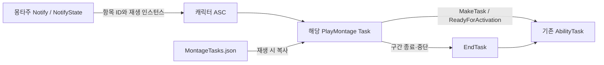

# 몽타주 Notify 전환 기술 설계

상태: 프로그래머 검토용 제안. 구조와 이관 절차를 제안하며, 엔진 경계 동작의 실행 검증은 아직 하지 않았습니다. 구현은 [AI 워크플로우](<../../Docs/AI 워크플로우.md>)의 설계 승인 이후 진행합니다.

## 1. 권장 구조와 정본

| 정보 | 정본 | 예 |
| - | - | - |
| 실행 시점·구간 | 몽타주 Notify 트랙 | 공격 0.27~0.30초, 무적 구간, 투사체 발사 시점 |
| 실행 항목과 기획 값 | `DesignData/MontageTasks.json` | Task 종류, 피해, 보상, 효과 ID, 속도, 투사체 ID, 전환 조건 |
| 어빌리티 발동 설정 | 기존 `Abilities.json` | 비용, 쿨다운, 태그, 발동 Task, 시작 몽타주·섹션 조건 |
| 게임 로직과 실행 상태 | 기존 C++ 어빌리티·Task | 판정, 효과 핸들, 중복 적중 기록, 정리 |
| 연출 | 기존 에셋·GameplayCue Notify | 무기 궤적, 공격 예고, 포스트프로세스 |

`AGENTS.md`의 JSON 단일 정본 규칙에 **몽타주 안의 실행 시각·구간은 몽타주 에셋을 정본으로 한다**는 예외를 추가하는 안입니다. 시각도 기획에 영향을 주는 값임을 인정하고, 데이터 분류만 바꿨다는 이유로 현행 정책과 같다고 취급하지 않습니다. 실제 규칙 수정은 설계 승인 후 이관 작업과 함께 합니다.

Notify는 항목 ID만 가지고 피해·효과·이동 값은 가지지 않습니다. ID로 가리키는 레코드를 실행하는 C++ 연결부입니다. 수치와 타이밍은 각각 한 곳만 편집합니다.

## 2. 데이터 스키마

`MontageTimelines.json`을 `MontageTasks.json`으로 교체합니다. 최상위 몽타주 경로는 유지하고, 섹션별 배열을 몽타주 내부에서 유일한 항목 ID의 맵으로 바꿉니다.

아래는 현재 기본 공격 1타 일부를 옮긴 형식 예입니다. 생략한 항목을 삭제한다는 뜻은 아닙니다.

```json
{
  "/Game/Animations/AM_Player_BasicAttack.AM_Player_BasicAttack": {
    "Attack1.Hit": {
      "Task": "WeaponHit",
      "HitReward": {"MP": 4},
      "Damage": {"HPMultiplier": 1, "PPMultiplier": 1, "HitReaction": "Flinch", "bGuardable": true}
    },
    "Attack1.Busy": {"Task": "ApplyEffect", "Effect": "Busy"},
    "Attack1.Combo": {"Task": "Transition", "Event": "Input.Attack", "Section": "Attack2", "BlendTime": 0.25}
  }
}
```

이 예에 대응하는 에셋 배치는 다음과 같습니다.

| 섹션 | 에셋에서 편집할 위치 | Notify | TaskId |
| - | - | - | - |
| Attack1 | 0.27~0.30초 | Task State | Attack1.Hit |
| Attack1 | 0~0.38초 | Task State | Attack1.Busy |
| Attack1 | 0.38초~섹션 끝 | Task State | Attack1.Combo |

표의 시각은 이관 설명이며 최종 데이터에 중복 저장하지 않습니다. Notify는 실제 몽타주 시간으로 배치합니다. `Start`, `End`, `EndSection`은 새 JSON과 `FAgTaskParams`에서 제거합니다. `Transition.Section`은 전환 목적지를 정하는 값이므로 JSON에 남깁니다.

- 항목 ID는 `FName`이며 GameplayTag가 아닙니다. `Attack1.Hit` 같은 이름에 섹션명을 써도 런타임은 이름을 파싱하지 않습니다.
- 한 몽타주 안에서 항목 ID는 하나의 Notify 배치에만 연결합니다. 다른 타격·다른 배치는 별도 ID를 부여합니다. 반복 재생은 같은 배치가 다시 실행되는 것입니다.
- 현재 118개 항목을 의미별 ID로 일대일 대응시킵니다. 이번 이관에서 공용 수치 테이블 추출이나 어빌리티별 오버라이드를 추가하지 않습니다.
- `FAgTaskParams::MakeTask`와 Task 이름에서 Params를 찾는 기존 방식은 유지합니다. `FAgTaskContext.Start/End`는 JSON에서 제거하는 시각 필드와 별개로, 에셋 구간을 런타임에 전달하기 위해 유지합니다.
- `UAgAssetManager`의 일괄 읽기·재로딩에 새 파일을 편입합니다. PlayMontage는 새 재생마다 해당 몽타주의 Task 맵을 복사합니다. 기존 효과·투사체·프리셋의 조회 시점은 유지합니다.
- 에셋 타이밍 편집은 PIE를 멈추고 적용합니다. 진행 중인 몽타주 에셋을 수정하면서 타이밍 스냅샷을 보장하는 기능은 만들지 않습니다.

## 3. C++ 클래스와 책임

| 클래스·구조체 | 변경 | 책임 |
| - | - | - |
| `UAgAnimNotify_Task` | 추가 | 단발 항목 ID를 전달. 실행 상태를 보관하지 않음 |
| `UAgAnimNotifyState_Task` | 추가 | 구간 시작·종료와 항목 ID를 전달. NotifyTick으로 게임 로직을 실행하지 않음 |
| `UAgMontageTaskData`, `FAgMontageTaskSet` | 기존 Timeline 데이터 대체 | 몽타주 → 항목 ID → `TInstancedStruct<FAgTaskParams>` |
| `FAgMontageTaskExecution` | 기존 TimelineEntry 대체 | 해당 재생의 활성 Task, Notify 실행 식별자, 소비·종료 상태 |
| `UAgAbilityTask_PlayMontage` | 축소·변경 | 재생·섹션 이동·재생별 데이터 사본·Notify와 Task의 수명 연결 |
| `UAgAbilitySystemComponent` | 작은 라우팅 기능 추가 | 해당 Mesh와 MontageInstanceID의 PlayMontage 찾기 |
| 기존 Task | 재사용 | 피해·효과·이동·전환·연출의 실제 처리와 종료 |



ASC가 보관하는 라우팅 목록은 약한 참조입니다. 몽타주 경로만으로 현재 어빌리티를 찾지 않습니다. 캐릭터의 다른 Mesh 또는 컷신의 Sequencer 몽타주가 게임플레이 Task를 실행하지 않도록 Mesh, 소스 몽타주, 인스턴스 ID를 모두 확인합니다. 등록되지 않은 에디터 미리 보기에서는 게임 로직을 실행하지 않습니다.

Notify 객체는 에셋에 소속되므로 Task 포인터, 대상, 효과 핸들, 적중 목록을 저장하지 않습니다. 이런 상태는 재생별 Task에 둡니다.

## 4. Notify 실행 방식

기본안은 **Queued Notify와 Queued NotifyState**입니다. 같은 시각에 여러 항목을 놓을 수 있고, 현재 데이터의 동시 시작을 임의로 밀지 않습니다. Notify의 확률은 1, LOD 필터는 없음으로 고정하고, 블렌드 중 구간을 누락하지 않도록 트리거 가중치와 Mesh 애니메이션 갱신 설정을 검증합니다. 정상 블렌드 아웃은 현재처럼 몽타주 종료까지 허용하고, 중단은 어빌리티가 즉시 정리합니다.

설치된 UE 5.8에는 다음 기능과 제약이 있습니다.

- Queued 콜백의 `FAnimNotifyEventReference`는 `FAnimNotifyMontageInstanceContext::MontageInstanceID`와 `GetNotifyInstanceID()`를 제공합니다.
- State에는 `EAnimNotifyStateBehaviorFlags::NoMergeOnConcurrentPlay`를 적용해 같은 몽타주의 겹친 재생을 분리합니다.
- Queued 전달은 단발 Notify, 이전 State의 End, 새 State의 Begin 순서로 처리하는 부분이 있으므로 모든 항목의 시각 순서를 보장한다고 가정하지 않습니다.
- `UAnimMontage::AddBranchingPointMarker`는 같은 트리거 시각의 Branching Point를 지원하지 않으며 일부 미호출을 경고합니다. 모든 게임플레이 Notify를 Branching Point로 만드는 안은 채택하지 않습니다.

동기 분기가 실제로 필요한 지점은 대표 동작 검증 후 Branching Point로 제한 전환할 수 있습니다. 그 경우 같은 시각의 다른 Branching Point와 충돌하지 않는지 검사하고, 여러 단발 작업을 반드시 함께 실행해야 하면 하나의 Notify에 ID 목록을 전달하는 확장안을 별도로 검토합니다. 시각에 작은 오프셋을 더해 경고를 숨기지 않습니다.

**Queued로 핵심 판정 구간을 충족할 수 있다는 것은 아직 실행으로 확인하지 않았습니다.** 0초 무적, 0.03초 타격, 같은 프레임의 구간 통과와 섹션 이동을 먼저 검증합니다. 실패하면 실행 방식과 어댑터 설계를 보완해 재검토하며, 이 단계가 통과하기 전에는 전체 이관이나 기존 판정기 삭제를 진행하지 않습니다.

## 5. 재생별 상태와 수명

PlayMontage의 단일 재생 안에서 `(Notify 배치, NotifyInstanceID)`로 구간 실행을 구분합니다. 재생 인스턴스 ID는 ASC 라우팅에서 먼저 확인합니다. 에디터 전용 Notify GUID를 패키지 런타임 식별자로 사용하지 않습니다.

1. 재생 성공 후 InstanceID, 데이터 사본, 콜백을 등록합니다.
2. 단발 Notify는 정의를 찾아 `MakeTask` 후 실행합니다. 동일 엔진 통지의 중복 전달은 한 번만 처리하며, 정상 반복에서 도달한 새 통지는 새 실행입니다.
3. State Begin은 Task를 만들고 보관한 뒤 활성화합니다. 활성화 중 취소·전환이 발생할 수 있으므로, 호출 뒤 같은 재생과 활성 어빌리티인지 확인합니다.
4. Task가 State보다 먼저 끝나도 그 State 실행은 소비된 상태로 남깁니다. 같은 구간 안에서 태그 변화나 추가 콜백 때문에 자동으로 다시 만들지 않습니다.
5. State End는 해당 실행의 Task만 종료합니다. 이미 끝난 Task의 End는 아무 효과가 없어야 합니다.
6. 중단·교체·완료 때는 새 통지를 받지 않도록 라우팅을 먼저 해제하고, 활성 Task 목록을 분리한 뒤 종료합니다. 종료 중 발생한 태그·이벤트가 이전 재생을 다시 전환하지 못하게 합니다.
7. 어빌리티 전체 종료는 GAS가 활성 Task를 정리하는 기존 경로를 사용합니다. PlayMontage의 개별 종료와 겹쳐도 두 번 정리하거나 새 재생을 멈추지 않아야 합니다.

효과와 워핑 목표 등의 수명은 기존 Task의 `OnDestroy`가 책임집니다. NotifyEnd만을 정리 경로로 사용하지 않습니다. Begin/End 순서가 뒤섞여도 이전 재생의 End가 새 재생의 무적을 지우지 않아야 합니다.

## 6. 시작·섹션·반복의 처리 계약

| 상황 | 요구 동작과 설계 방향 |
| - | - |
| 처음 재생, 0초 항목 | 엔진의 시작점 Notify 오프셋을 포함해 검증. 최초 판정 전에 필요한 효과가 적용되는지 확인 |
| 중간 섹션에서 시작 | 엔진이 도착점의 State를 시작하고, 그 전 단발 항목은 실행하지 않는지 확인 |
| 구간 안 → 같은 구간 안으로 이동 | Task와 적중 기록을 유지. State를 구간별로 잘라 재생성하지 않음 |
| 구간 밖으로 이동 | 해당 Task 종료. 점프로 건너뛴 중간 항목 실행 금지 |
| 반복 섹션 | 구간이 반복 영역 전체를 덮으면 하나의 실행을 유지. 기존처럼 반복 안에 단발·RootMotion 추적 항목을 새로 넣지 않음 |
| BlendTime 전환 | 새 재생으로 취급. 이전 수명 종료, 새 데이터 사본, 대상 갱신 |
| 같은 재생의 이동 뒤 대기 중인 Queued 통지 | 이전 위치에서 수집된 통지로 도착점의 작업을 잘못 실행하지 않도록 검증. InstanceID 검사만으로 해결됐다고 간주하지 않음 |

현재 `JumpToSection`·`ReplaySection`과 `Transition` Task의 이벤트·태그 구독을 재사용합니다. 여러 섹션에 걸친 State는 하나의 연속 구간으로 배치합니다. 엔진이 상태를 이어 주지 않는 사례가 발견되면 도착점에서 활성 상태를 한 번 맞추는 제한된 어댑터를 우선 검토합니다. 매 프레임 모든 Notify 구간을 읽어 기존 `EvaluateTimeline`을 다시 만드는 방식은 사용하지 않습니다.

0초 단발과 State의 초기화, 점프 직후 지연 콜백의 취소는 검증 전제입니다. 엔진 동작이 계약을 충족하지 못하면 어떤 콜백을 보완할지 설계에 추가한 뒤 이관합니다. 임의의 한 프레임 지연을 허용하거나 타이밍을 옮겨 통과시키지 않습니다.

## 7. 기존 Task의 이관 방식

| 기존 Task | Notify 형태 | 유지할 내용 |
| - | - | - |
| WeaponHit | State | 메시·물리 갱신 뒤 스윕, 한 구간의 적중·보상 기록 |
| ApplyEffect | 기본 State | 효과 핸들과 제거 규칙. 즉시 효과 또는 제거 책임이 독립적인 효과는 정의를 확인해 단발로 배치 가능 |
| RootMotion | State | 구간 시작 목표 고정, 엔진 Modifier, JSON의 추적 값 |
| Dash, Plunge, PlayCutscene | State | 스스로 먼저 끝날 수 있음. 구간 종료·취소 시 정리 |
| Transition | State | 구간 동안 이벤트·태그를 기다림. 기존 BlendTime·목적지·조건 유지 |
| SendGameplayEvent, SpawnProjectile, AreaHit, CameraShake | 단발 | 한 번 실행하고 종료하는 기존 Task |

무기 판정을 NotifyTick으로 옮기지 않습니다. 기존 `TG_PostPhysics`와 Mesh prerequisite를 유지합니다. 특히 시작·끝을 한 프레임 안에 모두 통과한 짧은 State가 스윕 전에 종료되거나 늦게까지 남는 경우는 대표 검증에서 다룹니다. 필요하면 WeaponHit 자체의 종료 처리에서 마지막 판정과 수명을 조정하며, 전체 타임라인 판정기를 되살리지 않습니다. 서브프레임 경계마다 정확한 뼈 자세를 계산하는 기능은 이번 범위가 아닙니다.

RootMotion은 현재도 엔진의 `AddRootMotionModifierSkewWarp`를 사용하는 지원 경로입니다. 우선 Notify가 기존 Task를 여닫고, 실제 에셋의 시작·끝 시각을 `FAgTaskContext`로 전달합니다. 엔진 Motion Warping Notify를 추가해 두 번 워핑하지 않습니다. Dash·Launch의 루트 모션 비활성화도 그 Task가 계속 소유합니다.

궁극기는 시간 정지 종료, 범위 피해, 셰이크, 슬로우모션의 실제 효과 순서를 별도 확인합니다. 현재 시간 서브시스템의 중첩 처리를 유지하며, Notify 트랙의 시각이나 배열 순서만으로 순서를 강제하지 않습니다.

## 8. 인터페이스 초안

최종 선언 순서는 해당 헤더에 맞춥니다. 아래는 책임을 보여 주는 제안 시그니처입니다.

```cpp
// UAgAnimNotify_Task
virtual void Notify(USkeletalMeshComponent* MeshComp, UAnimSequenceBase* Animation, const FAnimNotifyEventReference& EventReference) override;

// UAgAnimNotifyState_Task
virtual void NotifyBegin(USkeletalMeshComponent* MeshComp, UAnimSequenceBase* Animation, float TotalDuration, const FAnimNotifyEventReference& EventReference) override;
virtual void NotifyEnd(USkeletalMeshComponent* MeshComp, UAnimSequenceBase* Animation, const FAnimNotifyEventReference& EventReference) override;

// UAgAbilitySystemComponent
void RegisterMontagePlayback(int32 InstanceId, UAgAbilityTask_PlayMontage& Playback);
void UnregisterMontagePlayback(int32 InstanceId, const UAgAbilityTask_PlayMontage& Playback);
UAgAbilityTask_PlayMontage* FindMontagePlayback(int32 InstanceId) const;

// UAgAbilityTask_PlayMontage
void ExecuteNotifyTask(FName TaskId, const FAnimNotifyEventReference& EventReference);
void BeginNotifyTask(FName TaskId, const FAnimNotifyEventReference& EventReference);
void EndNotifyTask(FName TaskId, const FAnimNotifyEventReference& EventReference);
void EndNotifyTasks();
```

Task를 생성할 때 Notify의 에셋 시각을 읽어 `Context.Start/End`로 전달합니다. 원본 엔진 구조체 포인터를 장기간 보관하지 않고, 필요한 ID와 값을 복사합니다. JSON 사본과 활성 Task의 강한 참조는 UPROPERTY로 관리합니다.

## 9. 검증과 이관

작업은 **연결부 구현 → 대표 동작 검증 → 전체 이관 → 판정기 삭제** 순서입니다. 대표 검증의 실패는 전체 이관을 막는 조건입니다.

현재 정본의 JSON 문법·타입·정의 ID 검사는 `ReadJson`에 유지합니다. 별도로 에디터/쿡에서 몽타주와 Task 맵 사이의 연결만 검사하는 작은 검증 함수를 추가합니다. 이는 범용 검증 프레임워크나 저장소 내 자동화 테스트가 아닙니다.

검사 대상은 없는 TaskId, 중복 배치, 미사용 정의, 단발/구간의 잘못된 배치, 게임플레이 Notify의 잘못된 소스·필터 설정입니다. Branching Point를 도입한 몽타주에는 트리거 시각 충돌 검사를 추가합니다. 재로딩 시 참조 오류는 기존 데이터 묶음을 유지하고, 쿡 시 오류는 패키징을 실패시킵니다. 에셋 저장 검증과 PIE 시작 전 검증도 같은 함수를 사용합니다. 이 교차 검사는 현행 검증 범위에 추가되는 변경입니다.

대표 동작은 기본 공격 1타·회피·보스 돌진·점프 공격·궁극기입니다. 0초 효과, 가장 짧은 타격, 같은 시각의 복수 항목, 섹션 간 상태 유지, 컷신이 끼는 재생을 포함합니다. 실패하면 엔진 호출 순서와 효과 핸들·Task 수명을 기록해 이 문서의 실행 방식을 보완합니다.

전체 이관은 이전 항목마다 새 TaskId, 에셋 구간, Params 동등성을 대조합니다. 임시 변환 도구와 대조 자료는 저장소 밖 임시 위치에 두고 작업 후 정리합니다. 마이그레이션 중에도 한 몽타주를 JSON 타임라인과 Notify로 동시에 구동하지 않습니다. 개발용 혼합 경로가 필요하면 몽타주 단위로 배타적으로 선택하고 최종 변경에서 제거합니다.

최종적으로 `UAgMontageTimelineData`, `FAgMontageTimeline`, `FAgTimelineSection`, `FAgTimelineEntry`, `Begin/Evaluate/EndTimeline`, 타임라인 판정용 `TickTask`, JSON 시간 필드와 이전 파일 로딩을 제거합니다. PlayMontage의 블렌드 지정·섹션 전환 기능은 계속 필요하므로 무조건 엔진 `PlayMontageAndWait`로 대체하지 않습니다.

## 10. 정본 반영과 검토할 결정

승인할 구조 결정은 (1) 타이밍의 에셋 정본 예외, (2) 몽타주별 ID 기반 Task JSON, (3) 기존 Task·동적 Motion Warping 유지, (4) 대표 검증을 통과한 뒤 전체 이관하는 절차입니다. Queued 기본안의 경계 동작은 구현 초기에 증명할 항목이며, 아직 보장된 결과가 아닙니다.

구현과 검증을 마치고 사람이 결과를 확인하면 `AGENTS.md`, 기본 방침, 몽타주 타임라인 문서, 데이터 로딩·스키마, 캐릭터 기반 구조와 GAS의 관련 절과 클래스 구조를 갱신합니다. 이관 전까지 `Docs/Architecture`는 현재 빌드의 설명을 유지합니다.

진행 중인 강인도 작업에서 바뀌는 어빌리티·효과·캐릭터 데이터는 이관 직전에 다시 읽습니다. 다른 작업의 수정이나 새 필드를 이전 스냅샷으로 덮어쓰지 않습니다.

## 11. 근거

- [Epic Animation Notifies](https://dev.epicgames.com/documentation/unreal-engine/animation-notifies-in-unreal-engine): Queued/Branching Point, State, 가중치·필터, 세그먼트 연결 방식.
- [Epic Motion Warping](https://dev.epicgames.com/documentation/en-us/unreal-engine/motion-warping-in-unreal-engine): Notify와 동적 Root Motion Modifier 등록 경로.
- 설치된 UE 5.8 `AnimMontage.cpp`: `AddBranchingPointMarker`, `HandleEvents`, `UpdateActiveStateBranchingPoints`.
- 설치된 UE 5.8 `AnimInstance.cpp`: `TriggerAnimNotifies`; `AnimNotifyQueue.h`와 `AnimNotifyState.h`: 실행 ID 및 `NoMergeOnConcurrentPlay`.
- 프로젝트 `AgAbilityTask_PlayMontage.cpp`, `AgAbilityTask_WeaponHit.cpp`, `AgAbilityTask_RootMotion.cpp`, `AgAbilityTask_Transition.cpp`: 이관할 실행 경로와 수명.
