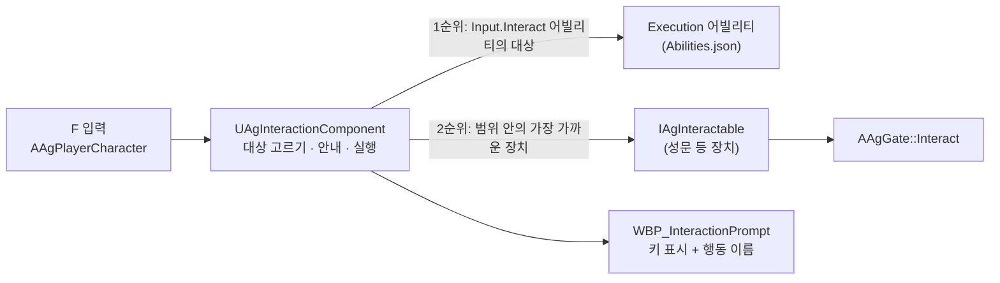

# 상호작용 기술 설계 (Plan)

## 1. 영향 범위 및 아키텍처

### 구조

F 입력, 대상 고르기, 안내를 플레이어의 컴포넌트 하나가 맡습니다. 대상이 되는 쪽은 "무엇이 일어나는가"만 맡습니다.



- **고르는 함수는 하나입니다.** 안내를 그릴 때와 F를 눌렀을 때 같은 함수(`FindInteraction`)로 대상을 고르므로, 안내가 가리키는 대상과 F가 닿는 대상이 어긋나지 않습니다. 고른 결과는 저장하지 않고 그때마다 다시 구합니다.
- **액션으로 하는 상호작용은 어빌리티입니다.** `InputTag`가 `Input.Interact`인 플레이어 어빌리티(지금은 `Execution`)마다 그 어빌리티의 `Targeting`으로 대상을 찾습니다. 처형의 범위·조건·락온 우선은 지금처럼 `Abilities.json`의 `Execution` 항목 한 곳에만 있고, 행동 이름은 그 항목의 `DisplayName`입니다. F로 하는 액션을 더할 때는 어빌리티 항목만 더합니다.
- **장치에 하는 상호작용은 인터페이스입니다.** 장치 액터가 `IAgInteractable`을 구현해 행동 이름, 안내 지점, 상호작용했을 때 할 일을 답합니다. 행동 이름은 물을 때마다 장치가 지금 상태로 답하므로, 상태에 따라 글자와 기능이 바뀌는 장치(문 열기 ↔ 문 닫기)도 같은 함수 안에서 처리합니다. 문, 아이템, 레버를 더할 때는 인터페이스를 구현한 액터를 더하면 되고, 플레이어 쪽 코드는 고치지 않습니다.
- **상호작용 범위는 장치의 도형 컴포넌트입니다.** 장치가 가진 도형(상자 등)에 충돌 프로파일 `AgInteractionRange`를 주면 그 도형이 범위가 됩니다. 에디터에서 크기가 보이고, 쓸 수 없는 동안에는 장치가 이 도형의 충돌을 끕니다.
- **안내 위젯은 하나입니다.** 적마다 붙어 있던 처형 안내 위젯을 없애고, 플레이어의 상호작용 컴포넌트(화면 공간 위젯 컴포넌트)가 고른 대상의 안내 지점으로 옮겨 다닙니다.

### 수정·추가할 클래스

| 클래스 | 위치 | 변경 |
| - | - | - |
| `UAgInteractionComponent` (신규) | `Interaction/` | `UWidgetComponent` 상속. 플레이어 캐릭터의 기본 서브오브젝트. 대상 고르기(`FindInteraction`), F 실행(`Interact`), 매 틱 안내 갱신(위치·행동 이름·표시 여부). |
| `IAgInteractable` (신규) | `Interaction/` | F로 쓸 수 있는 장치가 구현하는 인터페이스. 행동 이름(`GetInteractionText`), 안내 지점(`GetInteractionLocation`), 실행(`Interact`). |
| `AAgGate` (신규) | `Interaction/` | 성문. `IAgInteractable` 구현. 보이는 문(`Door`, 충돌 없음), 다 열릴 때까지 막는 상자(`Blocker`), 상호작용 범위 상자(`InteractionRange`), 문을 올리는 엔진 `UInterpToMovementComponent`. |
| `UAgInteractionPrompt` (신규) | `UI/` | `UCommonUserWidget` 상속, `DisableNativeTick`. 행동 이름 글자(`ActionText`)를 바꾸는 함수 하나. |
| `AAgPlayerCharacter` | `Character/` | `Interaction` 컴포넌트 추가. `ExecuteAction` → `InteractAction`. `RunInput`이 `Input.Interact`를 컴포넌트의 `Interact`로 넘깁니다(점프와 같은 자리). 선입력 제외 목록의 태그 교체. |
| `AAgEnemyCharacter` | `Character/` | `ExecutionPrompt` 컴포넌트, `IsExecutionTargetOf`, `UpdateWorldWidgets`의 처형 안내 줄을 삭제합니다. |
| `FAgAbilityData` | `Data/` | `DisplayName`(`FText`) 추가. |
| `AgGameplayTags` | `Core/` | `Input_Execute`(`Input.Execute`) → `Input_Interact`(`Input.Interact`). |
| `AgCollision.h` | `Core/` | `ECC_AgInteraction = ECC_GameTraceChannel2`와 프로파일 이름 `AgInteractionRange`. |

### 동작

- **대상 고르기(`FindInteraction`)**
  1. `AAgPlayerCharacter::FindInputAbilities(Input.Interact)`의 어빌리티마다 `Targeting`이 있으면 `AgTargeting::FindTarget`으로 대상을 찾습니다. 찾으면 그 대상과 어빌리티의 `DisplayName`, 스펙 핸들이 결과입니다. 같은 키의 어빌리티는 발동 조건이 서로 배타적이어야 한다는 기존 규약을 그대로 따릅니다.
  2. 없으면 플레이어 캡슐 중심에서 `ECC_AgInteraction` 채널로 점 겹침 검사를 해, 겹친 도형의 주인 가운데 `IAgInteractable`을 구현한 액터를 모으고 안내 지점이 가장 가까운 것을 고릅니다.
- **실행(`Interact`)**: 고른 결과가 어빌리티면 `TryActivateAbility`, 장치면 `IAgInteractable::Interact`를 부릅니다. 입력할 수 있는 상태인지는 지금처럼 입력 계층의 `IsActionInputBlocked`가 먼저 걸러, 종류와 관계없이 같은 규칙을 씁니다.
- **안내 갱신**: 매 틱 고른 대상의 안내 지점으로 컴포넌트를 옮기고(절대 위치) 행동 이름을 넣습니다. 안내 지점은 어빌리티 대상이면 엔진 `AActor::GetTargetLocation`(적은 락온 지점), 장치면 `GetInteractionLocation`입니다. 대상이 없거나 숨기는 상황(플레이어 사망, `State.Cutscene`, 스테이지 결과가 정해짐)이면 숨깁니다. 틱 그룹은 엔진 기본값을 그대로 씁니다. 뼈를 따라가는 대상(적의 락온 지점)은 안내가 한 프레임 늦게 따라올 수 있으므로 검증 때 공중에 뜬 그로기 대상으로 확인하고, 떨림이 보이면 틱 그룹을 바꾸지 않고 안내를 대상의 안내 지점 컴포넌트에 붙이는 방식으로 고칩니다.
- **성문**: `Interact`가 불리면 상호작용 범위의 충돌을 끄고(후보에서 빠짐) 이동 컴포넌트를 켭니다. 이동이 끝나면(`OnInterpToStop`) `Blocker`의 충돌을 끕니다. `Blocker`는 `BlockAll` 프로파일(WorldStatic)이라 이동, AI 시야, 탄환·시선 검사(모두 WorldStatic 또는 Visibility)를 막습니다. 내비게이션에는 영향을 주지 않게 해, 열린 뒤 길찾기가 통로로 이어집니다.

### 고른 까닭과 고르지 않은 안

| 결정 | 까닭 |
| - | - |
| 매 틱 다시 고름 (이벤트로 후보 목록을 관리하지 않음) | 위젯 컴포넌트는 화면 배치 때문에 이미 매 틱 돕니다. 현재 상태를 보는 함수 하나라 디버깅이 쉽고, 놓친 이벤트로 안내가 남거나 빠지는 일이 없습니다. 장치의 행동 이름이 바뀌어도 따로 알릴 필요가 없습니다. 비용은 프레임마다 처형 어빌리티의 대상 찾기 1회와 점 겹침 1회입니다. 지금은 그로기인 적마다 프레임당 대상 찾기 1회를 돌립니다. |
| 장치의 기능을 델리게이트가 아니라 인터페이스로 | 누가 상호작용 대상인지 클래스 선언에서 보이고, 호출이 장치의 함수로 바로 이어집니다. 행동 이름을 장치가 물을 때마다 답하므로 상태에 따라 바뀌는 글자를 밖에서 넣어 줄 필요가 없습니다. |
| 처형은 적이 인터페이스를 구현하지 않고 어빌리티의 대상으로 | 처형의 기능은 플레이어의 어빌리티이고 범위 3m·그로기 조건·락온 우선이 `Abilities.json` 한 곳에 있습니다. 적이 인터페이스를 구현하면 그 함수는 플레이어의 어빌리티를 대신 발동시키는 중계가 되고, 적을 후보로 찾으려면 처형 범위를 적 쪽 도형으로 한 번 더 정해야 합니다. |
| 상호작용 범위를 전용 컴포넌트 클래스가 아니라 충돌 프로파일로 | 충돌 설정을 여러 도형이 함께 쓰는 엔진의 방식입니다. 상자든 구든 프로파일만 주면 범위가 됩니다. |
| 성문의 열리는 시간·높이를 JSON이 아니라 `BP_Gate` 기본값(엔진 이동 컴포넌트의 `Duration`, `ControlPoints`)에 | 레벨에 놓는 장치의 값이고 엔진 컴포넌트의 설정입니다. 상호작용 범위도 상자 크기로 에디터에서 봅니다. 행동 이름 '성문 열기'도 `BP_Gate` 기본값에 둡니다. |
| Lyra의 상호작용 구조(옵션 목록, 어빌리티 부여, 인디케이터 매니저)를 옮기지 않음 | [기본 방침](<../../Docs/Architecture/기본 방침.md>) '구조 선택'. 대상이 인터페이스를 구현하고 전용 채널의 겹침 검사로 찾는 방식만 참고했습니다. |

### 공통 규칙 준수

- 어빌리티 클래스와 Task를 더하지 않습니다. 처형은 기존 `Execution` 항목 그대로입니다.
- 게임 로직은 모두 C++입니다. `BP_Gate`와 `WBP_InteractionPrompt`에는 그래프가 없고, 인터페이스는 블루프린트에서 구현할 수 없게 선언합니다.
- 위젯 갱신: 안내 위젯은 Tick하지 않고(`DisableNativeTick`), 글자는 컴포넌트가 넣습니다.
- 4단계에서 [캐릭터 기반 구조와 GAS](<../../Docs/Architecture/캐릭터 기반 구조와 GAS.md>)의 '입력' 결정과 '클래스 구조'(표, 그림), [데이터 로딩과 스키마](<../../Docs/Architecture/데이터 로딩과 스키마.md>)의 어빌리티 항목(`DisplayName`)을 고칩니다.

## 2. GAS 및 데이터 설계

| 대상 | 변경 |
| - | - |
| `AgGameplayTags` | `Input.Execute` 삭제, `Input.Interact`("상호작용 키") 추가. 새 태그는 이것뿐입니다. |
| `DesignData/Abilities.json` `Execution` | `"InputTag": "Input.Interact"`, `"DisplayName": "처형"` 추가. 나머지는 그대로입니다. |
| `Config/DefaultEngine.ini` | 트레이스 채널 `AgInteraction`(`ECC_GameTraceChannel2`, 기본 응답 Ignore)과 충돌 프로파일 `AgInteractionRange`(쿼리 전용, 모든 채널 무시, `AgInteraction`만 겹침) 추가. |
| `Content/Input/IA_Execute` | `IA_Interact`로 이름 변경. `IMC_Default`의 F 매핑과 `BP_Player`의 `InteractAction`에 연결. |
| `Content/UI/WBP_ExecutionPrompt` | `WBP_InteractionPrompt`로 이름 변경, 부모를 `UAgInteractionPrompt`로. 키 표시(원 + F) + 행동 이름(`ActionText`). |
| `BP_Player` | `Interaction` 컴포넌트의 위젯 클래스 = `WBP_InteractionPrompt`. |
| `Content/Interaction/BP_Gate` (신규) | `AAgGate` 상속. 문 메시(대역 상자), 막는 상자와 상호작용 범위 상자의 크기(성문 폭 × 앞뒤 1m), 안내 지점 높이 2m, 행동 이름 '성문 열기', 이동 2초·문 높이만큼 위로. |
| `LV_FortressBreach` | 문틀 사이에 `BP_Gate` 배치. 기획자가 합니다. `BP_Gate`의 기본 크기는 이 문틀(폭 5m × 높이 5m)에 맞췄고, 자리는 문틀 가운데의 바닥(성문 단 윗면)입니다. |
| `Scripts/ScenarioTest/runner.py` | `KEYS`의 `Input.Execute` → `Input.Interact`. |

## 3. 인터페이스 & 함수 시그니처

```cpp
// Interaction/AgInteractable.h
UINTERFACE(meta = (CannotImplementInterfaceInBlueprint))
class UAgInteractable : public UInterface
{
};

/** F로 쓸 수 있는 장치(문, 아이템, 레버)가 구현합니다. 상호작용 범위는 장치가 가진 AgInteractionRange 프로파일의 도형입니다. */
class IAgInteractable
{
public:
	/** 지금 상호작용하면 할 행동의 이름입니다. 장치의 상태에 따라 달라질 수 있습니다. */
	virtual FText GetInteractionText() const = 0;

	/** 안내를 띄울 지점입니다. */
	virtual FVector GetInteractionLocation() const = 0;

	virtual void Interact(AAgPlayerCharacter& Player) = 0;
};

// Interaction/AgInteractionComponent.h
/** 플레이어가 지금 F로 쓸 대상을 고르고, 그 대상의 안내 지점에 상호작용 안내를 띄웁니다. */
UCLASS()
class UAgInteractionComponent : public UWidgetComponent
{
public:
	UAgInteractionComponent();

	/** 지금 고른 대상에 상호작용합니다. 대상이 없으면 아무 일도 하지 않습니다. */
	void Interact();

	virtual void TickComponent(float DeltaTime, ELevelTick TickType, FActorComponentTickFunction* ThisTickFunction) override;

private:
	/** 안내와 입력이 같은 대상을 보도록 둘 다 이 함수로 고릅니다. 어빌리티의 대상이 장치보다 우선합니다. */
	FAgInteraction FindInteraction() const;
};

/** 지금 F를 누르면 일어날 일입니다. Ability가 유효하면 그 어빌리티를 발동하고, 아니면 Device에 상호작용합니다. 고른 함수 안에서만 씁니다. */
struct FAgInteraction
{
	FGameplayAbilitySpecHandle Ability;
	IAgInteractable* Device = nullptr;
	FVector PromptLocation = FVector::ZeroVector;
	FText Text;

	bool IsValid() const;
};

// Interaction/AgGate.h
UCLASS(Abstract)
class AAgGate : public AActor, public IAgInteractable
{
public:
	AAgGate();

	virtual FText GetInteractionText() const override;
	virtual FVector GetInteractionLocation() const override;
	virtual void Interact(AAgPlayerCharacter& Player) override;

private:
	UFUNCTION()
	void HandleOpened(const FHitResult& ImpactResult, float Time);

	UPROPERTY(VisibleAnywhere, Category = "Gate")
	TObjectPtr<UStaticMeshComponent> Door;

	UPROPERTY(VisibleAnywhere, Category = "Gate")
	TObjectPtr<UBoxComponent> Blocker;

	UPROPERTY(VisibleAnywhere, Category = "Gate")
	TObjectPtr<UBoxComponent> InteractionRange;

	/** 이 컴포넌트의 위치가 안내 지점입니다. */
	UPROPERTY(VisibleAnywhere, Category = "Gate")
	TObjectPtr<USceneComponent> PromptPoint;

	UPROPERTY(VisibleAnywhere, Category = "Gate")
	TObjectPtr<UInterpToMovementComponent> OpenMovement;

	UPROPERTY(EditAnywhere, Category = "Gate")
	FText InteractionText;
};

// UI/AgInteractionPrompt.h
UCLASS(Abstract, meta = (DisableNativeTick))
class UAgInteractionPrompt : public UCommonUserWidget
{
public:
	void SetAction(const FText& Text);

protected:
	UPROPERTY(meta = (BindWidget))
	TObjectPtr<UTextBlock> ActionText;
};

// Character/AgPlayerCharacter.h (추가·변경)
UPROPERTY(VisibleAnywhere, Category = "Interaction")
TObjectPtr<UAgInteractionComponent> Interaction;

UPROPERTY(EditDefaultsOnly, Category = "Input")
TObjectPtr<UInputAction> InteractAction;

// Data/AgAbilityData.h (추가)
/** 플레이어에게 보이는 이름입니다. 상호작용 안내의 행동 이름으로 씁니다. */
UPROPERTY()
FText DisplayName;
```
