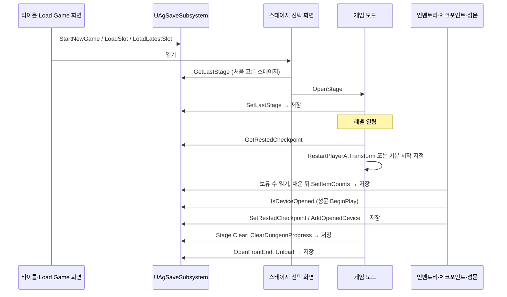

# 세이브&로드 기술 설계 (Plan)

## 1. 영향 범위 및 아키텍처

### 설계 결정

| 항목 | 결정 | 이유 |
| - | - | - |
| 저장 형식 | 엔진 `USaveGame`과 `UGameplayStatics`의 슬롯 함수(`SaveGameToSlot`, `LoadGameFromSlot`, `DoesSaveGameExist`, `DeleteGameInSlot`)를 씁니다. 슬롯 이름은 `Slot1` ~ `Slot6`입니다. | 엔진이 파일 위치(`Saved/SaveGames/<슬롯 이름>.sav`), 머리말, 직렬화를 맡습니다. Spec '2.9'의 경로와 같습니다. |
| 저장의 주인 | `UAgSaveSubsystem`(`UGameInstanceSubsystem`)이 지금 진행(`UAgSaveGame`)과 슬롯 번호를 들고, 읽기·쓰기·지우기를 모두 맡습니다. | 레벨을 다시 열어도 남아야 하는 상태입니다. 전투 통계·언어와 같은 자리입니다. |
| 슬롯 없는 진행 | 서브시스템은 언제나 지금 진행을 하나 들고 있습니다. 슬롯을 불러오지 않았으면 시작 보유 수로 만든 진행이고, 파일로 쓰지 않습니다. | 에디터에서 스테이지를 바로 플레이할 때(Spec '2.8')와 시나리오 테스트가 같은 코드 길로 돌고, 쓰는 쪽에 "슬롯이 있는가" 분기가 없습니다. |
| 저장 시점 | 서브시스템의 바꾸는 함수가 값을 바꾼 직후 동기로 파일을 씁니다. 모아 쓰기나 비동기는 하지 않습니다. | 저장 내용이 1KB 안팎이고 저장하는 순간이 드뭅니다. 쓰기를 미루면 레벨 이동·종료 때 밀어내는 처리가 따로 필요합니다. |
| 상태를 알리는 방향 | 상태의 주인(인벤토리, 체크포인트, 성문, 게임 모드)이 자기 값이 바뀔 때 서브시스템의 함수를 직접 부릅니다. 서브시스템은 게임 객체를 찾거나 구독하지 않습니다. | 호출이 한 방향이라 저장되는 순간을 호출 자리에서 바로 찾을 수 있습니다. |
| 체크포인트·성문의 식별 | 레벨에 놓인 액터의 이름(`GetFName`)으로 저장합니다. 던전의 키는 레벨 패키지 이름(PIE 접두사를 뗀 것, 스테이지 목록의 `FAgStage::Map`과 같은 값)입니다. | 놓인 액터의 이름은 레벨 파일에 저장되어 실행마다 같습니다. 사람이 ID를 적지 않아 겹치거나 빠뜨릴 일이 없습니다. 액터를 지우고 다시 놓으면 이름이 바뀌며, 이때는 Spec '2.8'대로 시작 지점에서 시작합니다. |
| 체크포인트에서 시작 | `AAgGameMode`가 엔진 `RestartPlayer`를 재정의해, 휴식한 체크포인트가 레벨에 있으면 엔진 `RestartPlayerAtTransform`으로 그 체크포인트의 시작 지점에 스폰합니다. 시작 지점은 체크포인트의 컴포넌트 `StartPoint`(기본 위치: 정면 150cm, 체크포인트를 바라봄)이고 발밑 기준이라, 플레이어 캡슐의 반높이만큼 올려 스폰합니다. | 엔진의 플레이어 스폰 경로를 그대로 씁니다. 정면 1.5m가 에디터에서 보이고, 지형에 맞춰 BP나 레벨에서 옮길 수 있습니다. 발밑 기준은 적 스포너와 같습니다. |
| 사망 뒤 다시 시작 | 전투 결과 화면(`UAgBattleResultScreen`)을 그대로 쓰되, 게임 모드가 Game Over에서 자동으로 다시 시작한다고 답하면(`ShouldRestartOnGameOver`, 기본 true, 시뮬레이션 룸은 false) 버튼을 숨기고, 기존 페이드(`FadeInAnimation`, 0.5초)가 끝나면 모습을 바꾸지 않는 위젯 애니메이션(`RestartDelayAnimation`, 1.5초)을 이어 재생한 뒤 끝나면 `RestartStage`를 부릅니다. | 문구의 모양·자리·페이드가 Game Over UI와 같아야 하므로 같은 위젯을 쓰고, 버튼은 접지 않고 숨겨 문구의 자리를 지킵니다. 유지 시간을 위젯 애니메이션에 두면 페이드와 시간 기준이 같고(실제 시간) 타이머가 없습니다. 메뉴 입력 모드라 조작과 Esc가 들어가지 않습니다. |
| 던전 다시 시작 | 사망과 일시정지 메뉴의 Restart 모두 지금의 `RestartStage`(레벨 다시 열기)입니다. 다시 열린 레벨이 위의 '체크포인트에서 시작'을 따릅니다. | 다시 시작하는 길이 하나입니다. 적·플레이어 상태는 레벨을 다시 여는 것으로 처음 상태가 됩니다. |
| 연 성문 되살리기 | 성문이 `BeginPlay`에서 자기 이름이 저장에 있으면 범위의 충돌을 끄고 문을 이동 경로의 끝 자리에 둡니다. | 열린 모습을 만드는 법은 성문만 압니다. |
| 인벤토리 | `UAgInventoryComponent`가 만들어질 때 지금 진행의 보유 수를 읽고(없는 아이템은 버리고 최대 보유 수로 자름), 휴식으로 채우는 아이템을 채운 뒤, 보유 수가 바뀔 때마다 서브시스템에 넘깁니다. 채우는 함수(`Refill`)는 인벤토리에 두고 휴식도 이것을 부릅니다. | 보유 수의 주인은 그대로 인벤토리입니다. 휴식과 레벨 시작의 채우기가 한 함수입니다. |
| 슬롯을 내려놓는 순간 | 스테이지 선택 화면을 Back·Esc로 닫을 때와 `AAgGameMode::OpenFrontEnd`에서 `Unload`를 부릅니다. 게임이 꺼질 때는 서브시스템의 `Deinitialize`가 저장합니다. | 슬롯을 들고 있는 구간이 "스테이지 선택 화면부터 타이틀로 나갈 때까지"로 호출 자리에 드러납니다. `Deinitialize`는 Quit 버튼과 창 닫기를 함께 받습니다. |
| 확인 창과 UI 레이어 | UI 레이아웃에 Menu 위의 `Modal` 레이어(스택)를 더하고, 삭제 확인 창(`UAgConfirmDialog`)을 거기에 엽니다. | CommonUI 스택은 맨 위 화면만 보여 주므로, 같은 Menu 스택에 올리면 뒤의 Load Game 화면이 사라집니다. |
| 슬롯 줄 | 줄 위젯(`UAgSaveSlotRow`) 6개를 Load Game 화면이 코드로 만들어 세로 상자에 넣습니다. 줄 안의 불러오기 버튼은 `UAgButton`을 상속한 `UAgSaveSlotButton`이고, 빈 슬롯과 읽을 수 없는 저장은 버튼 대신 글자만 있는 표시를 켭니다. | 슬롯 수가 서브시스템의 상수 하나에서 나옵니다. 선택·마우스 올림·효과음은 기존 버튼의 것을 그대로 받습니다. |
| 버튼 글자 | 영어로 고정한 글자(Continue, New Game, Load Game, Delete, Yes, No, Back, Empty, Corrupted, 'Slot {0}')는 기존 메뉴 버튼처럼 WBP의 글자 속성에 둡니다. 삭제 확인 문구만 문구 표에 `Menu.DeleteSave`로 더합니다. | 현지화가 필요한 문구만 문구 표에 둡니다(AGENTS 2번). |

### 흐름



### 추가하는 클래스

| 클래스 | 부모 | 역할 |
| - | - | - |
| `UAgSaveGame` | `USaveGame` | 슬롯 하나의 저장 내용 |
| `UAgSaveSubsystem` | `UGameInstanceSubsystem` | 지금 진행과 슬롯, 슬롯 정보 읽기, 새 게임·불러오기·지우기·내려놓기, 바꾸는 함수와 파일 쓰기 |
| `UAgLoadGameScreen` | `UAgMenuScreen` | Load Game 화면. 켜질 때마다 슬롯 줄을 다시 채우고, 불러오기·삭제 확인·Back을 처리 |
| `UAgSaveSlotRow` | `UCommonUserWidget` | 슬롯 줄 하나(불러오기 버튼 또는 글자 표시, Delete 버튼) |
| `UAgSaveSlotButton` | `UAgButton` | 슬롯 이름, 마지막 스테이지, 플레이 시간, 저장한 시각을 적는 불러오기 버튼 |
| `UAgConfirmDialog` | `UAgMenuScreen` | 문구와 Yes·No. Yes면 받은 델리게이트를 부르고 닫음. Esc는 No |

### 고치는 클래스

| 클래스 | 바뀌는 것 |
| - | - |
| `AAgGameMode` | `RestartPlayer` 재정의(체크포인트에서 시작), `OpenStage`에서 마지막 스테이지 저장, `OpenFrontEnd`에서 `Unload`, Stage Clear가 정해질 때 던전 진행 지우기, `ShouldRestartOnGameOver` |
| `AAgSimulationRoomGameMode` | `ShouldRestartOnGameOver`를 false로 재정의 |
| `AAgCheckpoint` | `StartPoint` 컴포넌트와 `GetStartTransform`, 휴식할 때 `SetRestedCheckpoint` |
| `AAgGate` | 열 때 `AddOpenedDevice`, `BeginPlay`에서 열린 상태 되살리기 |
| `UAgInventoryComponent` | 시작 값을 지금 진행에서 읽기, `Refill`, 바뀔 때 `SetItemCounts` |
| `AAgPlayerCharacter` | `Rest`의 채우기 반복문을 `Refill` 호출로 |
| `UAgTitleScreen` | Play 대신 Continue·New Game·Load Game, 켜질 때마다 슬롯 상태로 버튼 표시 정하기, 첫 포커스는 표시된 맨 위 버튼 |
| `UAgStageSelectScreen` | 처음 고른 스테이지를 마지막 스테이지로, Back·Esc에서 `Unload` |
| `UAgBattleResultScreen` | 자동 다시 시작 모드(버튼 접기, `RestartAnimation`, 끝나면 `RestartStage`) |
| `UAgUILayout`, `EAgUILayer` | `Modal` 레이어 |

### 에셋

| 에셋 | 작업 |
| - | - |
| `WBP_Title` | 버튼을 Continue, New Game, Load Game, Settings, Quit로. `LoadGameScreenClass` 기본값 |
| `WBP_LoadGame` (새로) | 메뉴 화면 양식, 제목, 슬롯 줄을 담는 세로 상자, Back 버튼 |
| `WBP_SaveSlotRow`, `WBP_SaveSlotButton` (새로) | 슬롯 줄과 불러오기 버튼 |
| `WBP_ConfirmDialog` (새로) | 화면을 덮는 어두운 바탕, 창, 문구, Yes·No |
| `WBP_UILayout` | `ModalStack` |
| `WBP_BattleResult` | `RestartDelayAnimation`(1.5초, 불투명도 1 → 1) |
| `BP_Checkpoint` | `StartPoint`가 메시 정면 빈 바닥에 오는지 확인 |
| `StringTable.csv` | `Menu.DeleteSave` |

### 공통 규칙 준수

- 게임 로직은 모두 C++이고 BP 그래프를 쓰지 않습니다. 화면 클래스에는 `meta = (DisableNativeTick)`을 붙입니다.
- 객체 수명: 지금 진행은 서브시스템의 `UPROPERTY`가 듭니다.
- 엔진 우선: 저장은 `USaveGame`, 스폰은 `RestartPlayerAtTransform`, 화면은 CommonUI 스택과 뒤로 처리(`bIsBackHandler`)를 씁니다.
- JSON 스키마, GameplayTag, GameplayAbility·Effect는 바뀌지 않습니다.

## 2. GAS 및 데이터 설계

GAS 변경은 없습니다. 저장 내용은 아래와 같습니다.

```cpp
USTRUCT()
struct FAgDungeonProgress
{
	GENERATED_BODY()

	/** 마지막으로 휴식한 체크포인트 액터의 이름입니다. */
	UPROPERTY()
	FName Checkpoint;

	/** 연 장치(성문) 액터의 이름입니다. */
	UPROPERTY()
	TSet<FName> OpenedDevices;
};

UCLASS()
class UAgSaveGame : public USaveGame
{
	GENERATED_BODY()

public:
	UPROPERTY()
	TMap<FName, int32> ItemCounts;

	/** 키는 던전 레벨의 패키지 이름입니다. */
	UPROPERTY()
	TMap<FName, FAgDungeonProgress> Dungeons;

	UPROPERTY()
	FName LastStage;

	/** 초 단위입니다. */
	UPROPERTY()
	double PlayTime = 0.0;

	UPROPERTY()
	FDateTime SavedAt;
};
```

- `DesignData` JSON은 바뀌지 않습니다. 시작 보유 수와 채우기는 지금의 `Items.json`(`StartCount`, `MaxCount`, `bRefill`)을 그대로 읽습니다.

## 3. 인터페이스 & 함수 시그니처

```cpp
enum class EAgSaveSlotState : uint8
{
	Empty,
	Saved,
	Corrupted
};

struct FAgSaveSlotInfo
{
	EAgSaveSlotState State = EAgSaveSlotState::Empty;
	FName LastStage;
	double PlayTime = 0.0;
	FDateTime SavedAt;
};

UCLASS()
class UAgSaveSubsystem : public UGameInstanceSubsystem
{
	GENERATED_BODY()

public:
	static constexpr int32 SlotCount = 6;

	static UAgSaveSubsystem& Get(const UObject* WorldContextObject);

	virtual void Initialize(FSubsystemCollectionBase& Collection) override;
	virtual void Deinitialize() override;

	/** 슬롯 파일을 읽어 상태를 돌려줍니다. 화면이 켜질 때 부릅니다. */
	TArray<FAgSaveSlotInfo> ReadSlots() const;

	/** 빈 슬롯 중 번호가 가장 작은 슬롯에 새 게임을 만들어 저장합니다. 빈 슬롯이 없으면 false입니다. */
	bool StartNewGame();
	bool LoadSlot(int32 Slot);
	/** 저장한 시각이 가장 늦은 슬롯을 불러옵니다. */
	bool LoadLatestSlot();
	void DeleteSlot(int32 Slot);
	/** 저장하고 슬롯을 내려놓습니다. 지금 진행은 슬롯 없는 새 진행이 됩니다. */
	void Unload();

	const TMap<FName, int32>& GetItemCounts() const;
	FName GetLastStage() const;
	/** 그 월드의 던전에서 마지막으로 휴식한 체크포인트의 이름입니다. 없으면 NAME_None입니다. */
	FName GetRestedCheckpoint(const UWorld& World) const;
	bool IsDeviceOpened(const AActor& Device) const;

	// 아래 함수는 값을 바꾸고 바로 저장합니다. 값이 그대로면 쓰지 않습니다.
	void SetItemCounts(const TMap<FName, int32>& Counts);
	void SetLastStage(FName Stage);
	void SetRestedCheckpoint(const AActor& Checkpoint);
	void AddOpenedDevice(const AActor& Device);
	void ClearDungeonProgress(const UWorld& World);

private:
	/** 플레이 시간과 저장한 시각을 갱신하고, 슬롯을 불러와 있으면 파일로 씁니다. */
	void Save();

	UPROPERTY()
	TObjectPtr<UAgSaveGame> Current;

	/** 불러온 슬롯이 없으면 INDEX_NONE이고, 이때는 파일로 쓰지 않습니다. */
	int32 CurrentSlot = INDEX_NONE;

	double PlayTimeStamp = 0.0;
};
```

```cpp
// AAgGameMode
virtual void RestartPlayer(AController* NewPlayer) override;
/** Game Over가 정해지면 버튼 없이 지금 스테이지를 다시 시작하는지 정합니다. */
virtual bool ShouldRestartOnGameOver() const;

// AAgCheckpoint
/** 이 체크포인트에서 시작할 때 플레이어의 발밑 자리와 방향입니다. */
FTransform GetStartTransform() const;

// AAgGate
virtual void BeginPlay() override;

// UAgInventoryComponent
/** 휴식으로 채우는 아이템을 최대 보유 수까지 채웁니다. */
void Refill();

// UAgConfirmDialog
void SetMessage(const FText& Message);
FSimpleDelegate OnConfirmed;

// UAgSaveSlotRow
void SetSlot(int32 Slot, const FAgSaveSlotInfo& Info);
FSimpleMulticastDelegate OnLoadRequested;
FSimpleMulticastDelegate OnDeleteRequested;
```

## 4. 구현 때 확인한 엔진 동작

| 확인한 것 | 결과와 처리 |
| - | - |
| 내용을 망가뜨린 저장 파일을 엔진 읽기 함수에 넘겨도 되는지 | 엔진은 머리말 표식('SAVG')이 다르면 옛 형식으로 보고 파일의 처음을 클래스 이름의 길이로 읽어 그만큼 메모리를 잡습니다. 그래서 `LoadDataFromSlot`으로 바이트를 읽어 앞 4바이트의 표식을 먼저 검사한 뒤 `LoadGameFromMemory`에 넘깁니다. |
| 월드 파티션 레벨에서 플레이어 참가 시점에 체크포인트 액터가 이미 있는지 | 있습니다. 따로 한 처리는 없습니다. |
| 접힌 버튼이 CommonUI의 자동 포커스 복원 대상이었을 때 | 엔진 기본값은 복원에 실패해도 첫 포커스 대상으로 넘어가지 않아 아무 버튼도 선택되지 않습니다. `DefaultEngine.ini`의 `[ConsoleVariables]`에 엔진 설정 `CommonUI.FallbackToDesiredOnAutoRestoreFailure=1`을 두었습니다. |
| 문구 유지 시간을 위젯 애니메이션으로 둘 수 있는지 | 프로젝트 도구 `AgBlueprintToolset.SetFadeAnimation`으로 불투명도 1 → 1의 1.5초 애니메이션을 만들어 페이드 뒤에 이어 재생합니다. |
| `Modal` 스택이 열린 동안 방향키 선택이 뒤의 화면으로 넘어가는지 | 넘어갑니다. `UAgConfirmDialog`가 네 방향의 엔진 내비게이션 규칙을 Stop으로 둡니다. |
| 버튼을 접었을 때 그 버튼을 담은 크기 상자가 자리를 차지하는지 | 엔진 크기 상자는 내용이 접히면 크기가 0이 됩니다. `WBP_Title`에서 버튼 사이 간격을 상자 바깥이 아니라 안쪽 여백에 두어, 접힌 버튼의 자리가 남지 않게 했습니다. |

## 5. 검증 방법

- 테스트 창을 타이틀 화면에서 시작해 메뉴 버튼은 CommonUI 버튼의 클릭으로, 방향키·Enter·Esc는 창에 보낸 키 메시지로 조작하고, 저장 파일(`Saved/SaveGames`)과 다시 실행한 뒤의 상태로 Spec '3. 완료 조건'을 항목별로 확인합니다. 임시 사본에서 돌려 공유 에디터와 실제 저장 파일을 건드리지 않습니다.
- 지금 어느 레벨에도 체크포인트가 놓여 있지 않으므로, 임시 사본의 `LV_FortressBreach`에 `BP_Checkpoint`를 놓아 확인합니다. 저장소의 레벨은 고치지 않습니다.
- 회귀: 스테이지를 바로 여는 기존 시나리오 12개가 슬롯 없는 진행으로 그대로 통과하는지 확인합니다.

## 6. 정본 동기화 때 고칠 문서

- 기획서: Spec '2.10'의 표.
- 아키텍처: [캐릭터 기반 구조와 GAS](<../../Docs/Architecture/캐릭터 기반 구조와 GAS.md>)의 '게임 모드와 게임 스테이트' 표·다이어그램(새 클래스, 게임 모드·인벤토리·UI 레이어), [상호작용](<../../Docs/Architecture/상호작용.md>)의 체크포인트·성문 행, [기본 방침](<../../Docs/Architecture/기본 방침.md>)에 저장 방침 한 줄(저장의 주인, 놓인 액터 이름으로 식별), [개발 도구와 검증](<../../Docs/Architecture/개발 도구와 검증.md>)에 저장 파일 위치.
- 레벨 작업 스킬: 체크포인트의 정면(`StartPoint`)이 빈 바닥이어야 한다는 배치 규칙.
