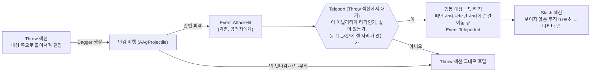

# 스킬 1 단검 투척과 후방 추격 기술 설계 (Plan)

[1-spec](<1-spec.md>)을 지금의 어빌리티 구조(어빌리티 하나 + 범용 Task, 타임라인, 섹션 전환은 Transition만)로 만드는 설계입니다. 새 클래스는 단검 BP 하나뿐이고, 나머지는 기존 Task와 투사체에 필드를 더합니다.

## 1. 영향 범위 및 아키텍처

### 1.1. 흐름



- 순간이동은 단검이 맞은 순간에 일어납니다. Spec의 '순간이동 직전에 확인'과 '안전한 자리가 없으면 이동과 베기 없음'을 함께 지키려면, 자리를 확인하는 때와 옮기는 때가 같아야 하기 때문입니다. 사라지는 모습은 떠난 자리의 순간이동 VFX와 이어지는 0.08초 숨김이 맡습니다.
- 섹션은 Transition만 바꿉니다. Teleport는 섹션을 바꾸지 않고, 성공했을 때 `Event.Teleported`를 자기에게 보내며, Throw 섹션의 Transition이 그 이벤트로 Slash 섹션에 갑니다. 두 Task는 이벤트를 기다리기만 하므로 같은 시각에 시작해도 순서와 무관합니다.
- 린이 피격·사망으로 행동이 끝나면 엔진이 Teleport·Transition을 끝내므로 후속 동작은 없고, 단검은 따로 된 액터라 계속 납니다(기존 투사체 규칙).

### 1.2. 바뀌는 C++

| 대상 | 변경 |
| - | - |
| `AAgProjectile` | `bPredictAim`(기본 켬)을 더합니다. 끄면 생성 순간 행동 대상의 지금 캡슐 중심을 향합니다. 단검만 끕니다. |
| `UAgAbilityTask_Teleport` | 구간 동안 `Event`를 기다렸다가, 그 이벤트가 이 어빌리티의 타격(효과 문맥의 어빌리티 인스턴스)이고 상대(`Instigator`)가 살아 있으면 상대의 **등 뒤**(상대 정면의 반대) `Distance`에서 시작해 좌우 15°씩 `MaxAngle`까지 설 자리를 찾습니다. 찾으면 행동 대상을 상대로 바꾸고, 떠난 자리와 나타난 자리에서 `GameplayCue.Teleport`를 실행하고, `Event.Teleported`를 보낸 뒤 끝납니다. 못 찾으면 아무것도 하지 않고 계속 기다립니다. 지금의 '플레이어에서 본 대상 너머' 방향과 '자리가 없으면 제자리에 나타남'은 쓰는 곳이 없어지므로 지웁니다. 설 자리 조건(바닥 높이, 겹침, 지형 가림)은 그대로입니다. |
| `AgGameplayTags` | `Event.Teleported`를 선언합니다. |

- 1.1의 '이 어빌리티의 타격' 확인은, 반사한 탄환처럼 같은 때 린의 다른 공격이 맞혀도 그 적에게 가지 않게 합니다.
- `HitReward`의 섹션 조건은 그대로 씁니다. 엔진은 이벤트로 발동하는 어빌리티를 일반 이벤트 콜백보다 먼저 부르므로, 단검 적중의 UP 보상은 Slash로 옮기기 전의 `Throw` 섹션에서 판정됩니다.

### 1.3. 새 에셋

| 에셋 | 내용 |
| - | - |
| `/Game/Projectiles/BP_Dagger` | `AAgProjectile` BP. 판정 캡슐(반지름 약 10cm)과 대신 쓰는 외형(기존 `Dual_Wield` `Sword` 메시를 줄여 붙임), 꼬리의 궤적 `Trail`. |
| `/Game/VFX/NS_DaggerTrail`, `M_DaggerTrail` | 단검 궤적(사용자 요청, 후보 GIF 네 개 중 'B 먹선 + 흰 심'). 리본 이미터 하나(수명 0.22초, 나이에 따라 18cm에서 가늘어짐)에, 머티리얼 하나가 어두운 먹선 결과 갓 생긴 마디(수명의 0.12)의 흰 심을 그립니다. 단검이 사라져도 남은 먹선은 마저 옅어집니다(투사체의 기존 처리). |
| `AM_Player_Skill1` | 섹션 `Throw`(새 투척 모션)와 `Slash`(지금 스킬 1의 `Attack_HeavyB` 나타나기·내려베기 부분)로 다시 짭니다. `Teleport` 트랙의 사라지는 큐 노티파이는 Teleport Task가 대신하므로 지웁니다. `Thrust` 트랙의 베기 섬광은 Slash에 남깁니다. |

- **투척 모션**: 팩에 던지는 동작이 없어, 후보 GIF에서 고른 Dual Wield `Attack_Combo1`(왼손 오버핸드)을 씁니다. 왼손이 0.29초에 어깨 높이 앞을 가장 빠르게 지나므로 그때 놓습니다. 이 시퀀스는 루트 모션이 꺼져 있고 다른 곳에서 쓰지 않아 켰습니다(약 1m 내디딤).
- **블렌드 아웃**: 엔진은 블렌드 아웃 중인 몽타주의 섹션을 옮기지 않습니다. 기본 블렌드 아웃은 투척 섹션 끝 0.25초 전(0.48초)에 시작해 대기 구간(0.69초까지)을 덮으므로, `AM_Player_Skill1`의 `BlendOutTriggerTime`을 0으로 두고 베기 섹션 끝의 머무는 조각을 줄여 베기 쪽 끝 시각은 옛 스킬 1과 같게 둡니다.

### 1.4. 공통 규칙과의 관계

- 어빌리티 하나 + 범용 Task, Task는 어빌리티를 끝내지 않음, 섹션 전환은 Transition만: 지킵니다.
- 단검은 기존 투사체 규칙을 따릅니다. 무적인 적에게는 '아무 일도 없음'이라 단검이 지나가며, 그 뒤의 적에게 맞으면 그 적이 후속 대상이 됩니다. 가드는 단검을 멈추고 후속 동작이 없습니다.
- 카메라 연출 '스킬 1 적중'은 스킬 1의 모든 타에 재생되므로 단검 적중에도 재생됩니다(코드 그대로).

## 2. GAS 및 데이터 설계

### 2.1. `Abilities.json` `Skill1` (단검을 놓는 시각 0.29초)

```json
"Targeting": {"Preset": "Throw", "Range": 1500, "TargetSpacing": 100},
"Montage": {
  "Asset": "/Game/Animations/AM_Player_Skill1.AM_Player_Skill1",
  "Sections": {
    "Throw": [
      {"Task": "RootMotion", "Start": 0, "End": 0.29, "bWarpTranslation": false},
      {"Task": "ApplyEffect", "Start": 0, "End": 0.69, "Effect": "Busy"},
      {"Task": "SpawnActor", "Start": 0.29, "Actor": "Dagger", "SocketName": "hand_l"},
      {"Task": "Teleport", "Start": 0, "End": 0.69, "Event": "Event.AttackHit", "Distance": 300, "MaxAngle": 45},
      {"Task": "Transition", "Start": 0, "End": 0.69, "Event": "Event.Teleported", "ToSection": "Slash"}
    ],
    "Slash": [
      {"Task": "ApplyEffect", "Start": 0, "End": 0.36, "Effect": "Busy"},
      {"Task": "ApplyEffect", "Start": 0, "End": 0.08, "Effect": "Invincible"},
      {"Task": "ApplyEffect", "Start": 0, "End": 0.08, "Effect": "Hidden"},
      {"Task": "RootMotion", "Start": 0.09, "End": 0.26, "TargetingRange": 500, "bWarpTranslation": true},
      {"Task": "WeaponHit", "Start": 0.271, "End": 0.36, "Damage": {"HPMultiplier": 1.2, "PPMultiplier": 1.2, "HitReaction": "Flinch", "AttackType": "Normal"}}
    ]
  }
}
```

- 대기 구간 0.69초(놓은 뒤 0.4초): 15m ÷ 초당 40m = 0.375초에 한 프레임 여유를 둔 값입니다. 단검이 일찍 벽에 닿아도 후딜은 이 시각에 시작합니다(고정 타임라인).
- Slash의 시각은 지금 스킬 1의 나타난 뒤 시각(0.08초 숨김 → 0.17초 추적 → 0.351초 베기 → 0.44초 후딜)을 0.08초 당긴 값입니다.
- `Targeting.Preset`: 지금의 `Teleport` 프리셋(락온 중이면 락온 대상만, 아니면 지형에 가려지지 않은 가장 가까운 적)을 쓰임에 맞게 `Throw`로 이름만 바꿉니다. 락온 대상이 지형에 가려지면 대상이 없어 정면 수평으로 던지는데, 린은 이미 락온 대상 쪽으로 돌아서 있으므로 Spec의 '락온 대상의 몸통을 향함'과 높이만 다릅니다.

### 2.2. 그 밖의 데이터

- `SpawnActors.json` `Dagger`: `Class` `BP_Dagger`, `Speed` 4000, `Range` 1500, `bDestroyOnHit` true, `bPredictAim` false, `Damage` HP 0.3 · PP 0.3 · `HitReaction` None · `AttackType` Normal.
- `Abilities.json` `HitReward`: 스킬 1 행에 `"Section": "Throw"`를 더해 단검 적중에만 UP 15를 줍니다. 린이 단검 비행 중 피격되어 몽타주가 바뀐 뒤에 단검이 맞으면 UP를 받지 않습니다.
- `TargetingPresets.json`: `Teleport` → `Throw` 이름 변경.

## 3. 인터페이스 & 함수 시그니처

```cpp
// AgAbilityTask_Teleport.h
USTRUCT() struct FAgTeleportParams : public FAgTaskParams
{
	/** 이 이벤트를 받으면 이벤트의 상대(Instigator) 등 뒤로 순간이동합니다. */
	UPROPERTY() FGameplayTag Event;
	UPROPERTY() float Distance = 0.f;
	/** 정후방이 막히면 좌우로 이 각도(도)까지 찾습니다. */
	UPROPERTY() float MaxAngle = 0.f;
};
class UAgAbilityTask_Teleport : public UAbilityTask
{
	virtual void Activate() override;
	virtual void OnDestroy(bool bInOwnerFinished) override;
	void HandleEvent(const FGameplayEventData* Payload);
	FDelegateHandle EventHandle;
};

// AgProjectile.h
UPROPERTY(EditInstanceOnly, Category = "Projectile") bool bPredictAim = true;
```
