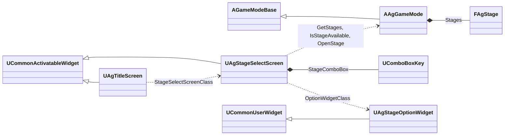
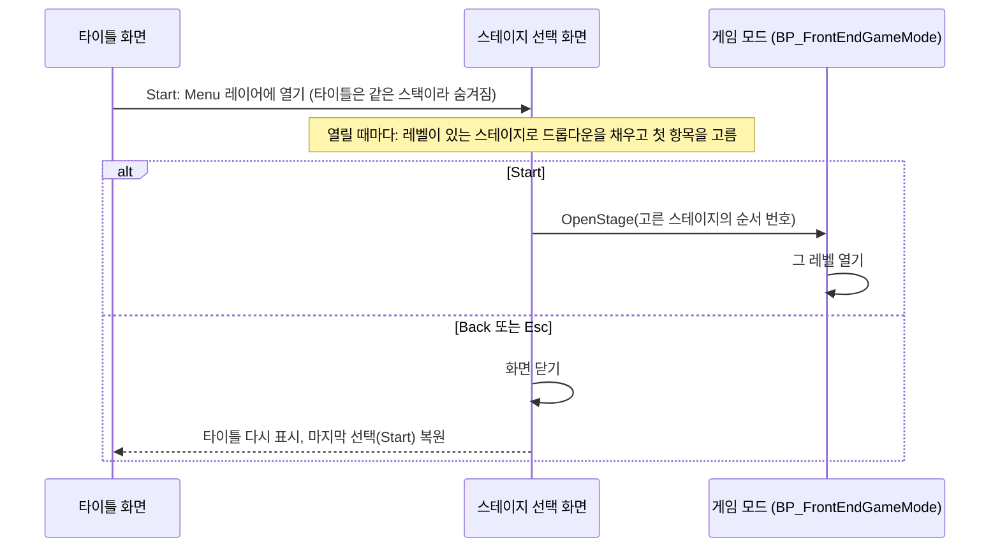

# 스테이지 선택 기술 설계 (Plan)

## 1. 영향 범위 및 아키텍처

### 구조 요약

| 대상 | 변경 | 내용 |
| - | - | - |
| `AAgGameMode` | 변경 | 스테이지 맵 하나(`StageMap`)를 스테이지 목록 `Stages`(`FAgStage` 배열: 이름, 레벨)로 바꿉니다. `OpenStage`는 목록의 순서 번호를 받고, `IsStageAvailable`이 그 레벨이 게임에 있는지 답합니다. |
| `FAgStage` | 신규 구조체 (`AgGameMode.h`) | 스테이지 하나의 이름 `DisplayName`과 레벨 `Map`(소프트 참조) |
| `UAgStageSelectScreen` | 신규 위젯 클래스 | 스테이지 선택 화면. 열릴 때마다 레벨이 있는 스테이지로 드롭다운을 채우고 첫 스테이지를 고릅니다. Start는 고른 스테이지로 이동하고, Back과 Esc는 화면을 닫습니다. |
| `UAgStageOptionWidget` | 신규 위젯 클래스 | 드롭다운 항목 하나의 모양. 스테이지 이름을 표시합니다. |
| `UAgTitleScreen` | 변경 | Start가 레벨 이동 대신 Menu 레이어에 스테이지 선택 화면(`StageSelectScreenClass`)을 엽니다. |
| 에셋 | 신규·변경 | 신규 `WBP_StageSelect`, `WBP_StageOption`. `BP_FrontEndGameMode`의 `Stages`(Spec '2.1'의 5개), `WBP_Title`의 `StageSelectScreenClass` |
| `Config/DefaultGame.ini` | 변경 | `MapsToCook`을 `LV_FrontEnd` 하나로 줄입니다. 스테이지 맵은 목록의 참조로 쿡됩니다. |

- 바꾸지 않는 것: 미니던전은 `BP_StageGameMode`(프로젝트 기본 게임 모드, `LV_DuelCorridor`도 월드 설정에서 지정)로 열리므로 보스전과 같은 `AAgGameMode` 규칙을 그대로 씁니다. 보스 사망이 Stage Clear, 플레이어 사망이 Game Over, 결과 연출·전투 결과 UI·일시정지·Restart(`RestartLevel`)·Return to Title이 모두 지금 코드입니다. 일반 적이 남아도 기본 클리어 조건(죽은 캐릭터가 보스)이 참이 됩니다.
- 시뮬레이션 룸은 들어온 뒤 바뀌는 것이 없습니다. 목록의 Simulation Room이 `LV_SimulationRoom`을 엽니다.



### 흐름



### 결정과 이유

| 항목 | 결정 | 이유 |
| - | - | - |
| 스테이지 목록의 위치 | `BP_FrontEndGameMode` 기본값 `Stages`입니다. 지금의 `StageMap`을 대신합니다. | 맵 이동은 게임 모드의 역할이고, 지금 스테이지 맵도 이 기본값입니다. 시뮬레이션 룸 후보처럼 게임 모드가 목록을 들고 화면이 읽습니다. JSON에 두면 에셋 매니저의 읽기 검사가 없는 레벨을 오류로 보고 쿡을 막는데, 이 Spec은 아직 없는 레벨을 목록에 두었다가 레벨을 만들면 나타나게 해야 합니다. 이름은 타이틀 버튼 글자처럼 에셋에 둡니다. 목록은 자주 바뀌지 않습니다(프로그래머 확인). |
| 드롭다운 | 화면에 엔진 `UComboBoxKey` 하나(`StageComboBox`)를 둡니다. 항목 키는 `Stages`의 순서 번호를 이름으로 쓴 것이고, 닫힌 칸(`OnGenerateContentWidget`)과 목록 항목(`OnGenerateItemWidget`)은 `WBP_StageOption`으로 그립니다. 드롭다운과 항목의 모양은 시뮬레이션 룸 적 드롭다운(`WBP_EnemySlot`의 `EnemyComboBox`, `WBP_EnemyOption`)의 값을 그대로 옮깁니다. | 시뮬레이션 룸과 같은 엔진 드롭다운과 같은 모양을 씁니다. 항목 모양을 위젯 에셋으로 두어, 나중에 스테이지 그림을 넣을 때 `WBP_StageOption`만 바꿉니다. 키를 순서 번호로 두어 게임 모드의 `OpenStage`가 그대로 받습니다. |
| 목록 채우기 | 화면이 활성화될 때마다 항목을 비우고, 게임 모드의 `IsStageAvailable`이 참인 스테이지만 순서대로 넣은 뒤 첫 항목을 고릅니다. `IsStageAvailable`은 `Map`이 비었거나 엔진 `FPackageName::DoesPackageExist`가 거짓이면 거짓입니다. | CommonUI 스택은 닫은 화면을 버리지 않고 다시 쓰므로, 열 때마다 채워야 전에 고른 스테이지가 남지 않습니다. 고른 값을 따로 기억하지 않습니다. 엔진 확인은 에디터에서는 디스크를, 패키지 게임에서는 IoStore를 봅니다. 목록에 없는 스테이지는 고를 수 없어 Start를 잠그는 경우가 생기지 않습니다. |
| 화면 열기와 닫기 | 타이틀 화면이 `PushScreen(Menu, StageSelectScreenClass)`로 엽니다. Back과 Esc(`UI.Action.Escape` 바인딩, 조작 안내 팝업과 같은 방식)는 `DeactivateWidget`입니다. 처음 선택은 드롭다운, 입력은 메뉴 입력에 커서 표시(타이틀과 같은 `FUIInputConfig`)입니다. | 같은 Menu 스택이라 엔진이 타이틀을 숨기고, 닫으면 타이틀을 다시 표시합니다. 타이틀은 `bAutoRestoreFocus`로 마지막 선택인 Start를 되돌립니다. CommonUI의 Esc 처리는 Slate가 처리하지 않은 키를 뷰포트가 받을 때 하므로, 열린 드롭다운 목록이 Esc를 먼저 받아 목록만 닫습니다. 레벨이 바뀌면 모든 화면이 닫히므로 Return to Title로 돌아오면 타이틀만 열립니다. |
| 방향키 | 위젯마다 탐색 규칙을 두지 않고 Slate 기본 기하 탐색(그 방향에서 가장 가까운 위젯, 끝에서 멈춤)을 씁니다. 열린 목록 안의 ↑·↓·Enter는 엔진 드롭다운의 동작입니다. | 적 선택 화면과 같습니다. 같은 스택의 숨겨진 타이틀 버튼은 탐색 대상이 아닙니다. |
| 쿡할 맵 | `MapsToCook`은 `LV_FrontEnd`만 둡니다. 스테이지 맵은 `BP_FrontEndGameMode`의 소프트 참조를 쿡이 따라가 함께 쿡합니다. 아직 없는 레벨의 참조는 쿡 로그(Display)만 남깁니다. | 엔진 쿡은 기본으로 소프트 참조를 따라갑니다(`bSkipSoftReferences` 꺼짐). 맵 목록을 두 곳에 두지 않아, 레벨을 만들어 목록에 넣으면 패키지에도 들어갑니다. 비교용 맵(`LV_DuelCorridor_Py`)처럼 목록에 없는 맵은 쿡하지 않습니다. 패키지 확인은 다음 패키징 때 합니다. |
| 레벨 경로 | 목록의 레벨은 `/Game/Maps/<Spec의 레벨 이름>`입니다. `LV_FortressBreach`, `LV_TempDungeon03`은 아직 없으므로 그 경로를 미리 적어 둡니다. | 레벨을 그 이름으로 만들면 목록을 고치지 않아도 다음에 화면을 열 때 드롭다운에 나옵니다. 이름이 바뀌면(Spec '2.1'의 임시 이름) `Stages`를 고칩니다. |

- `Docs/Architecture/` 공통 규칙 준수: 게임 로직은 C++, 위젯은 `BindWidget`과 기본값만, 새 위젯 클래스는 `DisableNativeTick`, 태그 추가 없음, 기획 데이터(JSON) 변경 없음.

### 4단계 구현 문서 반영

| 문서 | 반영 |
| - | - |
| [캐릭터 기반 구조와 GAS](<../../Docs/Architecture/캐릭터 기반 구조와 GAS.md>) | '게임 모드와 게임 스테이트': 기술 결정의 'BP 기본값(시작 화면, 스테이지 맵, 폰)'을 '스테이지 목록'으로, `AAgGameMode` 역할의 맵 이동에 스테이지 목록과 레벨 존재 확인 |
| [데이터 로딩과 스키마](<../../Docs/Architecture/데이터 로딩과 스키마.md>) 'JSON 외부 데이터 위치' | 새 행: 스테이지 목록(`BP_FrontEndGameMode`의 `Stages`: 이름과 레벨) |
| [기본 방침](<../../Docs/Architecture/기본 방침.md>) | 템플릿 콘텐츠의 쿡 문장: `LV_FrontEnd`에서 참조로 닿는 맵만 쿡 |

## 2. GAS 및 데이터 설계

- GameplayAbility, GameplayEffect, GameplayTag 변경은 없습니다. Esc는 기존 `UI.Action.Escape`를 씁니다.
- `DesignData/` JSON 스키마 변경은 없습니다.

## 3. 인터페이스 & 함수 시그니처

```cpp
// Game/AgGameMode.h
USTRUCT()
struct FAgStage
{
	GENERATED_BODY()

	UPROPERTY(EditDefaultsOnly)
	FText DisplayName;

	UPROPERTY(EditDefaultsOnly)
	TSoftObjectPtr<UWorld> Map;
};

class AAgGameMode : public AGameModeBase
{
public:
	const TArray<FAgStage>& GetStages() const;

	/** 그 스테이지의 레벨이 지정되어 있고 게임에 있는지 답합니다. */
	bool IsStageAvailable(int32 StageIndex) const;

	void OpenStage(int32 StageIndex);

protected:
	UPROPERTY(EditDefaultsOnly, Category = "Maps")
	TArray<FAgStage> Stages;
	// StageMap은 지웁니다.
};

// UI/AgStageSelectScreen.h
UCLASS(Abstract, meta = (DisableNativeTick))
class UAgStageSelectScreen : public UCommonActivatableWidget
{
protected:
	virtual void NativeOnInitialized() override;
	virtual void NativeOnActivated() override;
	virtual UWidget* NativeGetDesiredFocusTarget() const override;
	virtual TOptional<FUIInputConfig> GetDesiredInputConfig() const override;

	UPROPERTY(EditDefaultsOnly, Category = "UI")
	TSubclassOf<UAgStageOptionWidget> OptionWidgetClass;

	UPROPERTY(meta = (BindWidget))
	TObjectPtr<UComboBoxKey> StageComboBox;

	UPROPERTY(meta = (BindWidget))
	TObjectPtr<UAgButton> StartButton;

	UPROPERTY(meta = (BindWidget))
	TObjectPtr<UAgButton> BackButton;

private:
	UFUNCTION()
	UWidget* GenerateOptionWidget(FName Option);

	void OpenSelectedStage();
};

// UI/AgStageOptionWidget.h
UCLASS(Abstract, meta = (DisableNativeTick))
class UAgStageOptionWidget : public UCommonUserWidget
{
public:
	void SetStage(const FAgStage& Stage);

protected:
	UPROPERTY(meta = (BindWidget))
	TObjectPtr<UCommonTextBlock> NameText;
};

// UI/AgTitleScreen.h
protected:
	UPROPERTY(EditDefaultsOnly, Category = "UI")
	TSubclassOf<UAgStageSelectScreen> StageSelectScreenClass;

private:
	void OpenStageSelect();
```
