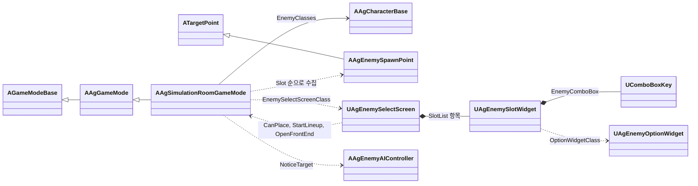
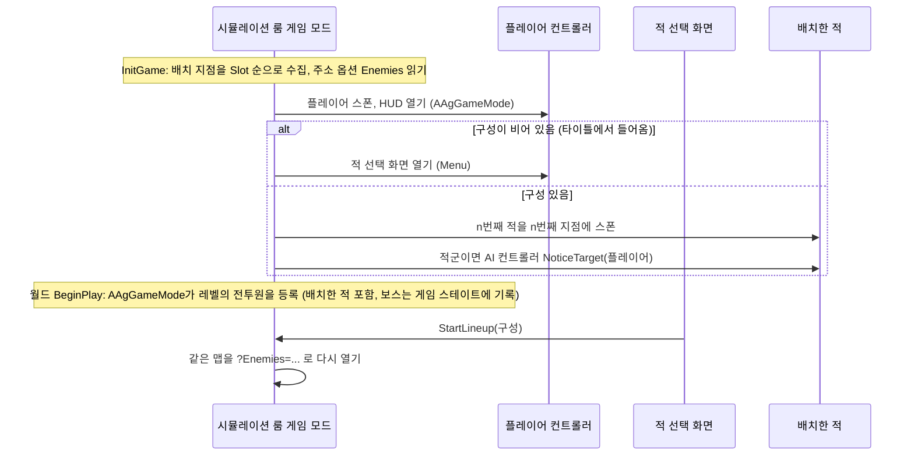

# 시뮬레이션 룸 기술 설계 (Plan)

## 1. 영향 범위 및 아키텍처

### 구조 요약

| 대상 | 변경 | 내용 |
| - | - | - |
| `AAgGameMode` | 변경 | Stage Clear 조건을 가상 함수 `IsStageCleared`로 나눕니다. 기본은 지금처럼 '죽은 캐릭터가 보스'입니다. 보스 처치 슬로우모션·카메라 연출은 '보스 처치로 결과가 정해질 때'에서 '결과가 정해지기 전에 보스가 죽을 때'로 바꿉니다. 보스전은 두 조건이 같아 동작이 바뀌지 않습니다. |
| `AAgSimulationRoomGameMode` | 신규 (`AAgGameMode` 상속) | 후보 클래스 목록, 레벨의 배치 지점 수집, 레벨 주소 옵션으로 받은 자리별 구성의 배치와 전투 진입, 구성이 비었을 때 적 선택 화면 열기, 구성으로 다시 시작. Stage Clear 조건은 '적군 진영 캐릭터가 모두 사망'입니다. |
| `AAgEnemySpawnPoint` | 신규 | `ATargetPoint`를 상속한 배치 자리 표시. 레벨에 놓으며 자리 번호 `Slot`만 가집니다. |
| `UAgEnemySelectScreen` | 신규 위젯 클래스 | 적 선택 화면. 배치 자리 수만큼 자리 위젯을 만들고, 자리의 선택이 바뀌면 모든 자리의 목록(보스 제외)과 Start 잠금을 갱신합니다. Start는 게임 모드에 구성을 넘기고, Return to Title은 타이틀로 갑니다. |
| `UAgEnemySlotWidget` | 신규 위젯 클래스 | 배치 자리 하나의 적 드롭다운(엔진 `UComboBoxKey`). 목록 항목과 닫힌 칸의 내용을 `UAgEnemyOptionWidget`으로 만들고, 사람이 바꾼 선택만 화면에 알립니다. |
| `UAgEnemyOptionWidget` | 신규 위젯 클래스 | 드롭다운 항목 하나의 모양. 캐릭터 데이터 ID를 받아 이름(없으면 Empty 글자)을 표시합니다. |
| `AAgEnemyAIController` | 변경 | 시야와 관계없이 상대를 알아차리게 하는 `NoticeTarget`을 더합니다. |
| 에셋 | 신규 | `BP_SimulationRoomGameMode`, `LV_SimulationRoom`(2026-10-25 보관본 `refs/parked/simulation-room`을 되살려 후보 목록과 자리 번호를 지금 Spec에 맞춤), `WBP_EnemySelect`(드롭다운 줄로 다시 구성), `WBP_EnemySlot`, `WBP_EnemyOption` |
| 쿡 | 변경 없음 | `LV_SimulationRoom`은 스테이지 선택 목록의 참조로 쿡됩니다([스테이지 선택 Plan](<../스테이지 선택/2-plan.md>)의 '쿡할 맵'). |

- 바꾸지 않는 것: 일시정지 메뉴와 전투 결과 화면은 `AAgGameMode`에 버튼을 잇고, Restart는 `RestartLevel`(상대 이동)이라 주소 옵션이 그대로 남아 같은 구성으로 다시 시작합니다. 전투 HUD는 게임 스테이트의 보스 변경을 구독하므로 배치한 보스도 그대로 표시합니다.



### 흐름



### 결정과 이유

| 항목 | 결정 | 이유 |
| - | - | - |
| 게임 모드 | `AAgGameMode`를 상속한 `AAgSimulationRoomGameMode`를 두고, `LV_SimulationRoom`의 월드 설정에서 게임 모드를 `BP_SimulationRoomGameMode`로 재정의합니다. | 타이틀과 보스전은 기본값만 달라 한 클래스로 합쳤지만, 시뮬레이션 룸은 배치·선택 화면·클리어 조건이라는 규칙이 다릅니다. 레벨마다 규칙을 바꾸는 엔진의 방식이 게임 모드 재정의입니다. |
| 클리어 조건 | `AAgGameMode`가 플레이어가 아닌 전투원의 사망마다 `IsStageCleared`를 묻습니다. 시뮬레이션 룸은 적군 진영(`EAgTeam::Enemy`)인 캐릭터가 하나도 살아 있지 않으면 참입니다. | 보스전·미니던전(보스 처치)과 시뮬레이션 룸(적 전멸)은 결과 연출과 UI를 함께 쓰고 조건만 다릅니다. 샌드백은 중립 진영이라 세지 않으며, 사망하지 않으므로 사망 알림도 오지 않습니다. 남은 적은 그 순간 레벨의 캐릭터를 훑어 정해 따로 세는 상태를 두지 않습니다. |
| 보스 처치 연출 | 결과가 정해지기 전에 보스가 죽으면 슬로우모션과 카메라 연출을 재생하고, 그 뒤 결과를 판정합니다. | [시간 규칙](<../../Docs/Design/System/시간 규칙.md>)과 [카메라와 타겟팅](<../../Docs/Design/System/카메라와 타겟팅.md>)이 '보스 사망 순간, 결과가 정해진 뒤가 아니면'으로 정합니다. 보스와 일반 적을 함께 배치하면 보스가 먼저 죽어도 결과는 아직이므로 이 구분이 필요합니다. |
| 구성 전달 | Start는 같은 맵을 레벨 주소 옵션 `?Enemies=,Cutter,Boss,Gunner,`(자리 번호 순서의 캐릭터 데이터 ID, 빈 자리는 빈 칸)로 다시 엽니다. 게임 모드는 `InitGame`의 Options에서 읽습니다. 모든 자리가 비어 있으면 처음 들어온 것으로 보고 적 선택 화면을 엽니다. | 레벨을 다시 로드하는 엔진의 기본 경로로 모든 상태를 초기화합니다. `RestartLevel`은 상대 이동이라 엔진이 옵션을 복사해 Restart가 같은 구성을 유지하고, 타이틀 이동은 절대 이동이라 옵션이 버려져 따로 비우는 코드가 필요 없습니다. Start는 모든 자리가 비어 있으면 실행되지 않으므로 빈 구성은 처음 들어온 경우뿐입니다. |
| 후보 목록 | `BP_SimulationRoomGameMode` 기본값 `EnemyClasses`(캐릭터 클래스 배열, 보스·일반 적·샌드백 순: `BP_Boss`, `BP_Cutter`, `BP_Gunner`, `BP_Sandbag`, `BP_AttackSandbag`)입니다. 이름은 각 클래스 기본 객체의 `CharacterDataId`로 캐릭터 데이터의 `DisplayName`을 읽습니다. | 캐릭터 데이터에는 스폰할 클래스가 없습니다(블루프린트가 데이터 ID를 고름). 스폰할 클래스는 실행 구조를 이루는 참조라 게임 모드의 에셋 기본값에 두고(AGENTS.md 코딩 규칙 2), 이 하드 참조가 쿡도 보장합니다. |
| 배치 자리 | 레벨에 `AAgEnemySpawnPoint`를 자리 수만큼 바닥에 놓고 인스턴스마다 `Slot`(1부터, 플레이어 시작 지점에서 본 왼쪽부터)을 적습니다. 보관본 레벨의 번호(가운데부터)는 Spec에 맞춰 고칩니다. 게임 모드는 지점을 `Slot` 순으로 정렬하고, 자리 수는 지점 수입니다. `Slot`이 겹치거나 빠지면 오류 로그를 남기고 정렬 순서대로 씁니다. 스폰 위치는 지점 위치에 그 캐릭터 캡슐의 절반 높이를 더한 곳이고, 방향은 플레이어를 바라보게 계산합니다. | 정찰 지점과 보스 시작 위치처럼 레벨 배치는 레벨이 들고, 수치는 레벨 문서에 적습니다. 자리 번호는 지점 이름(라벨)이 에디터에만 있어 따로 둡니다. 방향은 Spec 규칙을 그대로 계산해 지점 회전을 맞추는 규칙을 두지 않습니다. |
| 배치 시점과 등록 | 플레이어 참가 처리(`HandleStartingNewPlayer`)에서 플레이어 폰이 생긴 뒤 스폰합니다. 엔진은 이를 월드 BeginPlay 전에 부르므로, `AAgGameMode::BeginPlay`의 기존 순회가 레벨에 놓인 적과 같이 사망 알림을 구독하고 보스를 게임 스테이트에 기록합니다. | 등록 경로를 하나로 둡니다. 플레이어를 바라보는 방향에 폰이 필요합니다. |
| 전투 진입 | 적군 진영인 적만 스폰 직후 `AAgEnemyAIController::NoticeTarget(플레이어)`를 부릅니다. 엔진 대미지 감각에 그 상대가 대미지 0으로 친 자극을 남기고, 기존 전투 진입 조건(`IsTargetNoticed`, 지각한 적대 상대가 있음)이 전투로 넘깁니다. | [적 시스템](<../../Docs/Design/System/적 시스템.md>)의 '플레이어 공격에 맞으면 시야와 관계없이 전투에 들어가고, 마지막으로 맞은 순간부터 놓친 시간을 셈'과 같은 결과라 지각 시스템의 기존 판정을 그대로 씁니다. 별도의 '알아차린 시각' 상태를 두면 엔진 지각과 두 곳에서 같은 것을 셉니다. 샌드백은 [샌드백](<../../Docs/Design/Content/샌드백.md>)을 따르므로 부르지 않습니다. |
| 화면과 일시정지 | 적 선택 화면은 활성화될 때 `SetPause(true)`를 부르고, 스스로 닫히지 않으며 두 버튼 모두 레벨 이동으로 끝납니다. Esc 동작은 등록하지 않습니다(타이틀 화면과 같음). 열린 드롭다운 목록은 Slate 메뉴가 Esc로 닫습니다. | 일시정지 메뉴와 같이 멈춤의 주인이 화면입니다. 레벨 이동이 멈춤을 함께 풀므로 비활성화 처리는 두지 않습니다. HUD의 Esc(일시정지 메뉴)는 위 레이어 화면이 입력을 가져가 열리지 않습니다. |
| 드롭다운 | 자리마다 UMG `UComboBoxKey` 하나를 둡니다. 항목 키는 캐릭터 데이터 ID이고, 빈 자리는 파일 안 상수 키 `Empty`입니다. 닫힌 칸(`OnGenerateContentWidget`)과 목록 항목(`OnGenerateItemWidget`)은 모두 `WBP_EnemyOption`으로 그립니다. 드롭다운 모양(`FComboBoxStyle`·항목 줄 스타일)은 `WBP_EnemySlot`의 기본값입니다. | CommonUI에는 드롭다운이 없고, 엔진 드롭다운 가운데 항목을 위젯으로 그리는 것이 `UComboBoxKey`입니다(`UComboBoxString`은 글자만). 나중에 초상화가 생기면 `WBP_EnemyOption`·`WBP_EnemySlot` 에셋과 그 데이터만 바꿔 카드 모양으로 넓힐 수 있습니다. 엔진 목록은 None을 빈 항목으로 다뤄 선택할 수 없으므로 Empty에 별도 키가 필요합니다. |
| 목록 갱신 | 자리 위젯은 `UDynamicEntryBox`(가로)의 항목으로 화면을 만들 때 한 번 만듭니다. 한 자리의 선택이 바뀌면 화면이 모든 자리의 목록을 다시 채웁니다: Empty와 `EnemyClasses` 가운데 게임 모드의 `CanPlace`가 허락하는 것. 자리 위젯은 코드가 선택을 되돌려 놓을 때 나는 변경(`ESelectInfo::Direct`)은 화면에 알리지 않습니다. 어느 적을 어느 자리에 둘 수 있는지는 `CanPlace` 하나가 정하고, 목록과 주소 옵션 검사가 함께 씁니다. | 자리 수는 레벨의 배치 지점 수를 따르고 위젯에 따로 두지 않습니다. 목록을 다시 채울 때 엔진이 선택을 비우므로 다시 설정하는데, 그 변경을 사람의 선택으로 받으면 갱신이 되풀이됩니다. 목록 화면이 이것 하나라 MVVM은 쓰지 않습니다. |
| Start 흐림 | CommonUI 버튼 잠금(`SetIsLocked`)을 쓰고, 흐린 모양은 화면이 `LockedButtonOpacity`(WBP 기본값)로 투명도를 줍니다. | 엔진의 잠금이 '선택은 되지만 실행되지 않음'이라는 Spec과 맞고, CommonUI 버튼 스타일에는 잠금 모양이 없습니다(소리만 있음). |
| 방향키 | 위젯마다 탐색 규칙을 정하지 않고 Slate 기본 기하 탐색(그 방향에서 가장 가까운 위젯, 끝에서 멈춤)을 씁니다. 열린 목록 안의 ↑·↓·Enter는 엔진 드롭다운의 동작입니다. | 드롭다운 줄과 아래 버튼 줄을 규칙 없이 오갑니다. |
| 레벨 | 보관본 `LV_SimulationRoom`(LV_BossStage 복제, 보스 삭제, 게임 모드 재정의, 배치 지점 5개)을 되살립니다. 보관 뒤 LV_BossStage의 변경은 게임 모드 통합(10-26) 하나이며, 이 레벨은 게임 모드를 따로 재정의합니다. 타이틀에서 들어오는 버튼은 스테이지 선택 Spec의 몫이라 이번 확인은 이 맵을 직접 엽니다. | 아레나 조건이 보스전과 같습니다. |

- `Docs/Architecture/` 공통 규칙 준수: 게임 로직은 C++, 위젯은 `BindWidget`과 기본값만, 새 위젯 클래스는 `DisableNativeTick`, 태그 추가 없음, 기획 데이터(JSON) 변경 없음.

### 4단계 구현 문서 반영

| 문서 | 반영 |
| - | - |
| [캐릭터 기반 구조와 GAS](<../../Docs/Architecture/캐릭터 기반 구조와 GAS.md>) | '게임 모드와 게임 스테이트': 시뮬레이션 룸 게임 모드 하위 클래스와 그 이유, `AAgGameMode` 역할의 클리어 조건과 보스 처치 연출 조건, 클래스 표와 그림에 `AAgSimulationRoomGameMode`·`AAgEnemySpawnPoint`·`UAgEnemySelectScreen`·`UAgEnemySlotWidget`·`UAgEnemyOptionWidget`. `AAgEnemyAIController` 역할에 `NoticeTarget` |
| [데이터 로딩과 스키마](<../../Docs/Architecture/데이터 로딩과 스키마.md>) 'JSON 외부 데이터 위치' | 새 행: 시뮬레이션 룸 후보(`BP_SimulationRoomGameMode`의 `EnemyClasses`), 배치 자리(`LV_SimulationRoom`의 `AAgEnemySpawnPoint` 위치와 `Slot`), 적 선택 화면 흐린 버튼(`WBP_EnemySelect`의 `LockedButtonOpacity`) |

## 2. GAS 및 데이터 설계

- GameplayAbility, GameplayEffect, GameplayTag 변경은 없습니다.
- `DesignData/` JSON 스키마 변경은 없습니다. 이름은 기존 `DisplayName`을 씁니다.
- 레벨 주소 옵션 `Enemies`: 자리 번호 순서로 쉼표로 이은 캐릭터 데이터 ID, 빈 자리는 빈 칸. 후보에 없는 ID, 두 번째 보스, 배치 지점 수를 넘는 칸은 경고 로그를 남기고 빈 자리로 둡니다.

## 3. 인터페이스 & 함수 시그니처

```cpp
// Game/AgGameMode.h
protected:
	/** 플레이어가 아닌 전투원이 죽었을 때 Stage Clear인지 정합니다. 기본은 죽은 캐릭터가 보스일 때입니다. */
	virtual bool IsStageCleared(const AAgCharacterBase& DeadCharacter) const;

// Game/AgSimulationRoomGameMode.h
UCLASS(Abstract)
class AAgSimulationRoomGameMode : public AAgGameMode
{
public:
	const TArray<TSubclassOf<AAgCharacterBase>>& GetEnemyClasses() const;

	/** 후보 가운데 그 캐릭터 데이터 ID의 클래스. 없으면 nullptr입니다. */
	TSubclassOf<AAgCharacterBase> FindEnemyClass(FName CharacterDataId) const;

	int32 GetSlotCount() const;

	/** 자리별 구성(빈 자리는 nullptr)에서 그 자리에 그 적을 둘 수 있는지. 보스는 다른 자리에 보스가 없어야 합니다. */
	bool CanPlace(const TArray<TSubclassOf<AAgCharacterBase>>& InLineup, int32 SlotIndex, TSubclassOf<AAgCharacterBase> EnemyClass) const;

	void StartLineup(const TArray<TSubclassOf<AAgCharacterBase>>& NewLineup);

protected:
	virtual void InitGame(const FString& MapName, const FString& Options, FString& ErrorMessage) override;
	virtual void HandleStartingNewPlayer_Implementation(APlayerController* NewPlayer) override;
	virtual bool IsStageCleared(const AAgCharacterBase& DeadCharacter) const override;

	UPROPERTY(EditDefaultsOnly, Category = "SimulationRoom")
	TArray<TSubclassOf<AAgCharacterBase>> EnemyClasses;

	UPROPERTY(EditDefaultsOnly, Category = "UI")
	TSubclassOf<UAgEnemySelectScreen> EnemySelectScreenClass;

private:
	void CollectSpawnPoints();
	void SpawnLineup(AActor& Player);

	/** 자리 번호 순서이며 빈 자리는 nullptr입니다. */
	TArray<TSubclassOf<AAgCharacterBase>> Lineup;

	UPROPERTY()
	TArray<TObjectPtr<AAgEnemySpawnPoint>> SpawnPoints;
};

// Game/AgEnemySpawnPoint.h
UCLASS()
class AAgEnemySpawnPoint : public ATargetPoint
{
public:
	int32 GetSlot() const;

protected:
	UPROPERTY(EditInstanceOnly, Category = "SimulationRoom", meta = (ClampMin = 1))
	int32 Slot = 1;
};

// UI/AgEnemySelectScreen.h
UCLASS(Abstract, meta = (DisableNativeTick))
class UAgEnemySelectScreen : public UCommonActivatableWidget
{
protected:
	virtual void NativeOnInitialized() override;
	virtual void NativeOnActivated() override;
	virtual UWidget* NativeGetDesiredFocusTarget() const override;
	virtual TOptional<FUIInputConfig> GetDesiredInputConfig() const override;

	UPROPERTY(EditAnywhere, Category = "UI", meta = (ClampMin = 0, ClampMax = 1))
	float LockedButtonOpacity = 1.f;

	UPROPERTY(meta = (BindWidget))
	TObjectPtr<UDynamicEntryBox> SlotList;

	UPROPERTY(meta = (BindWidget))
	TObjectPtr<UAgButton> StartButton;

	UPROPERTY(meta = (BindWidget))
	TObjectPtr<UAgButton> ReturnToTitleButton;

private:
	TArray<TSubclassOf<AAgCharacterBase>> GetLineup() const;
	void RefreshSlots();
	void StartLineup();

	UPROPERTY()
	TArray<TObjectPtr<UAgEnemySlotWidget>> Slots;
};

// UI/AgEnemySlotWidget.h
UCLASS(Abstract, meta = (DisableNativeTick))
class UAgEnemySlotWidget : public UCommonUserWidget
{
public:
	/** Empty와 그 적들로 목록을 다시 채우고, 고른 적이 목록에 있으면 그대로 둡니다. */
	void SetOptions(const TArray<FName>& CharacterDataIds);

	/** 비어 있으면 None입니다. */
	FName GetSelectedEnemy() const;

	/** 사람이 목록에서 고른 때만 알립니다. */
	FSimpleMulticastDelegate OnSelectedEnemyChanged;

protected:
	virtual void NativeOnInitialized() override;

	UPROPERTY(EditDefaultsOnly, Category = "UI")
	TSubclassOf<UAgEnemyOptionWidget> OptionWidgetClass;

	UPROPERTY(meta = (BindWidget))
	TObjectPtr<UComboBoxKey> EnemyComboBox;

private:
	UFUNCTION()
	UWidget* GenerateOptionWidget(FName Option);

	UFUNCTION()
	void HandleSelectionChanged(FName SelectedItem, ESelectInfo::Type SelectionType);
};

// UI/AgEnemyOptionWidget.h
UCLASS(Abstract, meta = (DisableNativeTick))
class UAgEnemyOptionWidget : public UCommonUserWidget
{
public:
	/** None이면 EmptyText를 표시합니다. */
	void SetEnemy(FName CharacterDataId);

protected:
	UPROPERTY(EditAnywhere, Category = "UI")
	FText EmptyText;

	UPROPERTY(meta = (BindWidget))
	TObjectPtr<UCommonTextBlock> NameText;
};

// AI/AgEnemyAIController.h
/** 시야와 관계없이 그 상대를 알아차리게 합니다. 그 상대에게 맞은 것과 같은 자극이라 놓친 시간도 이 순간부터 셉니다. */
void NoticeTarget(AActor& Target);
```
