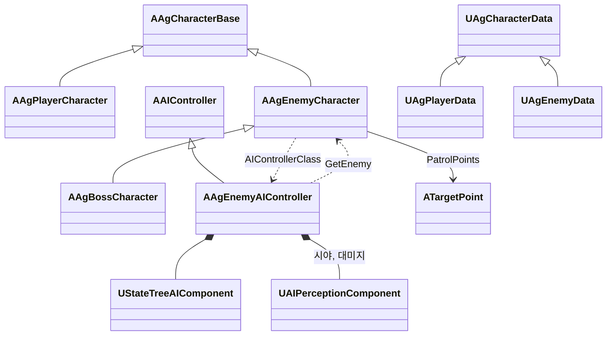
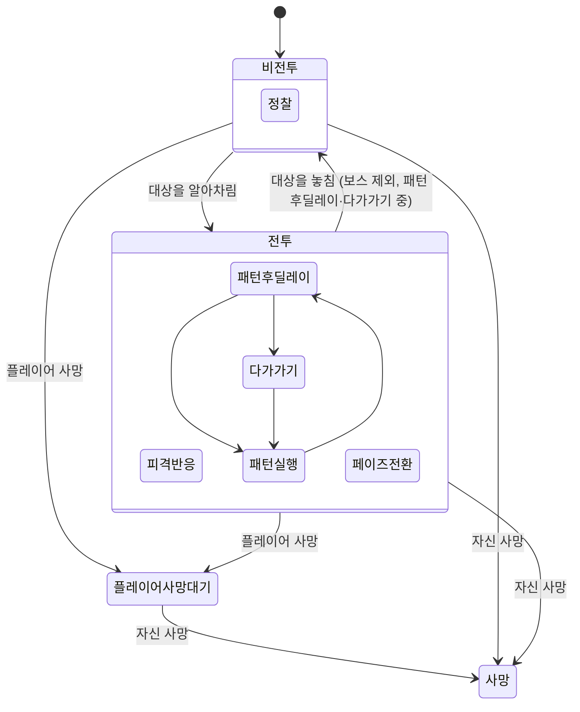

# 일반 적 기술 설계 (Plan)

[1-spec](<1-spec.md>)을 구현하는 설계입니다. 공통 규칙은 [기본 방침](<../../Docs/Architecture/기본 방침.md>), [캐릭터 기반 구조와 GAS](<../../Docs/Architecture/캐릭터 기반 구조와 GAS.md>), [데이터 로딩과 스키마](<../../Docs/Architecture/데이터 로딩과 스키마.md>)를 따릅니다. 프로그래머가 마지막 절의 결정을 모두 승인했습니다.

## 1. 영향 범위 및 아키텍처

### 지금 코드에서 확인한 것

| 항목 | 지금 동작 | 이번 작업 |
| - | - | - |
| HP·PP 유지 | 어트리뷰트는 캐릭터가 사라지지 않는 한 그대로이고, PP 리젠(`PPRegen`)은 시작 효과라 늘 돕니다. | 바꾸지 않습니다. |
| 처음 전투의 쿨다운 | 쿨다운 효과는 패턴을 시작할 때만 걸려, 시작할 때는 걸린 쿨다운이 없습니다. | 바꾸지 않습니다. 첫 전투 전에는 패턴을 쓰지 않으므로 모두 끝난 상태입니다. |
| 다시 들어올 때의 쿨다운 | 쿨다운 효과는 게임 시간으로 흐르고, 패턴이 취소돼도 이미 걸린 쿨다운은 남습니다. | 바꾸지 않습니다. 1-spec대로 비전투 동안에도 흐릅니다. |
| 보스 체력바 | `UAgHUDWidget`이 레벨의 첫 보스를 찾으면 조건 없이 이름·HP·PP를 갱신하고, 보스 상태 묶음을 숨기는 코드가 없습니다(플레이어 사망·컷신 때 `StatusPanel` 전체만 숨김). | 보스가 비전투인 동안 보스 상태를 숨깁니다. |
| 사망 뒤 | 래그돌이나 사망 모션 뒤 래그돌로 남고, 캐릭터를 지우는 코드가 없습니다. | 바꾸지 않습니다. |
| 보스전 시작 배치 | 플레이어는 아레나 중심, 보스는 8m 떨어져 플레이어를 바라봅니다. | 레벨을 바꾸지 않아도 첫 판정에서 시야 안입니다. |
| 피아 판정 | `GetGenericTeamId`가 캐릭터 1, 플레이어 0을 돌려주고 엔진 기본 태도(팀이 다르면 적대)를 씁니다. 적중은 `WeaponHit`·투사체가 적대일 때만, `AreaHit`·락온·패턴 대상은 대상 프리셋의 `UAgTargetingFilterTask_Hostile`로 고릅니다. 보스의 GroundSlam도 `AreaHit`입니다. | 아래 '피아 식별' |
| 비전투 태그 | `State.NonCombat`는 플레이어 사망 뒤 보스에 붙고, 보스 패턴의 `BlockedTags`와 `IsFacingFixed`(회전 멈춤)가 봅니다. | 아래 '전투와 비전투' |
| 페이즈 | 페이즈, 페이즈 전환 HP 비율, 전환 목표, 페이즈 전환 노드가 모두 보스 클래스에 있습니다. | 1-spec '페이즈'에 따라 적 공통으로 옮깁니다. |

### 클래스 구조

보스 전용 클래스를 적 공통 클래스로 바꾸고, 보스는 적을 상속합니다. 페이즈를 포함한 AI 규칙은 모두 적 클래스에 두고, 보스 클래스에는 보스 예외(비전투로 돌아가지 않음)와 보스 UI만 남깁니다. 그래서 보스 전용 AI 컨트롤러, 보스 전용 StateTree 노드, 보스 전용 데이터 클래스는 없어집니다.

| 클래스 | 부모 | 역할 |
| - | - | - |
| `AAgEnemyCharacter` (신규) | `AAgCharacterBase` | 적 공통. 팀(적군), AI 컨트롤러·빙의·회전 설정, `AIStateTree`, 정찰 지점(`PatrolPoints`), 처음 배치된 자리와 방향, 시야의 기준점, 페이즈(`GetPhase`, `GetReachedPhase`), 그로기 시작 미루기, 그로기·처형 피격·페이즈 전환이 끝날 때의 PP 회복, 비전투로 돌아가는지(`CanReturnToNonCombat`, 기본 참) |
| `AAgBossCharacter` | `AAgEnemyCharacter` (부모 변경) | `CanReturnToNonCombat`이 거짓, 락온 마커·처형 안내 월드 위젯과 락온 지점 |
| `AAgEnemyAIController` (옛 `AAgBossAIController`) | `AAIController` | StateTree 실행, 엔진 지각(`UAIPerceptionComponent`: 시야·대미지 감각)으로 대상을 알아차리고 놓친 시간 세기, 팀(빙의한 적의 팀과 태도), 마지막으로 시작한 페이즈 전환의 목표 페이즈, 대상의 기본 공격 시작 구독 |
| `UAgEnemyData` (옛 `UAgBossData`) | `UAgCharacterData` | 적 데이터: `PostPatternDelayTime`, `PhaseTransitionHPRatios`, `SightDistance`, `SightAngle` |
| `AgEnemyAITasks`, `AgEnemyAIConditions` (옛 `AgBossAITasks`, `AgBossAIConditions`) | StateTree AI 태스크·조건 | 모든 노드를 `FAgEnemyAI…`로 바꾸고, '전투', '정찰', '대상을 알아차림', '대상을 놓침'을 더합니다. |



- 보스 기획에 해당하는 곳(`AgPlayerCharacter`의 락온 지점, `AgCheatManager`의 보스 처치, `AgBossStageGameMode`의 결과 판정, `AgHUDWidget`의 보스 체력바)은 그대로 `AAgBossCharacter`를 씁니다.
- 락온 마커와 처형 안내는 [UI 시스템](<../../Docs/Design/System/UI 시스템.md>)이 보스 기준으로 정하고 있어 보스에 남깁니다. 일반 적의 머리 위 표시는 일반 적 UI 기획에서 정합니다.
- 캐릭터 ID와 데이터 클래스 짝은 `Boss`가 `UAgEnemyData`가 됩니다. 일반 적도 같은 클래스로 ID만 더합니다.

### 피아 식별

진영은 엔진 팀 인터페이스(`IGenericTeamAgentInterface`)로 나타내고, 진영 사이의 태도는 `AAgCharacterBase::GetTeamAttitudeTowards` 재정의 한 곳에 둡니다. 엔진 지각의 시야 감각은 리스너(적 AI 컨트롤러)의 `GetTeamAttitudeTowards(대상)`로 볼 상대를 고르고, 투사체·`WeaponHit`·대상 필터도 같은 함수를 거치므로 전역 태도 함수는 설치하지 않습니다.

| A의 B에 대한 태도 | 아군 | 적군 | 중립 |
| - | - | - | - |
| 아군 (플레이어) | Friendly | Hostile | Hostile |
| 적군 (적, 보스) | Hostile | Friendly | Neutral |
| 중립 (샌드백) | Hostile | Hostile | Friendly |

- 엔진의 `Neutral` 태도는 '노리지 않는 상대'라는 뜻으로 씁니다. 공격 대상 고르기(락온·패턴의 대상 프리셋, 지각의 시야와 피격 알림)는 지금처럼 `Hostile`만, 적중은 `Friendly`가 아닌 상대 모두입니다. 그래서 적은 샌드백을 고르지 않고 샌드백에게 맞아도 전투에 들어가지 않지만, 판정에 들어온 샌드백은 맞습니다.
- 팀은 캐릭터 클래스가 정합니다. `AAgCharacterBase`가 `Team`(기본 중립)을 들고 `GetGenericTeamId`가 돌려주며, 플레이어는 아군, 적은 적군으로 생성자에서 정합니다. 샌드백은 중립 기본값을 그대로 씁니다. 플레이어의 `GetGenericTeamId` 재정의는 없어집니다.
- 적 AI 컨트롤러의 `GetGenericTeamId`·`GetTeamAttitudeTowards`는 빙의한 적의 것을 돌려줍니다.
- 적중 판정: `WeaponHit`·`AgProjectile`은 `Hostile`이 아니면 거르던 것을 `Friendly`면 거르도록 바꿉니다. `AreaHit`은 대상 프리셋으로 맞을 대상을 찾으므로, 중립도 통과시키는 필터 설정(`UAgTargetingFilterTask_Hostile::bIncludeNeutral`)을 가진 새 프리셋 `Hit`을 쓰게 합니다.
- 이번 작업은 샌드백을 만들지 않으므로 중립 관련 동작은 샌드백 작업에서 확인합니다.

### 시야와 알아차림

엔진 AI 지각(`UAIPerceptionComponent`)의 시야 감각(`UAISenseConfig_Sight`)과 대미지 감각(`UAISenseConfig_Damage`)을 적 AI 컨트롤러에 둡니다.

- 시야 값은 빙의할 때 적 데이터에서 넣습니다: `SightRadius`·`LoseSightRadius` = `SightDistance`, `PeripheralVisionAngleDegrees` = `SightAngle`의 절반, 볼 상대는 적대(`DetectionByAffiliation`의 Enemies)만. 그 뒤 `ConfigureSense`로 다시 등록합니다.
- 시야의 기준점은 적의 캡슐 중심과 정면 방향입니다. 엔진 시야는 폰의 눈 위치·컨트롤러 방향을 쓰므로 `AAgEnemyCharacter::GetActorEyesViewPoint`를 재정의해 캡슐 중심과 액터 방향을 돌려줍니다. 엔진 시야의 거리는 이 기준점에서 대상의 위치(플레이어 캡슐 중심)까지로, 1-spec의 문구와 같습니다.
- 가림은 엔진 시야의 선 검사(기본 Visibility 채널)로 봅니다. 벽·지형은 이 채널을 막습니다. 캐릭터 캡슐·메시가 이 채널을 막아 다른 적이 시야를 가리는지는 구현 중 확인하고, 막으면 캐릭터가 무시하는 채널로 검사하게 설정합니다(1-spec은 벽·지형만 가린다고 적음).
- 피격: 대미지 결과 컴포넌트(`UAgDamageResultGameplayEffectComponent`)가 공격이 닿았을 때(일반 피격·가드·가드 브레이크·패리) `UAISense_Damage::ReportDamageEvent`로 알립니다. 엔진 대미지 감각이 맞은 적에게 공격자를 알려 줍니다.
- 컨트롤러는 `OnTargetPerceptionUpdated`에서 태도가 `Hostile`인 상대만 받고, 시야에 보이는 동안과 마지막으로 보이거나 맞은 시각을 기록합니다. '대상을 알아차림'은 시야에 보이거나, 마지막으로 알아차린 뒤 `TargetLostTime`(5초)이 지나지 않은 상태입니다. 엔진 자극 나이(`MaxAge`)와 잊기 설정(`bForgetStaleActors`)은 지각 시스템의 노화 주기 단위로만 흘러 쓰지 않습니다.

### 전투와 비전투

전투·비전투는 StateTree의 상태이고, `State.NonCombat` 태그는 비전투 상태 태스크가 상태에 들어갈 때 붙이고 나올 때 뗍니다. 태그는 "적이 전투 중이 아님"을 뜻하며(정찰·복귀·대기, 플레이어 사망 뒤 대기), 패턴의 `BlockedTags`와 HUD가 봅니다. 컨트롤러는 알아차림만 판단하고 전투 상태를 따로 들지 않습니다.



| 상태 | 태스크 | 하는 일 |
| - | - | - |
| 비전투 | 적: 비전투 | 들어갈 때 `State.NonCombat`을 붙이고 패턴을 취소합니다(지금 태스크). 나올 때 태그를 뗍니다. |
| 비전투 > 정찰 | 적: 정찰 (신규) | 지금 위치에서 수평 직선 거리가 가장 가까운 정찰 지점부터 배열 순서대로 돌고, 마지막 다음은 첫 지점입니다. 정찰 지점이 없으면 처음 배치된 자리로 걸어간 뒤 처음 배치된 방향으로 돌아서 머뭅니다(바라볼 지점을 그 방향에 두어 제자리 회전 모션으로 돕니다). 이동은 NavMesh 길찾기(`AAIController::MoveTo`, 옆걸음 없이 이동 방향을 바라봄)이고 속도는 MOV(`MaxWalkSpeed`)입니다. |
| 플레이어 사망 대기 | 적: 비전투 | 지금과 같습니다. 이후 사망 전환만 둡니다. |
| 전투 | 적: 전투 (신규) | 지금 컨트롤러 틱이 하던 락온 유지와 대상 바라보기(`SetFocus`)를 맡습니다. 나올 때 락온을 취소하고 바라보기를 풉니다. 비전투 중에는 락온이 없어 정찰 이동 방향을 바라봅니다. |
| 전투 > 패턴 후딜레이 | 적: 패턴 후딜레이 대기 | 전투에 들어가면 이 상태부터 시작해, 1-spec의 "패턴 후딜레이 대기 시간만큼 기다린 뒤 패턴 선택"이 됩니다. |
| 전투 > 다가가기 | 적: 다가가기 | NavMesh 길찾기로 대상에게 걸어갑니다. |
| 전투 > 페이즈 전환 | 적: 페이즈 전환 | 지금 보스 노드와 같습니다. 페이즈 전환 HP 비율이 없는 적은 도달 페이즈가 늘 1이라 들어가지 않습니다. |
| 전투 > 피격 반응, 패턴 실행, Backstep | 지금 태스크·조건 | 이름만 바뀝니다. |
| 사망 | 엔진 Delay | 지금과 같습니다. |

- 전환 순서는 적 시스템 '전투 시작과 상태 전환' 표(사망 → 플레이어 사망 → 그로기 → 처형 → 페이즈 전환)를 지금처럼 상위 상태의 우선 전환으로 두고, 그 다음이 알아차림·놓침입니다.
- 놓침 전환은 패턴 후딜레이·다가가기 상태에만 둡니다. 진행 중인 패턴과 피격 반응은 끝까지 진행한 뒤 비전투로 돌아가, 정찰 이동이 피격 모션의 루트 모션과 겹치지 않습니다.
- 보스는 `CanReturnToNonCombat`이 거짓이라 '대상을 놓침' 조건이 늘 거짓입니다. 보스와 일반 적이 같은 트리와 노드를 씁니다.
- `IsFacingFixed`에서 `State.NonCombat` 조건을 뺍니다. 정찰 중에는 회전해야 합니다. 플레이어 사망 뒤에는 락온과 바라보기가 없어 컨트롤러 방향이 폰 방향을 따르므로 돌지 않습니다(검증에서 확인).
- StateTree는 빙의할 때(캐릭터 `BeginPlay` 전) 시작하므로, 처음 배치된 자리와 방향은 캐릭터의 `PreInitializeComponents`에서 기록하고 정찰 이동 요청은 태스크의 첫 틱에서 보냅니다.

### StateTree 에셋

- 모든 적이 트리 하나(`ST_Enemy`)를 함께 씁니다. `ST_Boss`의 노드와 전환으로 위 상태 구성의 `ST_Enemy`를 만들고, `BP_Boss`의 `AIStateTree`를 바꾼 뒤 `ST_Boss`를 지웁니다. 락온 유지 태스크가 피격 반응·페이즈 전환 동안에도 이어지도록 그 상태들을 전투 아래에 둡니다.
- 노드 구조체 이름이 바뀌어 에셋이 옛 이름으로 저장돼 있으므로 `DefaultEngine.ini`의 `[CoreRedirects]`에 `StructRedirects`를 넣고, 에셋을 다시 저장한 뒤 지웁니다. 스키마의 AI 컨트롤러 클래스는 `AAgEnemyAIController`, 문맥 액터 클래스는 `AAgEnemyCharacter`로 바꿉니다.

### 정찰 지점과 이동

- 정찰 지점은 레벨에 둔 엔진 `ATargetPoint`이고, 레벨에 놓인 적 인스턴스의 `PatrolPoints`(`EditInstanceOnly`) 배열이 순서를 정합니다. 레벨 배치라 JSON이 아니라 레벨 에셋에 둡니다.
- 정찰·복귀와 다가가기는 길찾기를 쓰므로 적이 있는 레벨에 `NavMeshBoundsVolume`을 둡니다. `LV_BossStage`에도 둡니다.
- 레벨이 월드 파티션이라 정적 내비 메시는 에디터에서 만들어지지 않습니다. 프로젝트 설정의 `RecastNavMesh.RuntimeGeneration`을 Dynamic으로 두어 게임이 시작할 때 범위 안의 내비 메시를 만듭니다.

### 보스 체력바

- `UAgHUDWidget::UpdateBoss`가 보스에 `State.NonCombat`이 있으면 보스 상태(이름, HP 바, PP 바)를 숨깁니다. 보스는 한 번 전투에 들어가면 비전투로 돌아가지 않고, 플레이어 사망 뒤에는 HUD 전체가 이미 숨겨집니다.
- `WBP_HUD`의 보스 이름·HP 바·PP 바를 감싸는 패널을 `BossStatusPanel`(BindWidget)로 둡니다.

### Architecture 규칙 준수

- 기본 방침 '구조 선택': AI 시야·피격 알림·팀 태도·길찾기는 엔진 기능(AI 지각, 팀 인터페이스, NavMesh `MoveTo`, `ATargetPoint`)을 씁니다. StateTree 노드는 지금처럼 C++ 태스크·조건이고 속성 바인딩은 쓰지 않습니다.
- 기본 방침 '객체 수명': 지각 설정 객체는 컨트롤러의 기본 서브오브젝트, 정찰 지점은 레벨 액터 참조(UPROPERTY)입니다.
- 캐릭터 기반 구조와 GAS: 비전투는 상태 태그, 피격 알림은 대미지 결과 컴포넌트, 락온은 지금처럼 어빌리티입니다.
- 데이터 로딩과 스키마: 적별 기획 값은 `Characters.json`의 적 항목(`UAgEnemyData`), 모든 적 공통 값은 `CombatRules.json`, 레벨 배치는 레벨 에셋에 둡니다. 새 데이터 파일은 없습니다.

## 2. GAS 및 데이터 설계

### 게임플레이 태그

| 태그 | 변경 |
| - | - |
| `State.NonCombat` | 뜻을 "적이 전투 중이 아님 (비전투 상태, 플레이어 사망 뒤 대기)"으로 바꿉니다. |
| `Ability.Boss.Pattern` → `Ability.Enemy.Pattern` | 적 공통 패턴 태그로 이름을 바꿉니다. `Abilities.json`의 패턴 `Tags`도 함께 바꿉니다. |
| `Ability.Reaction.PhaseTransition`, `Event.PhaseTransition` | 이름은 그대로 두고, 설명의 '보스'를 '적'으로 바꿉니다. |

새 어빌리티와 효과는 없습니다. 락온은 지금의 `EnemyLockOn`을 '적: 전투' 태스크가 켜고 끕니다.

### DesignData JSON

| 파일 | 변경 |
| - | - |
| `Characters.json` | `Boss`에 `"SightDistance": 2000`, `"SightAngle": 120`을 더합니다(cm, 도). 항목 형식은 `UAgEnemyData`가 정합니다. |
| `CombatRules.json` | `"TargetLostTime": 5`를 더합니다. 시야에서 놓친 뒤 비전투로 돌아가기까지의 시간(초)이며 모든 적에 공통입니다. |
| `TargetingPresets.json` | `Hit` 프리셋을 더합니다: `AgTargetingSelectionTask_Sphere`, `AgTargetingFilterTask_Hostile`(`"bIncludeNeutral": true`), `AgTargetingFilterTask_TagRequirements`(`State.Dead` 제외). |
| `MontageTimelines.json` | `AreaHit` 세 곳(`AM_Boss_GroundSlam`, `AM_Player_Execute`, `AM_Player_Ultimate`)의 `Area.Preset`을 `Enemy`에서 `Hit`으로 바꿉니다. |
| `Abilities.json` | 패턴의 `Ability.Boss.Pattern`을 `Ability.Enemy.Pattern`으로 바꿉니다. `PatternSelection` 설명의 '보스 AI'는 '적 AI'가 됩니다. |

- 'JSON 외부 데이터 위치' 표에 정찰 지점(레벨의 적 인스턴스 `PatrolPoints`)을 더합니다.

## 3. 인터페이스 & 함수 시그니처

```cpp
// Character/AgCharacterBase.h
enum class EAgTeam : uint8
{
	Ally,
	Enemy,
	Neutral
};

virtual FGenericTeamId GetGenericTeamId() const override;
virtual ETeamAttitude::Type GetTeamAttitudeTowards(const AActor& Other) const override;

protected:
	EAgTeam Team = EAgTeam::Neutral;
```

```cpp
// Character/AgEnemyCharacter.h
UCLASS(Abstract)
class AAgEnemyCharacter : public AAgCharacterBase
{
	GENERATED_BODY()

public:
	AAgEnemyCharacter();

	int32 GetPhase() const;
	int32 GetReachedPhase() const;
	virtual bool CanReturnToNonCombat() const;
	const TArray<TObjectPtr<ATargetPoint>>& GetPatrolPoints() const;
	const FTransform& GetHomeTransform() const;

	virtual void PreInitializeComponents() override;
	virtual void GetActorEyesViewPoint(FVector& OutLocation, FRotator& OutRotation) const override;

	UPROPERTY(EditDefaultsOnly, Category = "AI")
	TObjectPtr<UStateTree> AIStateTree;

protected:
	virtual void BeginPlay() override;

private:
	void HandleGroggyChanged(const FGameplayTag Tag, int32 NewCount);
	void HandleHitReactionChanged(const FGameplayTag Tag, int32 NewCount);
	void HandleAbilityEnded(const FAbilityEndedData& Data);

	UPROPERTY(EditInstanceOnly, Category = "AI")
	TArray<TObjectPtr<ATargetPoint>> PatrolPoints;

	FTransform HomeTransform;
	int32 Phase = 1;
};
```

```cpp
// Character/AgBossCharacter.h (부모만 바뀌고, 페이즈·그로기 처리와 AIStateTree는 적으로 옮김)
virtual bool CanReturnToNonCombat() const override;
FVector GetLockOnLocation() const;
```

```cpp
// Data/AgCharacterData.h (UAgBossData의 이름을 바꾸고 값을 더함)
UCLASS(BlueprintType)
class UAgEnemyData : public UAgCharacterData
{
	GENERATED_BODY()

public:
	UPROPERTY(Transient, VisibleAnywhere, Category = "AI")
	FFloatInterval PostPatternDelayTime = FFloatInterval(0.f, 0.f);

	UPROPERTY(Transient, VisibleAnywhere, Category = "AI")
	float SightDistance = 0.f;

	UPROPERTY(Transient, VisibleAnywhere, Category = "AI")
	float SightAngle = 0.f;

	UPROPERTY(Transient, VisibleAnywhere, Category = "Phase")
	TArray<float> PhaseTransitionHPRatios;
};

// Data/AgCombatRules.h
UPROPERTY(Transient, VisibleAnywhere, Category = "AI")
float TargetLostTime = 0.f;
```

```cpp
// AI/AgEnemyAIController.h
UCLASS()
class AAgEnemyAIController : public AAIController
{
	GENERATED_BODY()

public:
	AAgEnemyAIController();

	AAgEnemyCharacter* GetEnemy() const;
	const UAgEnemyData* GetEnemyData() const;
	AAgCharacterBase* GetTarget() const;
	bool IsEnemyReacting() const;
	bool IsTargetNoticed() const;

	int32 GetPhaseTransitionTarget() const;
	void MarkPhaseTransitionStarted(int32 TargetPhase);

	virtual FGenericTeamId GetGenericTeamId() const override;
	virtual ETeamAttitude::Type GetTeamAttitudeTowards(const AActor& Other) const override;

protected:
	virtual void OnPossess(APawn* InPawn) override;
	virtual void OnUnPossess() override;
	virtual void Tick(float DeltaSeconds) override;

private:
	void ConfigureSight(const UAgEnemyData& Data);
	UFUNCTION()
	void HandleTargetPerceptionUpdated(AActor* Actor, FAIStimulus Stimulus);
	void BindTargetEvents();
	void HandleTargetBasicAttack(const FGameplayEventData* Payload);

	UPROPERTY(VisibleAnywhere, Category = "AI")
	TObjectPtr<UStateTreeAIComponent> StateTreeComponent;

	UPROPERTY(VisibleAnywhere, Category = "AI")
	TObjectPtr<UAISenseConfig_Sight> SightConfig;

	UPROPERTY(VisibleAnywhere, Category = "AI")
	TObjectPtr<UAISenseConfig_Damage> DamageConfig;

	bool bTargetInSight = false;
	double LastNoticedTime = -1.;
	int32 PhaseTransitionTarget = 1;
	TWeakObjectPtr<UAbilitySystemComponent> TargetASC;
	FDelegateHandle BasicAttackHandle;
};
```

- 지금 컨트롤러 틱의 락온 유지(`UpdateTarget`)는 '적: 전투' 태스크로 옮기고, 틱에는 대상의 기본 공격 구독만 남깁니다.

```cpp
// AI/AgEnemyAITasks.h: 인스턴스 데이터의 Controller는 AAgEnemyAIController
FAgEnemyAITask_Wait             // "적: 패턴 후딜레이 대기"
FAgEnemyAITask_Approach         // "적: 다가가기"
FAgEnemyAITask_RunPattern       // "적: 패턴 실행" (패턴 태그는 Ability.Enemy.Pattern)
FAgEnemyAITask_PhaseTransition  // "적: 페이즈 전환"
FAgEnemyAITask_WaitReaction     // "적: 피격 반응 대기"
FAgEnemyAITask_NonCombat        // "적: 비전투" (ExitState 추가)
FAgEnemyAITask_Combat           // "적: 전투" (신규)
FAgEnemyAITask_Patrol           // "적: 정찰" (신규)

// AI/AgEnemyAIConditions.h
FAgEnemyAICondition_Dead                  // "적: 사망" (옛 BossDead)
FAgEnemyAICondition_PlayerDead            // "적: 플레이어 사망"
FAgEnemyAICondition_Reacting              // "적: 피격 반응 중"
FAgEnemyAICondition_PhaseTransitionReady  // "적: 페이즈 전환 시작 조건"
FAgEnemyAICondition_ResponseReady         // "적: 반응 패턴 발동 조건" (옛 BackstepReady. Pattern 파라미터와 ResponseChance로 판정)
FAgEnemyAICondition_TargetNoticed         // "적: 대상을 알아차림" (신규)
FAgEnemyAICondition_TargetLost            // "적: 대상을 놓침" (신규, CanReturnToNonCombat && !IsTargetNoticed)
```

```cpp
// AbilitySystem/AgTargeting.h, UAgTargetingFilterTask_Hostile
UPROPERTY(EditAnywhere, Category = "Target Filter")
bool bIncludeNeutral = false;
```

## 4. 승인한 결정

1. 시야는 엔진 AI 지각의 시야 감각, 피격 알림은 엔진 대미지 감각으로 합니다.
2. 피아는 `AAgCharacterBase::GetTeamAttitudeTowards`의 태도 표로 정하고, 적이 중립을 `Neutral`로 보아 노리지 않습니다. 적중은 `Friendly`가 아니면 맞고, `AreaHit`은 새 `Hit` 프리셋을 씁니다.
3. 보스 전용 AI 클래스를 적 공통 클래스(`AAgEnemyCharacter`, `AAgEnemyAIController`, `UAgEnemyData`, `FAgEnemyAI…` 노드)로 바꾸고 보스가 상속합니다. 페이즈도 적 공통입니다. 노드 이름은 `CoreRedirects`로 옮기고, 태그는 `Ability.Enemy.Pattern`으로 바꿉니다.
4. 전투·비전투는 StateTree 상태가 정하고, `State.NonCombat`는 비전투 태스크가 붙이고 뗍니다. `IsFacingFixed`에서 비전투 조건을 뺍니다. 놓침 전환은 패턴 후딜레이·다가가기 중에만 적용합니다.
5. 정찰 지점은 레벨의 `ATargetPoint`와 적 인스턴스의 `PatrolPoints` 배열입니다.
6. 이동은 NavMesh 길찾기입니다. 정찰·복귀와 전투의 다가가기 모두 길찾기로 걷고, `LV_BossStage`에 `NavMeshBoundsVolume`을 둡니다(장애물 없는 아레나라 보스의 움직임은 거의 같습니다).
7. 시야 거리·정면 각도는 `Characters.json`의 적 항목, 5초는 `CombatRules.json`의 `TargetLostTime`에 둡니다.
8. 보스 체력바는 HUD가 보스의 `State.NonCombat`을 보고 `BossStatusPanel`을 숨깁니다.
9. 모든 적이 StateTree 하나(`ST_Boss`의 이름을 바꾼 `ST_Enemy`)를 함께 씁니다.
