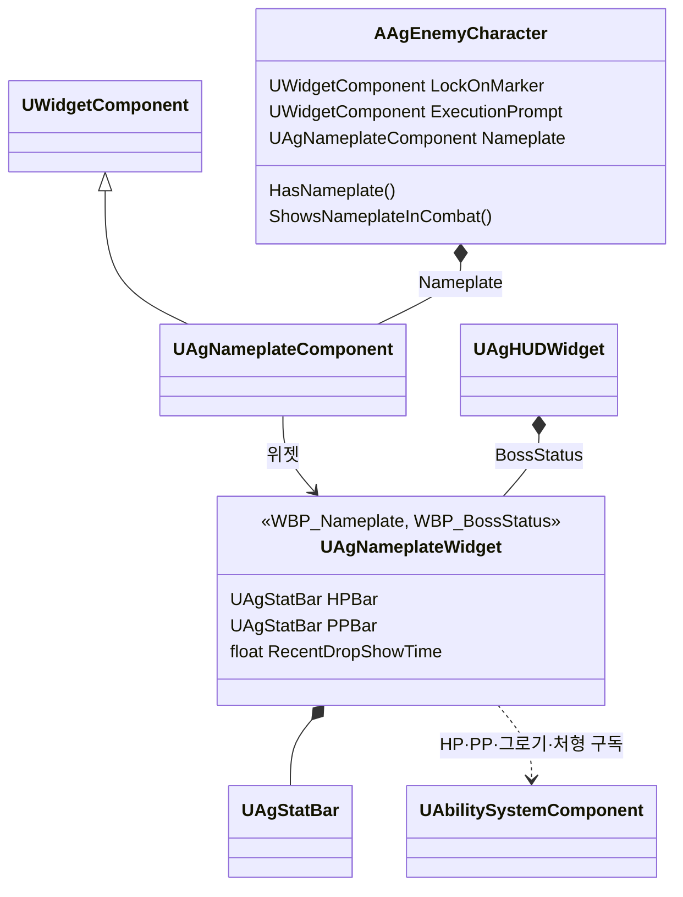

# 적 네임플레이트 기술 설계 (Plan)

[작업 명세](<1-spec.md>)를 구현하는 설계입니다. 공통 규칙은 [기본 방침](<../../Docs/Architecture/기본 방침.md>), [캐릭터 기반 구조와 GAS](<../../Docs/Architecture/캐릭터 기반 구조와 GAS.md>)를 따릅니다.

## 1. 영향 범위 및 아키텍처

### 기술 결정

| 항목 | 결정 | 이유 |
| - | - | - |
| 머리 위 표시 방식 | 락온 마커·처형 안내와 같은 엔진 `UWidgetComponent` 화면 공간(`EWidgetSpace::Screen`) 위젯으로 그립니다. 적마다 `Nameplate` 컴포넌트를 하나 둡니다. | 엔진이 매 프레임 투영해 거리와 관계없이 화면상 크기를 유지하고, 뷰포트 DPI 배율 아래에 있어 공통 해상도 배율을 따릅니다. 카메라 거리 순 정렬(가까운 대상이 앞)도 엔진 기본 동작입니다(`SWorldWidgetScreenLayer`의 ZOrder = −거리). |
| 머리 위 기준점 | `Nameplate`를 `head` 뼈에 붙이고 뼈 기준 +X 18cm(마네킹에서 잰 머리 꼭대기, Manny 17.9 · Quinn 17.6)로 올립니다. 피벗은 아래 가운데이고, 머리와의 16px은 `WBP_Nameplate`의 아래 여백입니다. | 뼈를 따라가므로 점프·넉업·넉다운 중에도 현재 자세의 머리를 따라갑니다. 사람형 캐릭터가 모두 `SK_Mannequin`이라 뼈 이름은 코드 상수입니다(락온 지점과 같음). |
| 처형 안내 위치 | 별도 위젯 컴포넌트 `ExecutionPrompt`를 그대로 두고, 붙이는 뼈를 `head`에서 락온 지점 뼈(`spine_05`)로 바꿉니다. 피벗은 왼쪽 가운데이며, 락온 지점에서의 간격(마커 반지름 16px + 12px)은 `WBP_ExecutionPrompt`의 왼쪽 여백입니다. | 1-spec 2.7의 위치입니다. 네임플레이트와 다른 자리라 두 위젯의 위치를 서로 맞추는 코드가 없습니다. |
| 락온 대상을 가장 앞에 | `UAgNameplateComponent`(엔진 위젯 컴포넌트를 상속)가 락온 대상일 때 엔진 화면 레이어 이름과 레이어 ZOrder를 바로 위 레이어로 바꿔 다시 등록합니다. | 엔진은 같은 레이어 안의 순서를 매 프레임 거리로 덮어써, 슬롯 ZOrder를 따로 줄 수 없습니다. 레이어 이름·ZOrder는 엔진이 상속 클래스에 열어 둔 설정이며, 락온이 바뀔 때만 다시 등록합니다. 앞쪽 레이어도 HUD 레이어 아래입니다. |
| HP·PP 바 묶음 | 보스 상태의 HP·PP 표시 규칙(그로기 중 남은 시간 표시, 처형 중 정지)을 `UAgHUDWidget`에서 새 위젯 `UAgNameplateWidget`으로 옮기고, 보스 상태(`WBP_BossStatus`)와 네임플레이트(`WBP_Nameplate`)가 이 클래스를 함께 씁니다. 머리 위 표시 조건(`Update`)은 네임플레이트만 부르고, 크기·간격은 각 WBP 레이아웃입니다. | 같은 PP 표시 규칙이 두 곳에 생기지 않고, HP·PP 바 클래스가 하나라 파악하기 쉽습니다. HUD는 보스 상태 패널의 표시 여부와 이름만 맡습니다. |
| 표시 조건의 주인 | 월드 조회(생존, 화면 안, 벽 가림, 락온, 전투, 결과·컷신 상태)는 `AAgEnemyCharacter::UpdateWorldWidgets`가 지금처럼 매 프레임 확인하고, 최근 감소 3초와 다시 표시할 때의 잔상 정리는 `UAgNameplateWidget`이 맡습니다. | 락온 마커·처형 안내의 기존 주인을 그대로 씁니다. 최근 감소 시각은 HP·PP 변화를 이미 구독하는 위젯이 기록하고, 3초는 감소 잔상 시간처럼 UI 에셋 기본값(`WBP_Nameplate`)에 둡니다. |
| 벽 가림 | 카메라 위치에서 캡슐 중심까지 `ECC_WorldStatic` 오브젝트 타입으로 라인 트레이스합니다. 다른 조건이 모두 맞을 때만 합니다. | 캐릭터(Pawn)는 걸리지 않아 '다른 캐릭터가 지나가는 것은 숨김 조건이 아님'과 맞습니다. 벽·지형은 WorldStatic입니다. |
| 화면 안 | 플레이어 컨트롤러로 `Nameplate` 위치를 투영해 뷰포트 안인지 봅니다. | 엔진은 카메라 뒤만 숨기고 화면 밖 좌표에도 그대로 두므로 직접 확인합니다. |
| 보스·샌드백 예외 | `AAgEnemyCharacter`에 가상 함수 두 개를 둡니다. 보스는 네임플레이트가 없고(`HasNameplate` false), 샌드백은 전투 조건을 쓰지 않습니다(`ShowsNameplateInCombat` false). | 기존 `CanReturnToNonCombat`과 같은 방식입니다. 공격 샌드백은 StateTree의 전투 상태에 들어가므로, 전투 조건을 끄지 않으면 가까이 가기만 해도 표시됩니다. |
| 결과·컷신 숨김 | 기존 공통 조건(플레이어 생존, 자신 생존, 시네마틱 모드 아님)에 '스테이지 결과가 정해지지 않음'을 더합니다. 락온 마커·처형 안내에도 함께 적용됩니다. | UI 시스템 '상황별 표시 규칙'은 스테이지 결과 연출부터 세 요소를 모두 숨기는데, 지금은 보스가 죽어 결과가 나도 다른 적(샌드백)의 표시가 남습니다. |
| 다시 표시할 때 | 바는 숨겨진 동안에도 계속 최신 값으로 갱신합니다. 표시가 허용되지 않던 동안(화면 밖, 벽 뒤, 컷신·결과)에서 다시 표시하는 순간 HP·PP 잔상을 현재 값으로 맞추고, 처형 피격 중의 PP 바는 그대로 둡니다. 요청이 없어 숨어 있다가 피해로 나타날 때는 그 피해의 잔상을 보여 줍니다. | 숨긴 동안의 피해 잔상을 몰아서 재생하지 않으면서, 처형 전환 때 고정한 PP 표시를 유지합니다. 숨은 상태에서 받은 피해는 곧 최근 감소로 표시를 요청하므로, 그 잔상까지 지우면 첫 타격의 감소 잔상이 보이지 않습니다. 구독은 위젯 수명 동안 유지합니다. 화면 공간 위젯 컴포넌트는 숨길 때 위젯을 화면에서 내려 `NativeDestruct`를 부르기 때문입니다. |
| 시간 기준 | 최근 감소 시간은 월드 시간(`GetTimeSeconds`)으로 셉니다. | 잔상·그로기 표시와 같은 게임 시간이라 일시정지에 멈추고, 슬로우모션에 느려지고, 궁극기 시간 정지에 멈추며, 히트스톱에는 영향받지 않습니다. 일시정지 중에는 캐릭터 Tick도 멈춰 직전 표시가 유지됩니다. |

- 그로기 면역은 현재 적 쪽 설정이 없습니다(플레이어만 PP를 잃지 않음). 이번에는 '최대 PP가 0이면 PP 바를 접음'만 구현하며, 그로기 면역 적이 생기면 그 설정을 같은 조건에 더합니다.
- 일반 적 캐릭터는 아직 없으므로 지금 확인할 수 있는 대상은 샌드백 2종입니다. 전투 조건 경로는 일반 적 구현 때 함께 확인합니다.

### 클래스

| 클래스 | 부모 | 변경 |
| - | - | - |
| `UAgNameplateWidget` (신규) | `UCommonUserWidget` | HP·PP 바(`UAgStatBar` 둘). 대상 ASC 구독, 평상시 비율·그로기 남은 시간·처형 중 정지, 최대 PP 0이면 PP 영역 접기. 머리 위 네임플레이트의 표시 결정(최근 감소 시간 `RecentDropShowTime`, WBP 기본값 3)과 다시 표시할 때 잔상 정리 |
| `UAgNameplateComponent` (신규) | `UWidgetComponent` | 앞쪽 레이어 전환(`SetFrontmost`) |
| `AAgEnemyCharacter` | — | `Nameplate`(`UAgNameplateComponent`) 추가, `ExecutionPrompt`를 락온 지점 뼈로 이동. 표시 조건 계산, `HasNameplate`·`ShowsNameplateInCombat` 가상 함수, BeginPlay에서 네임플레이트에 자기 ASC 연결 |
| `AAgBossCharacter` | — | `HasNameplate` false |
| `AAgSandbagCharacter` | — | `ShowsNameplateInCombat` false |
| `UAgHUDWidget` | — | `BossHPBar`·`BossPPBar`·보스 PP 계산·`BossTimer` 제거, `BossStatus`(`UAgNameplateWidget`)에 보스를 넘김. 보스 구독은 `State.NonCombat`만 남음 |
| `UAgStatBar` | — | 잔상을 현재 값으로 맞추는 `ClearTrail()` 추가 |

### 에셋

| 에셋 | 변경 |
| - | - |
| `WBP_BossStatus` (신규) | 부모 `UAgNameplateWidget`. 기존 보스 HP 1000 × 14px, PP 1000 × 6px 배치를 옮김 |
| `WBP_Nameplate` (신규) | 부모 `UAgNameplateWidget`. HP 118 × 10px, 6px, PP 118 × 4px 왼쪽 정렬, 아래 여백 16px, `RecentDropShowTime` 3 |
| `WBP_HUD` | 보스 HP·PP 바 자리에 `WBP_BossStatus`(`BossStatus`) |
| `WBP_ExecutionPrompt` | 왼쪽 여백 28px(락온 마커 반지름 16px + 12px) |
| `BP_Sandbag` | `Nameplate` 위젯 클래스 = `WBP_Nameplate` (`BP_AttackSandbag`은 상속). `BP_Boss`는 비워 둡니다. |



## 2. GAS 및 데이터 설계

- 새 태그, 어빌리티, 효과, JSON 필드는 없습니다. 기존 `State.Groggy`, `State.Execution`, `State.NonCombat`과 HP·MaxHP·PP·MaxPP 변경 알림을 구독합니다.
- 바 크기·간격·여백과 최근 감소 3초는 UI 에셋 기본값입니다(기존 감소 잔상 0.5·0.3초가 `WBP_StatBar` 기본값인 것과 같음).

## 3. 인터페이스 & 함수 시그니처

```cpp
// UAgNameplateWidget
void SetAbilitySystem(UAbilitySystemComponent* NewASC);
/** 허용될 때 요청되었거나 최근에 HP·PP가 줄었으면 표시하고, 표시하면 true입니다. */
bool Update(bool bAllowed, bool bRequested);

// UAgNameplateComponent
void SetFrontmost(bool bNewFrontmost);

// AAgEnemyCharacter
virtual bool HasNameplate() const { return true; }
virtual bool ShowsNameplateInCombat() const { return true; }

// UAgStatBar
void ClearTrail();
```

`AAgEnemyCharacter::UpdateWorldWidgets` 흐름:

1. 공통 조건 `bShown` = 플레이어 생존 · 자신 생존 · 시네마틱 모드 아님 · 스테이지 결과 없음.
2. 락온 마커: `bShown` · 락온 대상 (기존과 같음).
3. 처형 안내: `bShown` · 그로기 · 처형 대상 (기존과 같음).
4. 네임플레이트 허용 = `bShown` · `HasNameplate()` · 화면 안 · 벽에 가리지 않음 (트레이스는 앞 조건이 맞을 때만).
5. 네임플레이트 요청 = 락온 대상 · 또는 (`ShowsNameplateInCombat()` · `State.NonCombat` 없음). 최근 감소는 위젯이 더합니다.
6. `Nameplate->SetFrontmost(락온 대상)`, `SetHiddenInGame(!위젯->Update(...))`.
