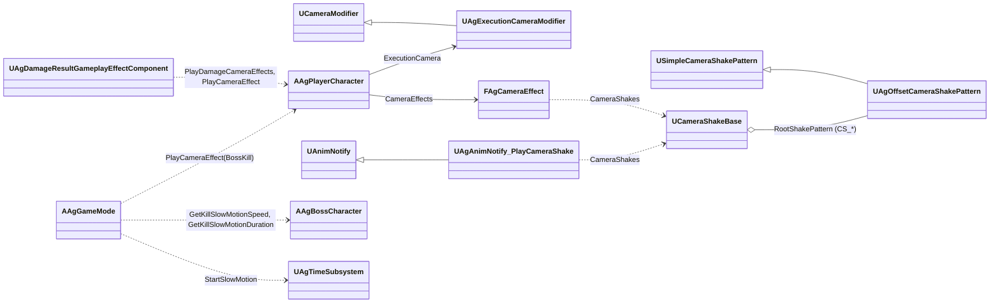
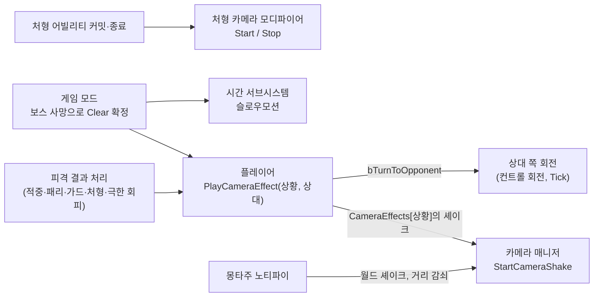

# 카메라 연출 기술 설계 (Plan)

## 1. 영향 범위 및 아키텍처

### 구조 요약

| 대상 | 변경 | 내용 |
| - | - | - |
| `UAgOffsetCameraShakePattern` | 신규 (`USimpleCameraShakePattern` 상속) | 시야각 변화(`FieldOfView`)를 더하는 셰이크 패턴입니다. 들어가기·유지·돌아오기는 엔진 패턴의 `BlendInTime`, `Duration`(세 시간의 합), `BlendOutTime`이 맡습니다. 엔진이 주는 선형 블렌드 가중치에 이즈 인·아웃을 걸어 부드럽게 바꿉니다. |
| `UAgExecutionCameraModifier` | 신규 (`UCameraModifier` 상속) | 처형 카메라입니다. `Start`가 좌우 구도를 정하고 모디파이어를 켜며, `Stop`은 블렌드 아웃으로 끕니다. 매 프레임 구도 위치·회전·시야각을 계산해, 들어온 게임 카메라와 엔진 `Alpha`(이즈 적용)로 섞습니다. |
| `UAgAnimNotify_PlayCameraShake` | 신규 (`UAnimNotify` 상속) | 몽타주의 원하는 시점에 셰이크 에셋 목록을 월드 셰이크(`UGameplayStatics::PlayWorldCameraShake`)로 재생합니다. 진원은 모션 주인의 위치이며, 감쇠 반경(`InnerRadius`, `OuterRadius`)은 노티파이마다 정합니다. |
| `Camera/AgCameraEffect.h` | 신규 | `EAgCameraSituation`(Spec '2.5'에서 코드가 알아내는 상황 13개)과 `FAgCameraEffect`(재생할 셰이크 에셋 목록, 상대 쪽 회전 여부와 목표 각도) |
| `AAgPlayerCharacter` | 변경 | 셰이크 세기 필드 10개와 `GetCombatCameraShake`를 `CameraEffects` 맵과 `PlayCameraEffect`·`PlayDamageCameraEffects`로 바꿉니다. 상대 쪽 회전(Tick), 처형 카메라의 시작과 끝, 처형 카메라 중 시야 입력 무시, 시간 정지 시작 때 연출 정지를 더합니다. |
| `UAgDamageResultGameplayEffectComponent` | 변경 | 셰이크 재생을 `PlayDamageCameraEffects`로 바꾸고, 극한 회피 시작에서 `PlayCameraEffect(PerfectDodge, 공격자)`를 부릅니다. |
| `AAgGameMode` | 변경 | 보스 사망으로 Stage Clear가 정해지면 죽은 보스의 처치 슬로우모션 값으로 슬로우모션을 걸고 `PlayCameraEffect(BossKill, 보스)`를 부릅니다. |
| `AAgBossCharacter` | 변경 | 처치 슬로우모션의 속도와 실제 시간(`KillSlowMotionSpeed`, `KillSlowMotionDuration`)을 기본값으로 갖습니다. |
| `UAgTimeSubsystem` | 변경 | 슬로우모션 중에 다시 발동하면 진행 중인 것(또는 시간 정지 중 기다리는 것)과 합쳐, 더 느린 속도와 더 긴 남은 시간으로 이어 갑니다. 새 상태는 두지 않습니다. |
| `AgCameraShake.h`·`.cpp`(`EAgCameraShake`, `AgCameraShake::Play`), 태그 `GameplayCue.CameraShake.Small`·`Medium`·`Large`, 에셋 `GC_CameraShake_*` 3개 | 삭제 | 상황 연결과 노티파이가 셰이크 에셋을 직접 재생합니다. |
| 에셋 | 신규·변경 | 신규: 연출 셰이크 7개(`CS_Parry` 등), `CM_Execution`. 변경: `BP_Player` 기본값, `AM_Boss_GroundSlam`·`AM_Player_Ultimate`의 셰이크 큐 노티파이 교체, `AM_Boss_PhaseTransition`에 노티파이 추가 |



### 흐름



### 결정과 이유

| 항목 | 결정 | 이유 |
| - | - | - |
| 연출 정의 | 연출 하나가 카메라 셰이크 에셋 하나(`/Game/Camera/CS_*`, 루트 패턴 `UAgOffsetCameraShakePattern`)입니다. 연출 에셋은 `bSingleInstance`를 켭니다. | 엔진 셰이크가 Spec의 공통 규칙을 그대로 맡습니다. 여러 연출이 겹치면 카메라 셰이크 모디파이어가 모두 더하고, 같은 연출이 다시 일어나면 `bSingleInstance`가 처음부터 다시 재생하며, 월드 셰이크는 거리에 따라 약해지고, 일시정지 중에는 엔진이 카메라를 갱신하지 않아 멈춥니다. 기획자는 에디터의 셰이크 미리보기로 값을 확인합니다. JSON 정의는 이 동작을 직접 다시 만들어야 하고, 엔진 셰이크와 경로가 둘로 나뉘어 쓰지 않습니다. (2026-10-26 결정) |
| 시간 기준 | 게임 시간입니다. Spec '2.2'에 반영했습니다. | 엔진은 월드 시간 배율이 걸린 프레임 시간으로 카메라 매니저를 갱신하고, 일시정지 중에는 갱신하지 않습니다(`UWorld::Tick`). 셰이크와 락온 카메라도 같은 기준입니다. 히트스톱은 캐릭터의 시간 배율이라 카메라에 영향이 없습니다. |
| 셰이크와 연출의 연결 | 상황과 노티파이가 셰이크 에셋 배열을 고르며, 흔들림(`CS_Small`·`CS_Medium`·`CS_Large`)과 연출(`CS_Parry` 등)을 같은 배열에 넣습니다. 연출 에셋 안에 흔들림을 합치지 않습니다. | 엔진의 합성 패턴은 다른 셰이크 에셋을 참조하지 못해, 합치면 흔들림 값이 연출마다 복제됩니다. 셰이크 큐는 거리 감쇠만 하던 포장이라, 상황은 플레이어 카메라에 바로 재생하고(늘 제 세기) 모션 시점은 노티파이가 감쇠를 맡으면서 필요가 없어집니다. |
| 상황 연결 위치 | `BP_Player` 기본값 `CameraEffects`(`TMap<EAgCameraSituation, FAgCameraEffect>`)입니다. 맵에 없는 상황은 연출이 없습니다. | 지금의 셰이크 세기 필드와 같은 주인(카메라 주인)이고, 실행 구조를 이루는 에셋 참조라 에셋 기본값에 둡니다(AGENTS.md 코딩 규칙 2). 맵 하나에 모아, 상황을 더할 때는 enum 값 하나와 호출 한 곳만 더합니다. |
| 모션 시점 연결 | `UAgAnimNotify_PlayCameraShake`입니다. 기존 GroundSlam 착지와 궁극기 마무리의 셰이크 큐 노티파이도 이 노티파이로 바꿉니다. (2026-10-26 결정) | 셰이크 에셋을 직접 고르므로 연출마다 네이티브 태그와 큐를 더하지 않습니다. 모션 시점은 한 방식만 남습니다. 노티파이는 모션 진행을 따라 히트스톱과 시간 정지 중에는 캐릭터와 함께 멈춥니다. |
| 피격 결과의 상황 | `PlayDamageCameraEffects`가 지금 `GetCombatCameraShake`의 분기로 상황을 고르되, 플레이어가 공격자(적중, 처형)이거나 대상(피격, 가드, 가드 브레이크, 패리)일 때만 재생합니다. 회피 반격(`Ability.Action.DodgeCounter` 스펙 태그)의 적중이면 'PlayerHit' 계열과 함께 'DodgeCounterHit'도 재생합니다. | 지금은 적이 샌드백을 때려도 '플레이어 피격' 셰이크가 납니다. M2에는 적이 여럿이고 샌드백도 있어, Spec('플레이어 피격', '플레이어의 공격 적중')대로 플레이어가 낀 결과로 좁힙니다. |
| 상대 쪽 회전 | 플레이어 Tick에서 컨트롤 회전의 Yaw를 돌립니다. 락온 카메라의 `SpringToward`와 `LockOnSmoothingTime`·`LockOnRotationSpeed`를 그대로 씁니다. 목표는 상대 방향에서 `TurnAngle`만큼 덜 돈 경계이고, 상대의 가로 각도가 `TurnAngle` + 1° 안에 들면 끝납니다. 시야 입력(`Look`), 락온, 처형 카메라, 시간 정지 시작이 회전을 끝냅니다. 같은 프레임에 여러 회전이 시작되면 프레임 번호로 비교해 더 가까운 상대를 남깁니다. | 컨트롤 회전을 돌려야 회전이 끝난 뒤 자유 시점이 그 방향을 이어 갑니다. Spec이 락온 카메라와 같은 속도를 정했으므로 값을 따로 두지 않습니다. 감쇠 접근은 경계에 끝없이 다가가므로 끝내는 허용 오차가 필요합니다. |
| 처형 카메라 | 카메라 모디파이어입니다. 플레이어가 `ExecutionCameraClass`(`BP_Player` 기본값 `CM_Execution`)를 `NotifyControllerChanged`에서 카메라 매니저에 더하고(`AddNewCameraModifier`) 포인터를 보관합니다. 시작은 처형 어빌리티의 커밋 콜백이고, 끝은 시작 뒤 `ReturnTime`(게임 시간)과 `OnAbilityEnded` 가운데 먼저 오는 쪽입니다. 처형 모션은 정해져 있어 마지막 일격 시각(몽타주 타임라인 0.8초 ÷ 배속 0.6 = 1.33초)에 0.2초를 더한 1.53초를 값으로 두며, 일격 시각이나 배속을 바꾸면 함께 고칩니다. 줌인용으로 세는 경과 시간을 그대로 써 피격 이벤트를 따로 받지 않습니다. `Priority`는 64로, 셰이크 모디파이어(127)보다 먼저 적용합니다. 카메라 충돌은 바라보는 지점에서 카메라 위치로의 구 스윕(`ECC_Camera`, 플레이어·대상 제외)으로 처리하고, 시작할 때 같은 스윕으로 오른쪽 구도가 막혔으면 왼쪽을 고릅니다. 바라보는 지점은 플레이어 위치와 시작할 때 저장한 대상 위치로 정합니다. | 모디파이어는 엔진이 게임 카메라를 잠시 덮어쓰도록 둔 확장 지점이며, 블렌드 인·아웃(`AlphaInTime`·`AlphaOutTime`)이 들어 있습니다. 컨트롤 회전을 건드리지 않아, 돌아올 때 자유 시점은 처형 직전 방향으로, 락온 중이면 그동안 락온 카메라가 돌린 방향으로 저절로 돌아옵니다. 스프링 암을 직접 옮기면 처형 동안 붐 설정과 컨트롤 회전을 바꿨다가 되돌리는 관리가 생깁니다. 처형 대상은 `ActivateAbility`의 `RefreshTarget` 뒤에 정해지므로, 활성화 콜백(PreActivate 직전)이 아니라 커밋 콜백에서 읽습니다. 셰이크보다 먼저 적용해야 처형 카메라 위에 셰이크가 더해집니다. |
| 처형 카메라 중 시야 입력 | `Look`이 처형 카메라 모디파이어가 꺼지지 않았으면(`IsDisabled`가 거짓) 입력을 버립니다. | 블렌드 아웃이 끝날 때 엔진이 모디파이어를 끄므로, '들어가기부터 돌아오기가 끝날 때까지'와 같습니다. |
| 보스 처치 | `AAgGameMode::HandleCombatantDied`에서 `DecideStageResult`가 Clear로 성공한 뒤 부릅니다. 슬로우모션 값은 죽은 보스의 기본값(`BP_Boss`)입니다. | 결과를 정하는 곳에 붙어, '결과가 정해진 뒤의 사망에는 발동하지 않음'이 따로 검사 없이 지켜집니다. 기존 슬로우모션 효과(Effects.json)는 어빌리티 Task가 거는 데이터인데, 보스 사망은 어빌리티가 아니고 발동은 게임 모드의 판정입니다. 값은 처치당하는 보스의 연출이라 보스 기본값에 두어, 게임 모드는 판정만 맡고 보스마다 다르게 정할 수 있습니다. |
| 슬로우모션 재발동 | `StartSlowMotion`이 진행 중인 슬로우모션이 있으면 속도는 지금 월드 시간 배율과 새 속도 중 작은 쪽, 지속 시간은 타이머 남은 시간 ÷ 시간 배율(실제 남은 시간)과 새 지속 시간 중 긴 쪽으로 다시 겁니다. 시간 정지 중에는 기다리는 값(`PendingSlowMotion*`)과 같은 방식으로 합칩니다. Spec '2.6'의 규칙 변경을 따릅니다(2026-10-26 결정). | 최솟값과 최댓값은 순서와 관계없이 같아, 궁극기 마무리로 보스를 처치할 때처럼 같은 프레임에 요청이 겹쳐도 결과가 하나로 정해집니다. 같은 프레임만 골라 합치려면 프레임 번호와 앞선 요청 값을 따로 기억해야 하는데, 규칙을 넓히면 이미 있는 상태(월드 시간 배율, 타이머, 대기 값)만으로 됩니다. |
| 궁극기 컷신 | 시간 정지 시작(`State.TimeStop` 추가)에서 `StopAllCameraShakes(true)`를 부르고 회전을 끝냅니다. | 카메라 모디파이어는 컷신 카메라에도 적용되므로, 지우지 않으면 컷신 위에 남습니다. |

- `Docs/Architecture/` 공통 규칙 준수: 게임 로직은 C++, BP는 기본값만, 태그 추가 없음(삭제 3개), 기획 데이터(JSON) 변경 없음. 수치는 기획서가 정하고 위치는 'JSON 외부 데이터 위치'에 적습니다.

### 1-spec 수정 제안

설계 승인 뒤 3-tasks 1번에서 반영합니다.

1. **카메라 거리 변화 삭제**: 쓰는 상황이 없고, 셰이크의 위치 변화는 스프링 암의 카메라 충돌 처리 뒤에 더해져 거리를 늘리면 벽을 뚫을 수 있습니다. '2.1'의 행, '2.2'의 '거리' 문구와 '거리 변화가 있어도…' 문장, '2.8'의 항목을 지웁니다.
2. **회피 반격 적중**: '첫 적중 때 한 번만'을 '적중할 때마다 재생하며 같은 연출 규칙('2.2')을 따름'으로 바꿉니다. 같은 프레임에 여러 적이 맞으면 결과가 같고, 몇 프레임 차이로 맞으면 다시 재생된 것으로 보입니다. 첫 적중만 세려면 어빌리티 실행마다 상태를 따로 둬야 합니다. 완료 조건 4는 '여러 적에게 적중해도 조임이 더해지지 않음'으로 바꿉니다.
3. **'2.8' 정리**: 연출 항목은 시야각 변화와 시간만 남기고, 셰이크와 상대 쪽 회전은 상황 연결·모션 시점 연결의 항목으로 옮깁니다. 셰이크도 같은 에셋으로 조정하므로 '셰이크 세 단계의 흔들림 자체는 이번 조정 범위가 아님' 문장을 지웁니다.
4. **'2.7' 조건 1**: '공격(패턴)'을 '패턴'으로 바꿔, 공격하지 않는 Backstep도 포함함을 밝힙니다. (화면 밖 공격 절은 이후 삭제)

### 4단계 구현 문서 반영

| 문서 | 반영 |
| - | - |
| [데이터 로딩과 스키마](<../../Docs/Architecture/데이터 로딩과 스키마.md>) 'JSON 외부 데이터 위치' | 삭제: '카메라 셰이크 큐', '전투 카메라 셰이크 세기'. 새 행: 카메라 연출과 셰이크(`/Game/Camera/CS_*`의 패턴 값과 `bSingleInstance`), 상황별 카메라 연출(`BP_Player`의 `CameraEffects`), 모션 시점 카메라 연출(몽타주의 `AgAnimNotify_PlayCameraShake`: 셰이크, 감쇠 반경), 처형 카메라(`CM_Execution` 기본값), 보스 처치 슬로우모션(`BP_Boss`의 `KillSlowMotionSpeed`·`KillSlowMotionDuration`) |
| [캐릭터 기반 구조와 GAS](<../../Docs/Architecture/캐릭터 기반 구조와 GAS.md>) '클래스 구조' | `AAgPlayerCharacter` 역할에 전투 카메라 연출(상황별 연출, 상대 쪽 회전, 처형 카메라 시작·끝) |

## 2. GAS 및 데이터 설계

- 태그: `GameplayCue.CameraShake.Small`·`Medium`·`Large`를 삭제합니다. 추가하는 태그는 없습니다.
- JSON: 변경이 없습니다.

### 연출 셰이크 에셋

모두 `/Game/Camera`에 두는 `UCameraShakeBase` 블루프린트이고, 루트 패턴은 `UAgOffsetCameraShakePattern`, `bSingleInstance`는 켭니다. `Duration`은 들어가기·유지·돌아오기의 합입니다.

| 에셋 | 시야각 | BlendIn | Duration | BlendOut |
| - | - | - | - | - |
| `CS_Parry` | -5 | 0.05 | 0.37 | 0.25 |
| `CS_PerfectDodge` | -8 | 0.03 | 0.45 | 0.3 |
| `CS_DodgeCounter` | -6 | 0.04 | 0.37 | 0.25 |
| `CS_ExecutionStab` | -3 | 0.05 | 0.45 | 0.3 |
| `CS_ExecutionBlow` | -6 | 0.05 | 0.75 | 0.5 |
| `CS_BossKill` | -12 | 0.3 | 1.5 | 0.8 |
| `CS_PhaseTransition` | +6 | 0.1 | 1.0 | 0.5 |

### `BP_Player`의 `CameraEffects`

| 상황 | 셰이크 | 상대 쪽 회전 |
| - | - | - |
| `PlayerHit` | `CS_Small` | |
| `PlayerHitHeavy` | `CS_Medium` | |
| `Parry` | `CS_Medium`, `CS_Parry` | |
| `PerfectDodge` | `CS_PerfectDodge` | 회전 0° |
| `DodgeCounterHit` | `CS_DodgeCounter` | |
| `PlayerHurt` | `CS_Small` | |
| `PlayerHurtHeavy` | `CS_Large` | |
| `Guard` | `CS_Small` | |
| `GuardPushback` | `CS_Medium` | |
| `GuardBreak` | `CS_Large` | |
| `ExecutionStab` | `CS_Small`, `CS_ExecutionStab` | |
| `ExecutionBlow` | `CS_Large`, `CS_ExecutionBlow` | |
| `BossKill` | `CS_BossKill` | |

### 그 밖의 에셋 값

| 에셋 | 값 |
| - | - |
| `CM_Execution` (`UAgExecutionCameraModifier` 블루프린트) | `Yaw` 135, `Distance` 480, `CameraHeight` 0, `Height` 30, `FieldOfView` 50, `ZoomFieldOfView` 40, `ZoomDuration` 1.8, `ReturnTime` 1.53, `AlphaInTime` 0.8, `AlphaOutTime` 0.8 (C++ 기본값과 같음) |
| `BP_Player` | `ExecutionCameraClass` = `CM_Execution` |
| `BP_Boss` | `KillSlowMotionSpeed` 0.3, `KillSlowMotionDuration` 1.0 (C++ 기본값과 같음) |
| `AM_Boss_GroundSlam` | 셰이크 큐 노티파이를 같은 시각의 `AgAnimNotify_PlayCameraShake`(`CS_Medium`)로 교체 |
| `AM_Player_Ultimate` | 셰이크 큐 노티파이를 같은 시각의 `AgAnimNotify_PlayCameraShake`(`CS_Large`)로 교체 |
| `AM_Boss_PhaseTransition` | 기합 순간에 `AgAnimNotify_PlayCameraShake`(`CS_Medium`, `CS_PhaseTransition`) 추가. 시각은 원본 모션(`ARPG_Samurai_Anim_UE_Buff`)을 측정해 정합니다. |

- 노티파이의 감쇠 반경 기본값은 삭제 전 `GC_CameraShake_*`의 `WorldInnerRadius`·`WorldOuterRadius`를 읽어 옮깁니다. 세 큐의 값이 다르면 각 노티파이에 해당 셰이크의 값을 적습니다.

## 3. 인터페이스 & 함수 시그니처

```cpp
// Camera/AgCameraEffect.h
UENUM()
enum class EAgCameraSituation : uint8
{
	PlayerHit UMETA(DisplayName = "플레이어의 공격 적중"),
	PlayerHitHeavy UMETA(DisplayName = "플레이어의 공격 적중 (넉업·넉다운)"),
	Parry UMETA(DisplayName = "패리 성공"),
	PerfectDodge UMETA(DisplayName = "극한 회피"),
	DodgeCounterHit UMETA(DisplayName = "회피 반격 적중"),
	PlayerHurt UMETA(DisplayName = "플레이어 피격"),
	PlayerHurtHeavy UMETA(DisplayName = "플레이어 피격 (넉업·넉다운)"),
	Guard UMETA(DisplayName = "가드 움찔"),
	GuardPushback UMETA(DisplayName = "가드 밀림"),
	GuardBreak UMETA(DisplayName = "가드 브레이크"),
	ExecutionStab UMETA(DisplayName = "처형의 찌르기"),
	ExecutionBlow UMETA(DisplayName = "처형의 마지막 일격"),
	BossKill UMETA(DisplayName = "보스 처치"),
};

USTRUCT()
struct FAgCameraEffect
{
	GENERATED_BODY()

	UPROPERTY(EditAnywhere)
	TArray<TSubclassOf<UCameraShakeBase>> CameraShakes;

	UPROPERTY(EditAnywhere, meta = (InlineEditConditionToggle))
	bool bTurnToOpponent = false;

	/** 상대가 화면 가운데에서 좌우 이 각도 안에 들어올 때까지 돕니다. */
	UPROPERTY(EditAnywhere, meta = (EditCondition = "bTurnToOpponent", ClampMin = "0"))
	float TurnAngle = 0.f;
};

// Camera/AgOffsetCameraShakePattern.h
UCLASS()
class UAgOffsetCameraShakePattern : public USimpleCameraShakePattern
{
	UPROPERTY(EditAnywhere, Category = "Offset")
	float FieldOfView = 0.f;

	virtual void UpdateShakePatternImpl(const FCameraShakePatternUpdateParams& Params, FCameraShakePatternUpdateResult& OutResult) override;
	virtual void ScrubShakePatternImpl(const FCameraShakePatternScrubParams& Params, FCameraShakePatternUpdateResult& OutResult) override;
};

// Camera/AgExecutionCameraModifier.h
UCLASS()
class UAgExecutionCameraModifier : public UCameraModifier
{
public:
	UAgExecutionCameraModifier(); // Priority 64, 꺼진 채 시작, AlphaInTime 0.8, AlphaOutTime 0.8

	void Start(const AActor& Player, const AActor& Target); // 좌우 구도 결정, EnableModifier
	void Stop(); // DisableModifier(false)

protected:
	virtual void ModifyCamera(float DeltaTime, FVector ViewLocation, FRotator ViewRotation, float FOV, FVector& NewViewLocation, FRotator& NewViewRotation, float& NewFOV) override;

private:
	UPROPERTY(EditDefaultsOnly, Category = "Composition")
	float Yaw = 135.f;

	UPROPERTY(EditDefaultsOnly, Category = "Composition")
	float Distance = 480.f; // 수평 거리

	UPROPERTY(EditDefaultsOnly, Category = "Composition")
	float CameraHeight = 0.f; // 음수면 바라보는 지점보다 낮아 올려다봄

	UPROPERTY(EditDefaultsOnly, Category = "Composition")
	float Height = 30.f;

	UPROPERTY(EditDefaultsOnly, Category = "Composition")
	float FieldOfView = 50.f; // 시작 시야각

	UPROPERTY(EditDefaultsOnly, Category = "Composition")
	float ZoomFieldOfView = 40.f; // 줌인 끝 시야각

	UPROPERTY(EditDefaultsOnly, Category = "Composition")
	float ZoomDuration = 1.8f; // 게임 시간

	UPROPERTY(EditDefaultsOnly, Category = "Timing")
	float ReturnTime = 1.53f; // 시작 뒤 돌아오기 시작 (마지막 일격 + 0.2초)

	UPROPERTY(EditDefaultsOnly, Category = "Collision")
	float ProbeSize = 12.f; // 스프링 암 기본값

	TWeakObjectPtr<const AActor> Player;
	TWeakObjectPtr<const AActor> Target;
	FVector TargetStartLocation; // 걷어찬 대상을 따라가지 않음
	float CompositionYaw; // 시작할 때 정한 방향(좌우 포함)
	float Elapsed; // 시작한 뒤 지난 게임 시간 (줌인, 돌아오기 시작)
};

// Animation/AgAnimNotify_PlayCameraShake.h
UCLASS()
class UAgAnimNotify_PlayCameraShake : public UAnimNotify
{
	virtual FString GetNotifyName_Implementation() const override; // 셰이크 에셋 이름
	virtual void Notify(USkeletalMeshComponent* MeshComp, UAnimSequenceBase* Animation, const FAnimNotifyEventReference& EventReference) override;

	UPROPERTY(EditAnywhere, Category = "Camera Shake")
	TArray<TSubclassOf<UCameraShakeBase>> CameraShakes;

	UPROPERTY(EditAnywhere, Category = "Camera Shake")
	float InnerRadius; // GC_CameraShake_*의 값

	UPROPERTY(EditAnywhere, Category = "Camera Shake")
	float OuterRadius;
};

// AAgPlayerCharacter (변경분)
public:
	void PlayCameraEffect(EAgCameraSituation Situation, const AActor* Opponent);
	void PlayDamageCameraEffects(const FGameplayTagContainer& SpecTags, const AAgCharacterBase& Attacker, const AAgCharacterBase& Target);
private:
	void HandleAbilityCommitted(UGameplayAbility* Ability);
	void StartCameraTurn(const AActor& Opponent, float Angle);
	void UpdateCameraTurn(float DeltaTime);
	bool IsExecutionCameraActive() const;

	UPROPERTY(EditDefaultsOnly, Category = "Camera|Combat")
	TMap<EAgCameraSituation, FAgCameraEffect> CameraEffects;

	UPROPERTY(EditDefaultsOnly, Category = "Camera|Execution")
	TSubclassOf<UAgExecutionCameraModifier> ExecutionCameraClass;

	UPROPERTY(Transient)
	TObjectPtr<UAgExecutionCameraModifier> ExecutionCamera;

	TWeakObjectPtr<const AActor> TurnOpponent;
	float TurnAngle = 0.f;
	float TurnYawRate = 0.f;
	uint64 TurnStartFrame = 0;

// AAgBossCharacter (변경분)
public:
	float GetKillSlowMotionSpeed() const;
	float GetKillSlowMotionDuration() const;

private:
	UPROPERTY(EditDefaultsOnly, Category = "Death", meta = (ClampMin = "0.01", ClampMax = "1"))
	float KillSlowMotionSpeed = 0.3f;

	/** 실제 시간입니다. */
	UPROPERTY(EditDefaultsOnly, Category = "Death", meta = (ClampMin = "0"))
	float KillSlowMotionDuration = 1.f;

// AAgGameMode: 멤버 변경 없음 (HandleCombatantDied에서 죽은 보스의 값을 읽음)

// UAgTimeSubsystem: 멤버 변경 없음 (StartSlowMotion 안에서 합침)
```
